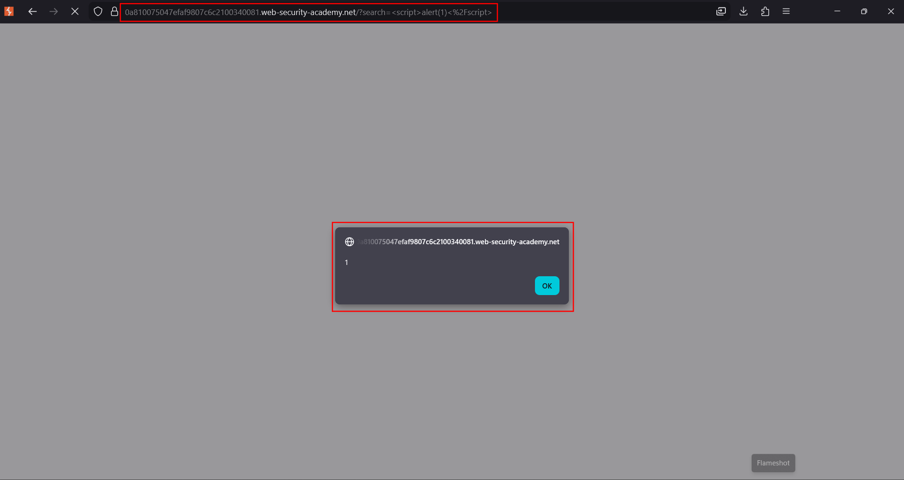

# Reflected XSS into HTML context with nothing encoded

**Lab:** PortSwigger Web Security Academy — *Reflected XSS into HTML context with nothing encoded* (Apprentice).

> The lab has a reflected cross-site scripting vulnerability in the search functionality. The goal is to perform an XSS attack that calls the `alert` function.

This is the canonical "hello world" of XSS: the search term is copied into the HTML response with **no encoding at all**, so a `<script>` tag in the query becomes a real script node in the page.

## 1. Find the reflection

Open the lab and use the search box with a harmless unique marker, for example `xsstest123`. The term appears in the response:

```html
<h1>0 search results for 'xsstest123'</h1>
```

The marker is reflected directly into the **HTML body** context, between tags. Because nothing around it is encoded, anything you type is parsed as HTML.

## 2. Submit the payload

Search for a classic payload instead of plain text:

```html
<script>alert(1)</script>
```

You can submit it in the search box, or put it straight in the URL:

```text
https://YOUR-LAB-ID.web-security-academy.net/?search=<script>alert(1)</script>
```

## 3. The script executes

The server reflects the payload unencoded, the browser parses it as a `<script>` node, and `alert(1)` runs:




The lab is solved as soon as the `alert` fires.

## Why the attack works

The application treats the search term as **data** but inserts it into the page as **markup**. With no HTML-encoding, `<`, `>` and `/` keep their structural meaning, so `<script>…</script>` opens a new executable node instead of printing the literal characters.

## Remediation

HTML-encode the value on output so the browser renders it as text: `<` becomes `&lt;`, `>` becomes `&gt;`. In that case the page would display the literal string `<script>alert(1)</script>` and nothing would execute.
