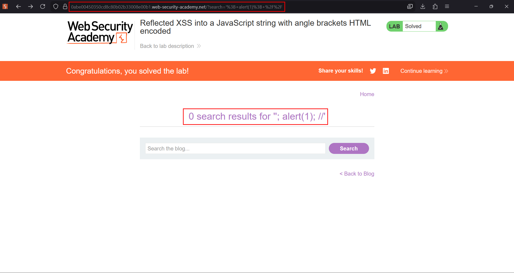
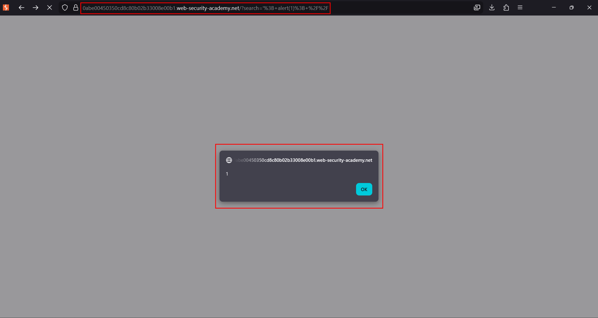

# Reflected XSS into a JavaScript string with angle brackets HTML-encoded

**Lab:** PortSwigger Web Security Academy — *Reflected XSS into a JavaScript string with angle brackets HTML-encoded* (Apprentice).

> The lab contains a reflected XSS vulnerability in the search query tracking functionality where angle brackets are encoded. The reflection occurs inside a JavaScript string. The goal is to break out of the JavaScript string and call the `alert` function.

This is another "encoding is context-specific" lab, but here the value lands **inside a `<script>` block**, within a JavaScript string literal. Angle brackets are HTML-encoded, so you cannot open a new tag — but you do not need one. You are already inside script, so you only have to break out of the string and write JavaScript.

## Where the value lands

The page tracks the search term in an inline script:

```html
<script>
    var searchTerms = 'REFLECTED-HERE';
    document.write('');
</script>
```

The injection point is between the single quotes of `searchTerms`. HTML-encoding `<` and `>` is irrelevant in this context because the browser is not parsing HTML here — the JavaScript interpreter is running.

## 1. Find the reflection

Search for a unique marker and view source. The marker appears inside the single-quoted JavaScript string in the inline `<script>`.



## 2. Break out of the string

Close the string with `'`, call `alert`, then comment out the rest of the line so the remaining original code does not cause a syntax error:

```text
'-alert(1)-'
```

An alternative that also works is terminating the statement and commenting out the remainder:

```text
';alert(1)//
```

Using `'-alert(1)-'` keeps the expression syntactically valid (string minus number minus string), which avoids breakage from the surrounding code.



## 3. The script runs

The resulting line becomes:

```js
var searchTerms = ''-alert(1)-'';
```

The interpreter evaluates the expression, `alert(1)` executes as the script runs, and the lab is solved — no user interaction needed.

## Why the attack works

The value is placed into a **JavaScript** context, so the dangerous character is the string delimiter (`'`), not the angle bracket. HTML-encoding protects HTML contexts; it does nothing for a value embedded in a script. Once you terminate the string, everything after it is parsed as code.

## Remediation

Use **JavaScript-context** escaping, not HTML-encoding, for values written into scripts — for example, serialise with `JSON.stringify()` or an equivalent that escapes quotes, backslashes and line terminators. Better still, avoid injecting request data into inline scripts at all; pass it through a data attribute or a safely-encoded JSON block and read it with `textContent`.
