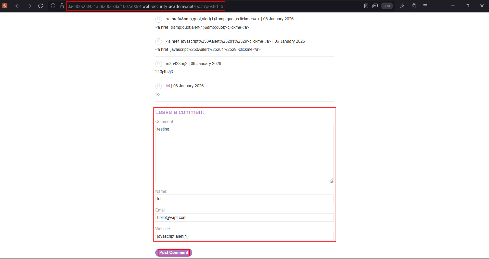
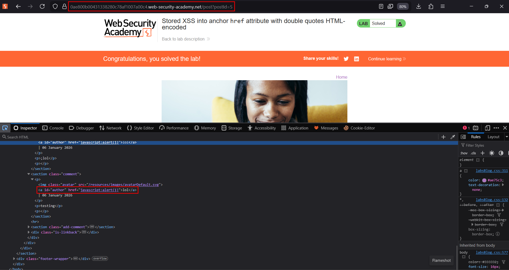

# Stored XSS into anchor href attribute with double quotes HTML-encoded

**Lab:** PortSwigger Web Security Academy — *Stored XSS into anchor href attribute with double quotes HTML-encoded* (Apprentice).

> The lab contains a stored XSS vulnerability in the comment functionality. The goal is to submit a comment that calls the `alert` function when the comment author name is clicked.

Here the stored value (the comment author's **website**) is reflected inside an anchor's `href`, and double quotes are HTML-encoded (`"` → `&quot;`). So you cannot break out of the attribute with a quote — but you do not need to. A `href` that begins with the `javascript:` scheme executes JavaScript when the link is clicked, and that lives entirely *inside* the attribute value.

## Where the value lands

The author name links to the website the commenter supplied:

```html
<a href="REFLECTED-HERE">commenter name</a>
```

Quote-encoding blocks `"` breakout, but the `javascript:` URI scheme never needs to leave the attribute.

## 1. Find the comment form

Open a blog post and scroll to **Leave a comment**. The **Website** field is the one reflected into the `href` of the author link.


## 2. Submit a javascript: URI as the website

Put the following in the **Website** field, and fill the other fields with any valid-looking values:

```text
javascript:alert(1)
```



The stored link becomes:

```html
<a href="javascript:alert(1)">commenter name</a>
```

## 3. Trigger it

Return to the post and **click the comment author's name**. The browser navigates the `javascript:` URI, which runs the code, and `alert` fires:



The lab is solved once the alert fires on click.

## Why the attack works

The defence only encodes quotes, which stops attribute **breakout** — but it never validates the attribute's *scheme*. An `href` is a URL, and `javascript:` is a valid (dangerous) URL scheme that executes its body in the page's origin. Because the comment is stored, every visitor who clicks the link is affected.

## Remediation

Validate URL schemes on output: allow only `http:`, `https:` (and perhaps `mailto:`), and reject or neutralise `javascript:`, `data:` and other active schemes. Combine this with context-aware attribute encoding, and apply the checks server-side so stored values cannot bypass them.
