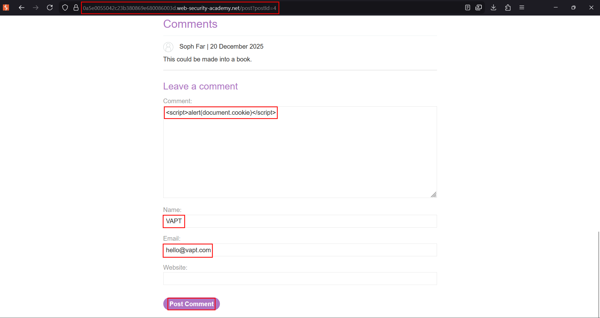
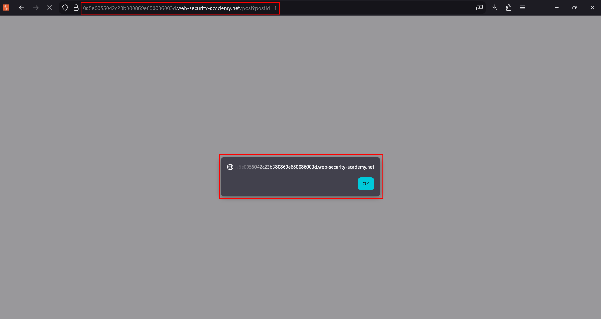

# Stored XSS into HTML context with nothing encoded

**Lab:** PortSwigger Web Security Academy — *Stored XSS into HTML context with nothing encoded* (Apprentice).

> The lab has a stored cross-site scripting vulnerability in the comment functionality. The goal is to submit a comment that calls the `alert` function when the blog post is viewed.

Stored XSS differs from reflected XSS in one important way: the payload is **saved** by the application and then served to everyone who opens that page. No crafted link is needed — the victim just reads the blog post.

## 1. Open a blog post and find the comment form

Open any post from the lab home page and scroll to **Leave a comment**. The comment is displayed back on the post once submitted, which is the sink we are targeting.


## 2. Submit a payload as the comment

Put a script payload in the **Comment** field and fill the other required fields with any valid-looking values:

```html
<script>alert(document.cookie)</script>
```



Using `document.cookie` instead of a plain `alert(1)` makes the point explicit: the injected script can read the viewer's cookies in their session.

## 3. The stored payload runs on view

After posting, the application saves the comment and renders it unencoded inside the post. Every time the page is loaded, the browser parses the stored `<script>` node and executes it:




The lab is solved once the comment triggers `alert` on page load.

## Why the attack works

The comment text is persisted and later written into the post's HTML with no output encoding. Because the value keeps its markup meaning, the saved `<script>` tag is treated as code for **every** visitor — this is what makes stored XSS higher-impact than reflected XSS.

## Remediation

HTML-encode comment content on output so it renders as text, and validate/clean rich input server-side if formatting must be allowed. Marking session cookies `HttpOnly` additionally prevents `document.cookie` from returning them even if a payload runs.
