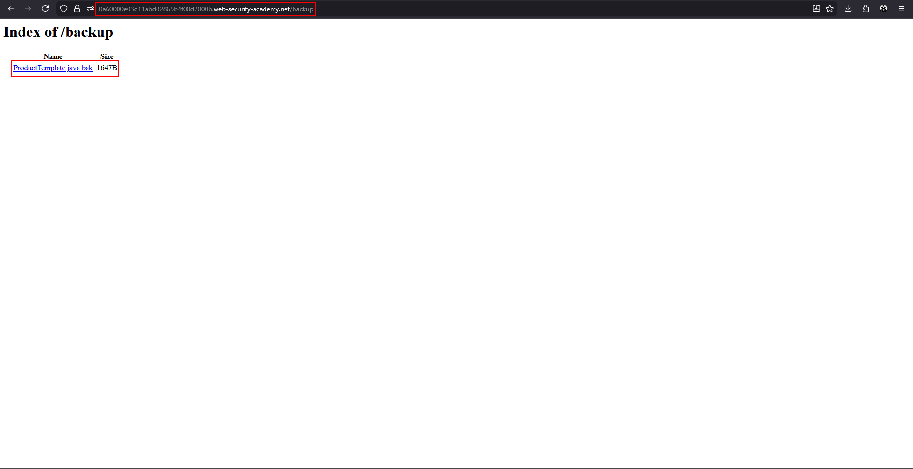
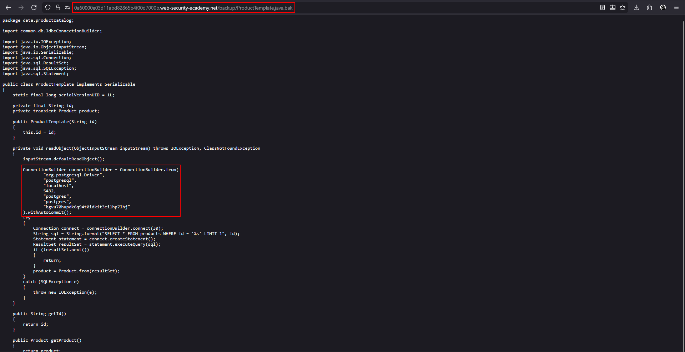

# Source code disclosure via backup files

**Lab:** PortSwigger Web Security Academy — *Source code disclosure via backup files* (Apprentice).

> This lab leaks its source code via backup files in a hidden directory. To solve the lab, identify and submit the database password, which is hard-coded in the leaked source code.

Normally a server **executes** `.php` or `.jsp` files and returns only the output. A backup copy with a different extension (`.bak`, `.old`, `~`) is not recognised as code, so the server returns it as **plain text** — the full source, comments and secrets included.

## 1. Discover the hidden directory

Look for paths the site does not link. The classic starting point is `robots.txt`, which often lists a disallowed directory:

```text
User-agent: *
Disallow: /backup
```

Content-discovery tools (ffuf, gobuster, Burp's discovery) can find the same path.

## 2. Browse the directory

`/backup` has directory listing enabled and shows one file, `ProductTemplate.java.bak`:



## 3. Read the source

Open the file. Because of the `.bak` extension it is served as text. The class opens a database connection and the credentials are hard-coded:

```java
ConnectionBuilder connectionBuilder = ConnectionBuilder.from(
    "org.postgresql.Driver",
    "postgresql",
    "localhost",
    5432,
    "postgres",
    "postgres",
    "DB-PASSWORD-HERE"
).withAutoCommit();
```



Submit the last argument (the password) to solve the lab.

## Why the attack works

A source backup was left in a web-accessible directory, with directory listing on. Because the extension was not handled by the application server, the file was sent as text, and the developer had stored a database password in code.

## Remediation

Never leave backup or editor files in the web root; clean them out of deployment pipelines. Disable directory listing. Do not hard-code credentials: load them from environment variables or a secret manager and rotate any that have been exposed.
