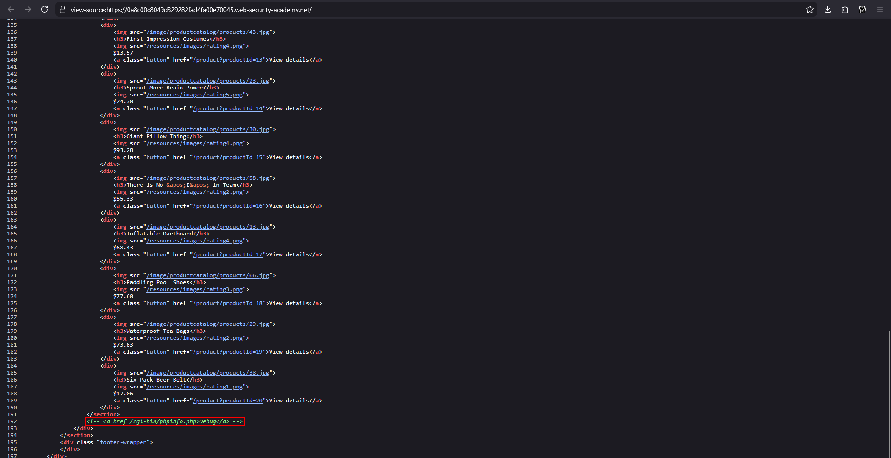
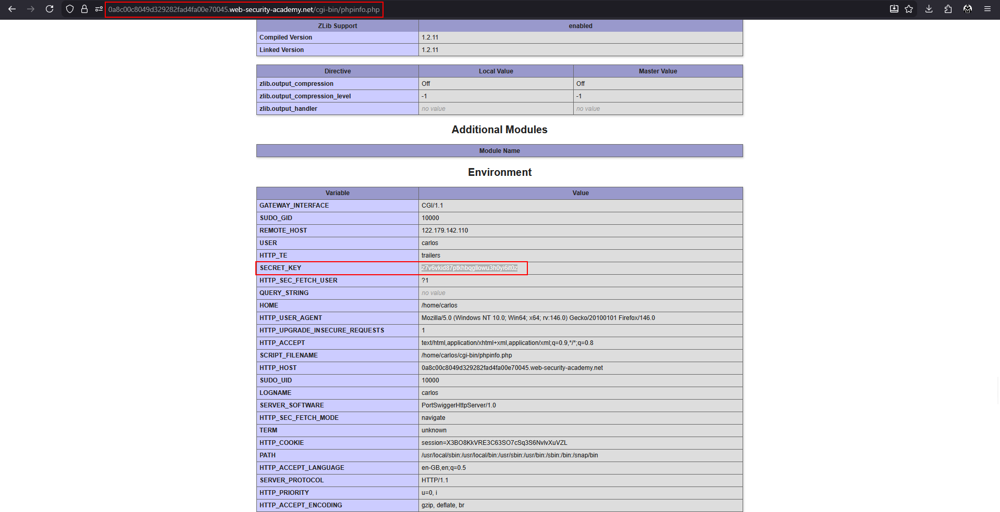

# Information disclosure on debug page

**Lab:** PortSwigger Web Security Academy — *Information disclosure on debug page* (Apprentice).

> This lab contains a debug page that discloses sensitive information about the application. To solve the lab, obtain and submit the `SECRET_KEY` environment variable.

Developers add diagnostic pages such as `phpinfo()` to check configuration. If one is forgotten in production it dumps the server's environment, including secrets passed as environment variables. These pages are often hidden only by not being linked, or by being linked in a **comment** that browsers do not display.

## 1. Read the page source

Open the home page and view the source (`Ctrl+U`). Scroll to the bottom and look for comments. A commented-out link to a debug page is left in the HTML:

```html
<!-- <a href=/cgi-bin/phpinfo.php>Debug</a> -->
```



!!! tip "Search for comments"
    In Burp use *Engagement tools > Find comments*, or search the source for `<!--`, `TODO`, `debug`, `admin`.

## 2. Open the debug page

Browse to the path:

```text
/cgi-bin/phpinfo.php
```

The page prints PHP configuration and the server **Environment** table.

## 3. Find the secret

In the Environment section, locate `SECRET_KEY`:



Copy the value and submit it to solve the lab.

## Why the attack works

A diagnostic page was left reachable in production, and the application keeps a real secret in an environment variable that `phpinfo()` prints. Hiding the link in an HTML comment did nothing to protect the URL.

## Remediation

Remove debug and diagnostic pages from production. Restrict any that must exist to authenticated administrators on an internal network. Treat everything in the environment as potentially exposed, and rotate the leaked secret.
