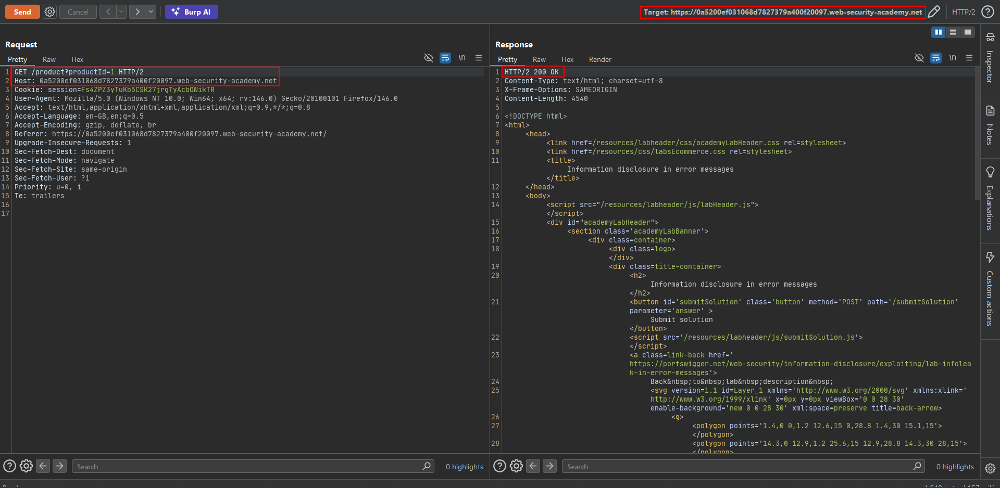
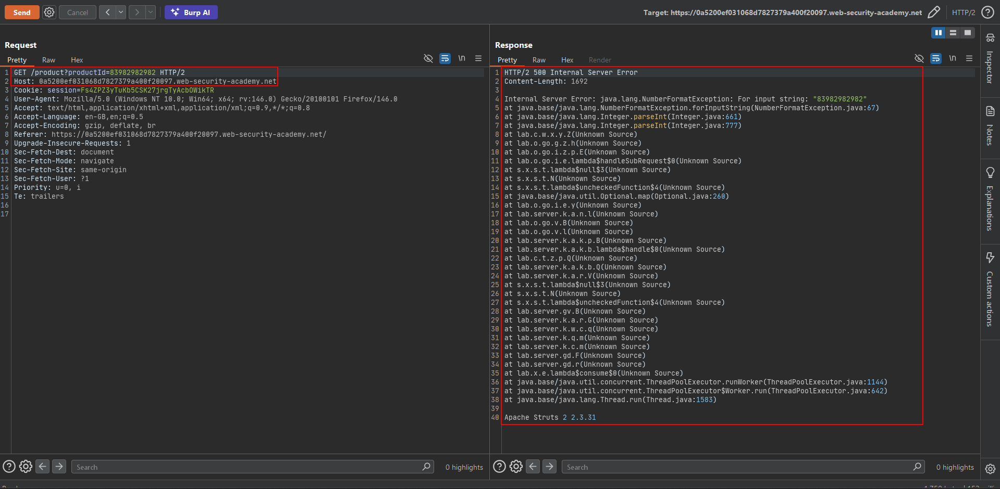

# Information disclosure in error messages

**Lab:** PortSwigger Web Security Academy — *Information disclosure in error messages* (Apprentice).

> This lab's verbose error messages reveal that it is using a vulnerable version of a third-party framework. To solve the lab, obtain and submit the version number of this framework.

Error handlers are meant to tell *developers* what went wrong. When they are left verbose in production they tell *attackers* the language, the code structure and, as here, the exact framework and version. The technique is simple: send input the application did not expect and read the error.

## 1. Find a parameter to break

Open a product page and send the request to Burp Repeater. The product is selected by a numeric parameter:

```http
GET /product?productId=1 HTTP/2
```

A valid ID returns the normal product page (`200 OK`).



## 2. Force an error

The parameter is expected to be a small integer. Send a value that is not a valid integer — an oversized number or a string such as `abc` — and see how the server reacts:

```http
GET /product?productId=83982982982 HTTP/2
```

## 3. Read the stack trace

The server responds with `500 Internal Server Error` and prints the full Java stack trace, which shows the failing call (`NumberFormatException` from `Integer.parseInt`) and, at the bottom, the framework and its version:

```text
Internal Server Error: java.lang.NumberFormatException: For input string: "83982982982"
at java.base/java.lang.Integer.parseInt(Integer.java:...)
...
Apache Struts 2 2.3.31
```



Submit the version (`2.3.31`) to solve the lab.

## Why the attack works

The application parses the input without validating it, and the unhandled exception bubbles up to the response with full debug output. The disclosed Struts 2 version is a known-vulnerable release, so the leak points directly at further attacks.

## Remediation

Validate input and handle parse errors with a generic message (`400 Bad Request`). Configure the framework to hide stack traces and version banners in production, and send the details to a log that only developers can read.
