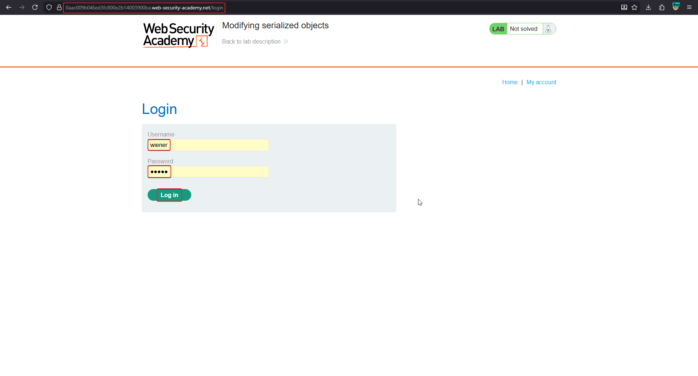
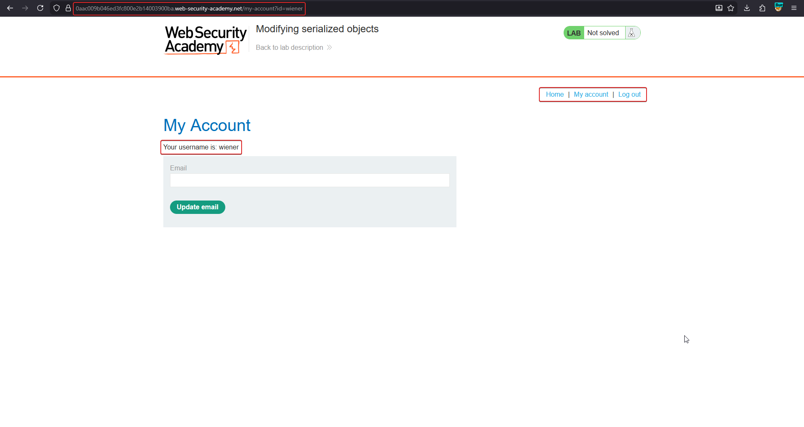
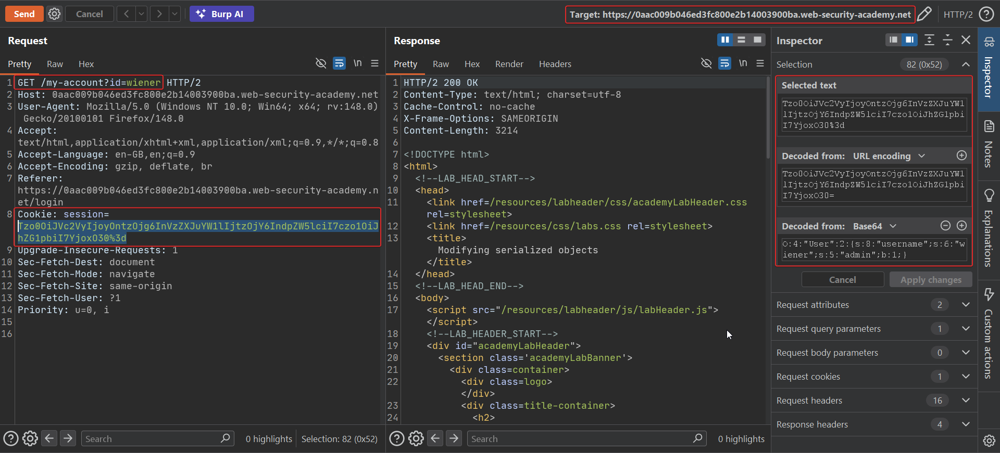
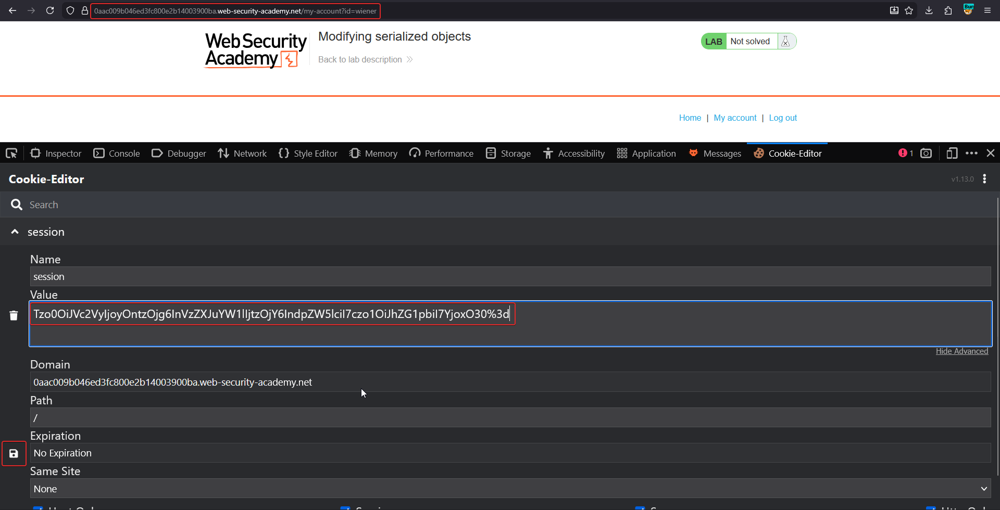
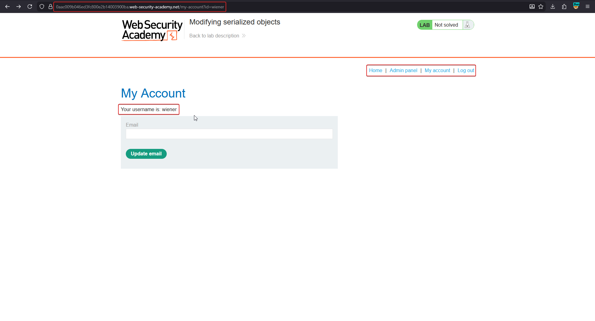
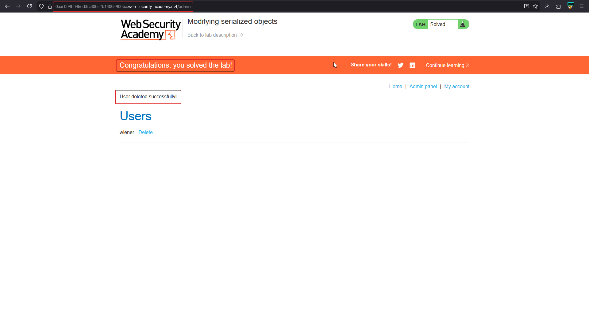

# Modifying serialized objects

**Lab:** PortSwigger Web Security Academy — *Modifying serialized objects* (Apprentice).

> This lab uses a serialization-based session mechanism and is vulnerable to privilege escalation as a result. To solve the lab, edit the serialized object in the session cookie to gain administrative privileges and delete the user `carlos`.
>
> Credentials: `wiener:peter`.

This is the simplest form of the bug: the session cookie is just a base64-encoded PHP serialized object, and the server trusts whatever it contains. Changing one boolean turns a normal user into an admin.

## 1. Log in and capture the session cookie

Log in as `wiener:peter`, then look at the `session` cookie sent with the request. It is URL-encoded base64.





## 2. Decode the cookie

Send a request to Burp Repeater and use the **Inspector** to decode the cookie value — first from URL encoding, then from base64. It reveals a PHP serialized `User` object:

```text
O:4:"User":2:{s:8:"username";s:6:"wiener";s:5:"admin";b:0;}
```

The `admin` attribute is a boolean set to `0` (false).



## 3. Flip the admin flag

Change `b:0` to `b:1` so the object becomes:

```text
O:4:"User":2:{s:8:"username";s:6:"wiener";s:5:"admin";b:1;}
```

Re-encode it (base64, then URL-encode) and replace the `session` cookie. In the screenshots this is done with a browser cookie editor, but Repeater's Inspector works just as well.



## 4. Reach the admin panel

Reload **My Account**. Because the server deserialized an object with `admin` set to true, an **Admin panel** link now appears.



## 5. Delete carlos

Open the admin panel and delete the user `carlos`. The lab is marked solved.



## Why the attack works

The application stores session state **client-side** as a serialized object and never verifies its integrity. Since the serialized format is plain, readable text, the attacker simply edits the `admin` boolean and re-encodes. The server deserializes the tampered object and trusts the `admin` field for its authorization decision.

## Remediation

Do not trust client-side session objects for authorization. Either keep session state server-side (store only an opaque session ID in the cookie), or sign the serialized blob with a server-side secret (HMAC) and reject any cookie whose signature does not match before deserializing it.
