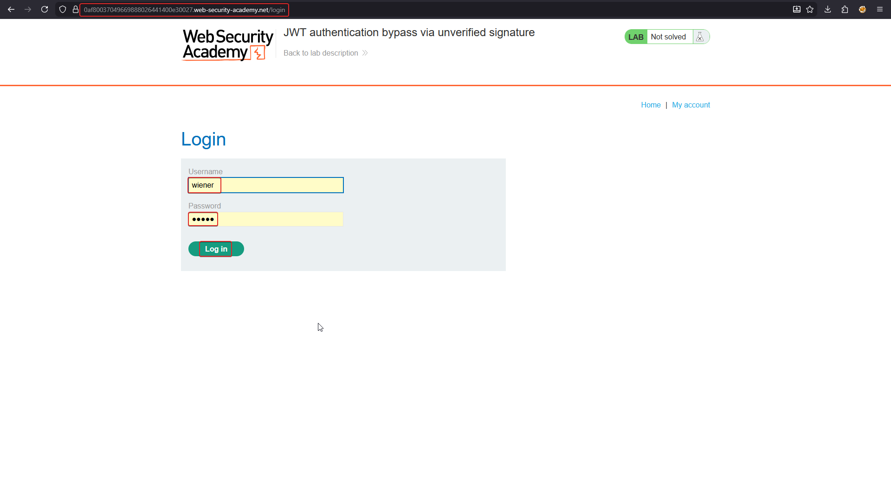
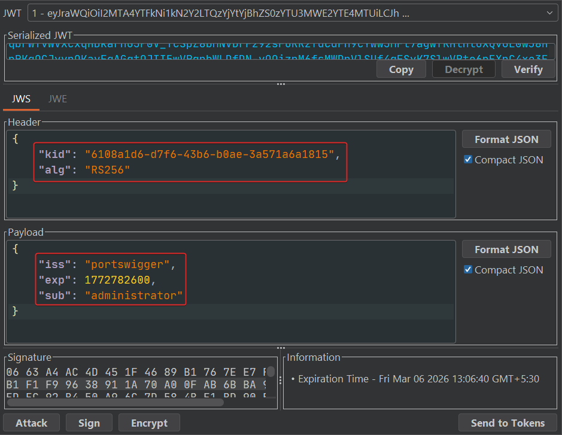
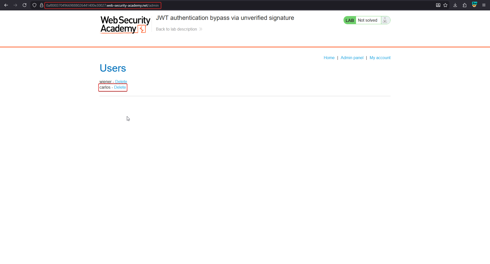
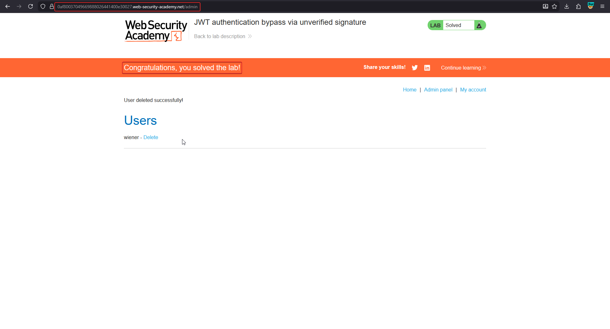

# JWT authentication bypass via unverified signature

This is the simplest possible JWT flaw: the application **decodes and trusts the payload** but never calls a signature-verification routine. Any value in the token can be edited, re-encoded, and sent back — the server has no way to tell it apart from a token it issued itself.

!!! note "BASICS — why this works"
    A JWT's header and payload are just Base64URL JSON — not encrypted, not tamper-proofed on their own. The **only** thing stopping an attacker from editing `"sub": "wiener"` into `"sub": "administrator"` is the server checking the signature against a secret/key it controls. If that check is missing (or checks the wrong thing), the signature becomes decorative.

## 1. Log in and capture a token

Log in with the supplied low-privileged credentials (`wiener`), then open the resulting session cookie in Burp Suite's **JWT Editor** tab.



The decoded JWT shows the structure that matters:

```json
// Header
{ "kid": "6108a1d6-d7f6-43b6-b0ae-3a571a6a1815", "alg": "RS256" }

// Payload
{ "iss": "portswigger", "exp": 1772782600, "sub": "wiener" }
```



## 2. Edit the payload and drop the signature

Change `"sub"` to `"administrator"` and forward the token **unchanged otherwise** — including the original (now-invalid) signature, or with the signature segment stripped entirely. Send the modified cookie to `/admin`.

```http
GET /admin HTTP/2
Cookie: session=eyJraWQiOiI...<edited-payload>...<original-or-stripped-signature>
```

Because the server never verifies the signature, it accepts the forged claim and renders the admin panel.



## 3. Confirm privileged action

Use the admin panel to delete the `carlos` user, confirming full admin-level access was gained purely by editing an unsigned claim.



## Why it works

The server decodes the JWT to read `sub` but has no corresponding call to a `verify()` function tied to a trusted key. Whether the signature is wrong, missing, or simply never checked, the outcome is identical: the payload is treated as ground truth. This is the base case every other JWT attack elaborates on — flawed algorithm checks, `jwk`/`jku`/`kid` injection, and weak secrets all exist because developers found partial ways to still skip real verification.

## Remediation

- Always call the JWT library's signature-verification function and make it fail closed — never decode-then-trust.
- Use a well-maintained JWT library and don't hand-roll verification logic.
- Reject tokens whose `alg` doesn't match a **pinned, server-chosen** algorithm.
- Enforce `exp` and short token lifetimes so even a forged token has limited value.
