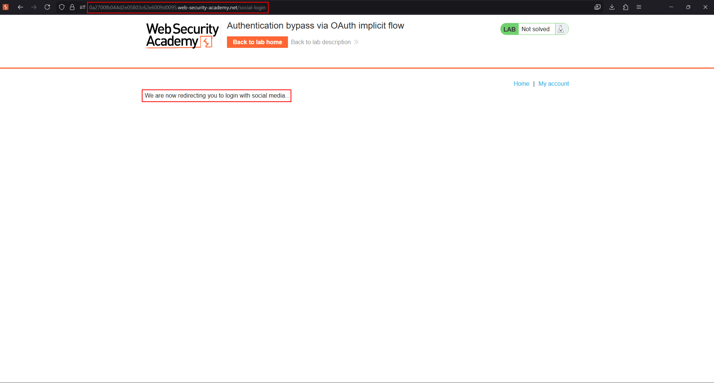
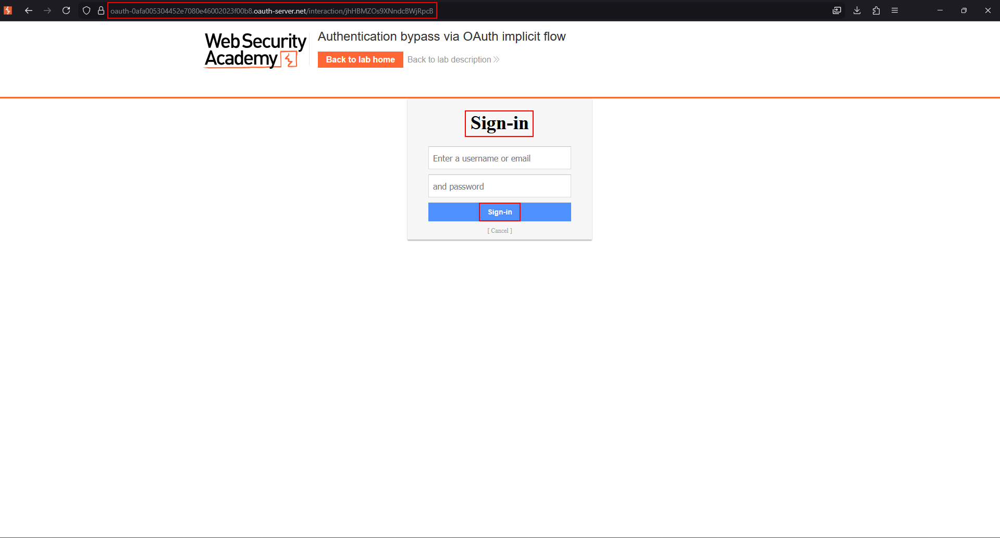

# Lab: Authentication bypass via OAuth implicit flow

This lab's client application uses the OAuth **implicit** grant for social login: the authorization server redirects back with an `access_token` in the URL fragment, client-side JavaScript picks it up, calls the provider's `/userinfo`-equivalent endpoint, and then POSTs the result — including an `email` field — to the client application's own `/authenticate` endpoint to finish logging the user in.

The flaw: `/authenticate` trusts whatever `email` value the browser sends it, without independently verifying that the accompanying `access_token` actually belongs to a user with that email. Since the token and the email are sent as two separate, independently-editable fields, an attacker can keep their *own* valid token (proving nothing more than "a real login happened") while swapping in the *victim's* email — and the server logs them in as the victim.

To solve the lab, log in as Carlos (`carlos@carlos-montoya.net`), using your own account `wiener:peter` to drive a legitimate OAuth flow.

## 1. Walk through a normal login to see the flow

Click "Login with social media" and let it redirect to the OAuth provider:



Sign in with your own credentials (`wiener:peter`) at the provider's sign-in form:



After signing in, the provider redirects back to the client application with an `access_token` in the URL fragment. The client's JavaScript reads that fragment, calls the provider to resolve it to profile data (including your email), and then sends a POST like this to finish the login:

```http
POST /authenticate HTTP/2
Host: client-app.com
Content-Type: application/json

{"email":"wiener@hotdog.com"}
```

(Depending on the exact lab build, the token itself may also be included in this request or only used to make the preceding profile lookup — either way, `/authenticate` is the step that actually establishes the session, and it keys off `email` alone.)

## 2. Capture the authenticate request and isolate the trust boundary

Intercept the `/authenticate` request in Burp. The important observation: this request is sent *after* the token has already been exchanged for profile data client-side. The server-side `/authenticate` handler has no way to see the original token exchange — it only sees whatever JSON the browser decided to send it, and it trusts the `email` field at face value.

## 3. Replay the request with the victim's email

Send the captured `/authenticate` request to Repeater, and change only the email value to Carlos's:

```http
POST /authenticate HTTP/2
Host: client-app.com
Content-Type: application/json

{"email":"carlos@carlos-montoya.net"}
```

Because the handler never cross-checks this value against the actual OAuth token or profile lookup result, it accepts the request and issues a session for Carlos's account.

## 4. Load the application as Carlos

Follow the response (or just browse to the application) with the newly-issued session cookie. The application now treats you as Carlos, and the lab is marked solved.

## Why it works

The client application correctly performs an OAuth flow to obtain an access token and uses it to fetch the authenticated user's profile — but then hands the *result of that lookup* (the email address) to the browser, and trusts the browser to faithfully send that same value back unmodified in a later, separate request. Because the email and the proof-of-authentication (the token) are decoupled into two independently controllable pieces of client-supplied data, nothing stops an attacker from supplying a validly-obtained token for their own account alongside an arbitrary email of their choosing. The server-side session is created from data it never independently verified.

## Remediation

- Never let the client (browser) tell the server which identity a token resolved to. The server should look up the identity itself, directly from the token, in a single trusted call it controls.
- Prefer the authorization code flow (or Authorization Code + PKCE) for anything used to authenticate users, so the token exchange and identity resolution both happen server-side, out of the browser's reach.
- If OpenID Connect is available, validate the ID token's signature, issuer, audience and expiry server-side rather than trusting a separately-reported profile field.
