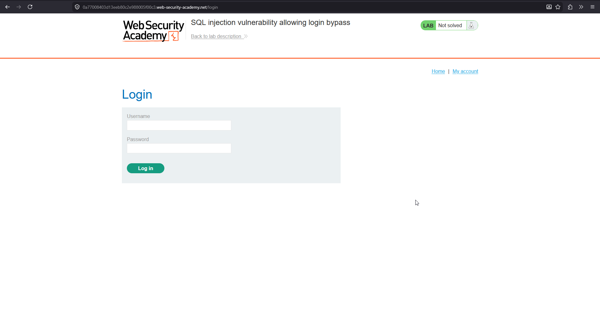
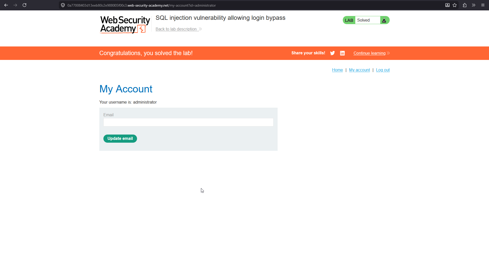

# SQL injection vulnerability allowing login bypass

**Lab:** PortSwigger Web Security Academy — *SQL injection vulnerability allowing login bypass* (Practitioner).

> The login function contains a SQL injection vulnerability. The goal is to perform a SQL injection attack that logs in to the application as the `administrator` user.

## 1. Find the login form

Open the lab and go to **My account** to reach the login form. The application looks up the submitted username and password in a single query.



The backend query is built by concatenation, something like:

```sql
SELECT * FROM users WHERE username = 'administrator' AND password = 'peter'
```

If a row comes back, the user is logged in as whoever that row belongs to.

## 2. Comment out the password check

In the **Username** field enter:

```text
administrator'--
```

Put anything in the **Password** field (it will be ignored).


The query the database receives becomes:

```sql
SELECT * FROM users WHERE username = 'administrator'--' AND password = 'xxxx'
```

- The `'` after `administrator` closes the username string.
- `--` starts a SQL comment, so everything after it — including `AND password = '...'` — is ignored.

The database therefore returns the `administrator` row based on the username alone, with no password check at all.

## 3. Logged in as administrator

Submit the form. The application authenticates you as `administrator` and the lab is solved.



## Why the attack works

The username is concatenated into the SQL string unescaped, so the quote and comment sequence are parsed as SQL syntax rather than as part of the username value. By terminating the string early and commenting out the remainder, the attacker removes the password condition entirely — authentication reduces to "does a user named `administrator` exist?".

## Remediation

Use a parameterised query so the username and password are bound as data:

```sql
SELECT * FROM users WHERE username = ? AND password = ?
```

Then `administrator'--` is treated as a literal username that does not exist, and login fails. Passwords should additionally be stored as salted hashes and compared after retrieval, never matched directly in the `WHERE` clause.
